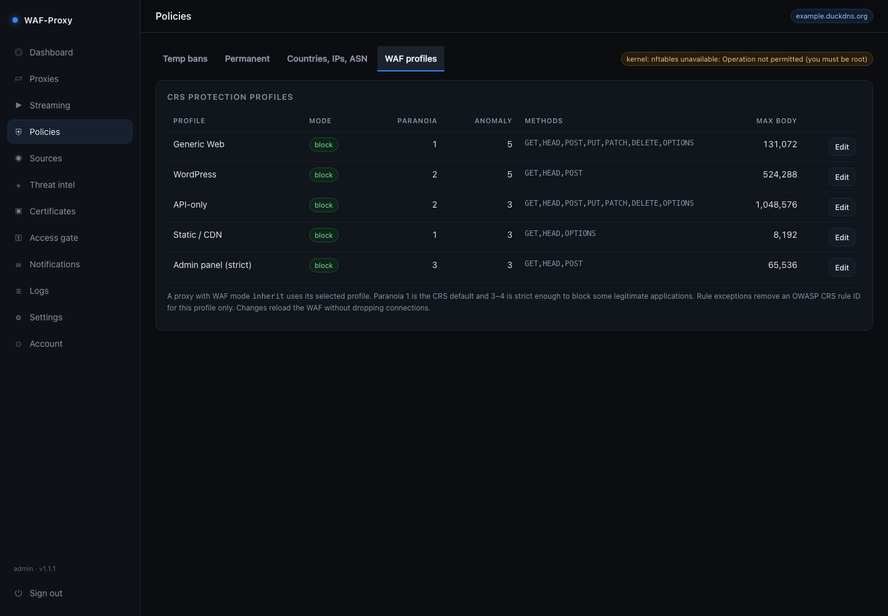
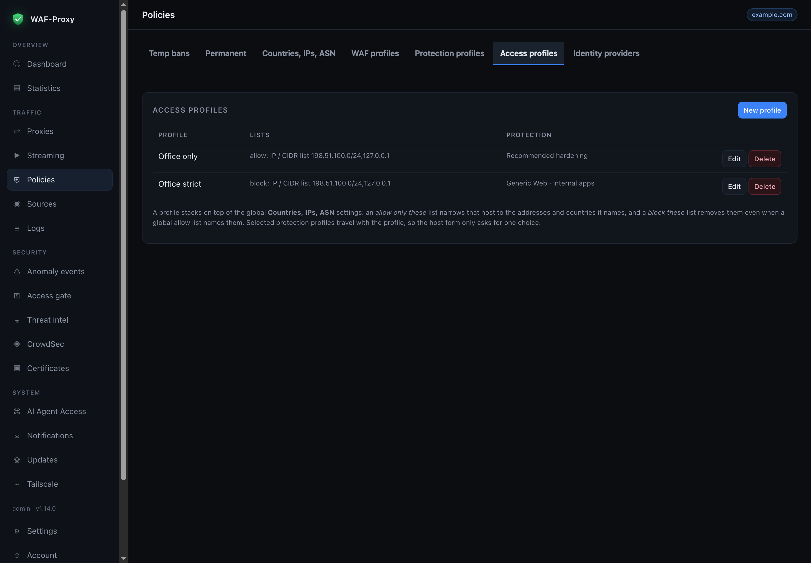

# WAF-Proxy

A self-hosted reverse proxy with a real WAF in front of it: OWASP CRS, an IPS-style ban
engine, CrowdSec, GeoIP/ASN policy, threat feeds, bot challenges, per-site access gates and
live observability. One Go binary and one React console, deployed either as a Docker Compose
stack or as a systemd service on a two-NIC Linux host. Built to run on a home server, a lab box
or a small office network without a cloud dependency.

**Version 1.14.0** · Linux only · `443/tcp` only on the WAN · admin console on the LAN


*The dashboard on a two-site test deployment. **Every screenshot in this README uses seeded
sample traffic, not production figures.***

## Contents

- [What it does](#what-it-does)
- [How a request is handled](#how-a-request-is-handled)
- [Requirements](#requirements)
- [Native VM sizing](#native-vm-sizing)
- [Quick start](#quick-start)
- [First certificate and first site](#first-certificate-and-first-site)
- [Streaming forwarders (Plex, Jellyfin)](#streaming-forwarders-plex-jellyfin)
- [Tailscale access](#tailscale-access)
- [Application and host updates](#application-and-host-updates)
- [AI Agent Access (MCP gateway and webhooks)](#ai-agent-access-mcp-gateway-and-webhooks)
- [Notifications and event routing](#notifications-and-event-routing)
- [CrowdSec](#crowdsec)
- [Updating from the repository](#updating-from-the-repository)
- [Day-to-day operations](#day-to-day-operations)
- [Statistics and uptime](#statistics-and-uptime)
- [Security model and limitations](#security-model-and-limitations)
- [Development](#development)
- [Documentation](#documentation)

## What it does

### Protection

| Feature | Behaviour |
|---|---|
| **OWASP CRS WAF** | Coraza v3 with the embedded Core Rule Set. Five profiles (Generic Web, WordPress, API-only, Static/CDN, Admin panel), paranoia level 1–4, anomaly thresholds, per-profile method allowlists, body and response ceilings, optional upstream response inspection (`off`, `flag` or `block`), per-path login throttling, admin-path allowlists and per-rule exceptions — all editable from **Policies → WAF profiles**, and filled in from an application preset when a site is created. Each site can inherit its profile, or override with `block`, `detect` or `off`, and admins can add and delete their own profiles. |
| **Ban engine** | Temporary bans last at most **24 hours** and are deleted when they expire, so the list only ever holds recent cool-downs. Permanent bans are absolute — no whitelist lifts them — and **Policies → Bans → Roll up** can fold them into one local threat list (`<data>/feeds/permanent-bans.txt`), which stays enforced while the ban rows are cleared. A roll-up only deletes rows after the new list has loaded and reports every expected entry, so a failed load can never leave an address unblocked. **Policies → Bans** shows the newest ten temporary and ten permanent bans, searches both lists at once, and opens a two-pane view for the full list where addresses can be dragged between temporary and permanent (or ticked and moved), moved back to a fresh 24-hour ban, or lifted. Enforced in the kernel with nftables (IPv4 + IPv6), or use the `unban` CLI. |
| **Anomaly detection** | Per-proxy baselines over the last hour of one-minute windows drive three detectors: **egress byte spike** (outbound data far above the site's own median, the exfiltration signal), **request-rate spike** and **login-failure burst**. Detections are stored as events, raise their own notification classes, are visible on **Anomaly events**, reach an attached agent by webhook, and can be acknowledged. Thresholds are tunable on the same page. |
| **Rate limiting** | Global per-IP request rate with burst, plus per-scope `rate_limit` policies (`rps/burst`) that can be global or attached to one site. |
| **Country / ASN policy** | Allow and block lists by ISO country code and by ASN, using MaxMind GeoLite2 or DB-IP Lite databases. The country picker lists every ISO code, and a country allow list is exclusive: countries not on it are blocked unless the source matches an explicit IP allow list. **Settings → GeoIP database** can download and install the DB-IP Lite city and ASN files, validate them and reload without a restart. Once a database is installed it refreshes **daily** unless the automatic-update box is cleared; the **Update database** button still runs a refresh on demand. Without a database the stages report “unavailable” instead of silently allowing traffic. |
| **Threat feeds** | Fifteen built-in lists — FireHOL 1/2, Spamhaus DROP, Tor exits, Feodo C2, ET compromised, DShield, plus eight keyless lists that start disabled (Blocklist.de, GreenSnow, Binary Defense, CINS Army, BruteForceBlocker, IPSum level 3, Spamhaus DROP IPv6, ET firewall) — your own HTTP(S) feeds, and uploaded `.txt`/`.csv` local lists. Change a feed's action (block, challenge, log only) from its row. ETag/If-Modified-Since caching, CIDR de-duplication, a 5× growth freeze and last-good retention so a broken upstream cannot empty the table. Local uploads are always global blocks. |
| **CrowdSec** | A dedicated **CrowdSec** page configures the LAPI bouncer, tests the key, shows poll status and links the Docker sidecar or native Security Engine setup. Decisions are applied as local bans and removals are honoured. |
| **Bot challenge** | JavaScript proof-of-work challenge with four levels, a 24-hour cookie and auto-ban after repeated failures. |
| **Bot filter** | **Policies → Bot filter** refuses automation by user agent before the challenge runs. Two modes: known scrapers (SEO, marketing and AI-training crawlers) or scrapers plus any declared bot and empty user agent. Search engines, link previews and an editable always-allow list are never caught. Refusals are logged as a `bot-filter` stage. |
| **Protection profiles and header audit** | Named response-hardening profiles (HSTS, framing, CSP, Referrer-Policy, Permissions-Policy, banner removal) applied after the upstream's own headers. **Check a site** on a profile fetches a proxy's backend and compares the application's headers with the profile, flagging when `frame_options=off` would delete a strong X-Frame-Options, when the profile duplicates what the app already sends, and which headers neither side sets. |
| **Access gate** | Per-site passphrase, accounts, or accounts + TOTP, with a per-site account allowlist. Escalating bans for repeated failures and per-account lockout that survives IP changes. |
| **Decoys** | Requests for configured decoy paths or hostnames never reach a backend and permanently ban the source. Defaults contain only paths no real application serves. |

### Front door

| Feature | Behaviour |
|---|---|
| **Reverse proxy** | HTTPS with SNI + Host routing, WebSocket passthrough, weighted round-robin upstreams, active health checks, path redirects and aliases, gzip, a conservative GET cache, and streamed responses. |
| **Tailscale ingress** | Optional native `tailscale0` listeners for the admin console and for app traffic. The app path keeps the existing TLS/SNI certificate and WAF pipeline, and a tailnet-only DNS responder supplies split-DNS answers for configured sites. |
| **TLS** | DNS-01 wildcard certificates through lego — DuckDNS, Cloudflare, Route53, DigitalOcean, Hetzner, OVH, GoDaddy and RFC2136 — plus **HTTP-01** (port 80) and **TLS-ALPN-01** (answered by the existing HTTPS listener) for operators who do not want DNS credentials. Per-site assignment, per-certificate renewal policy (monthly, every 2 or 3 months, or 1 month before expiry), serialised ACME orders, staging toggle. |
| **Streaming forwarders** | Transparent TCP relays for **Plex** and **Jellyfin** on their own WAN ports, with a source allowlist (one or more IPs/CIDRs, comma separated, empty = any) and the same named blocklists and whitelists a proxied site attaches — block first, whitelist exclusive. Connection cap, banned-source refusal that also cuts running streams, and live counters. |
| **Maintenance mode** | Per-site switch that answers with a maintenance response instead of the backend. |
| **Request simulator** | **Logs → Why?** replays one logged request through the real policy pipeline in-process: the ban, screening and WAF stages, every rule that matched, and the upstream or route that would serve it. Rate limiting, the access gate and forward auth are reported as skipped because they depend on live state. A WAF block offers a one-click rule exception that first names every other site sharing the profile. Available to `policies.read` and never audited, because a simulation is not an event. |
| **Named blocklists and whitelists** | Reusable lists under **Policies → Blocklist profiles** and **Whitelist profiles**. Each holds IPs/CIDRs (pasted one per line) and countries picked from a searchable list. Attach any number to an **Access profile**: a blocklist refuses its addresses and countries on those sites, and a whitelist makes the site reachable only from what it names. A blocklist attached to the same profile wins over a whitelist. |
| **Access profiles** | One named profile per host holds everything the site's policy needs: named blocklists and whitelists, lists from **Global Profile** marked *allow only these* or *block these*, plus the WAF and protection profiles it uses. Creating or editing a proxy asks for one selection. A host profile stacks on the global lists: an allow list narrows that site to the addresses and countries it names, a block list drops them even when a global allow list names them, so one site can be stricter than the global setting and another wider. |

### Operations

| Feature | Behaviour |
|---|---|
| **Live dashboard** | WAN/LAN throughput and packet rates, conntrack sessions, per-site request counts, live inbound/outbound bps and req/s per proxy, a rotating world-map attack globe with 1 h / 6 h / 24 h history and clickable category filters, and the newest blocked requests — pushed over SSE, no polling. |
| **Statistical analysis** | **Statistics** page with a date range, total/success/error requests, hourly traffic, per-proxy request and byte shares, visitor countries, request stages, and 24-hour uptime for every proxy and backend. |
| **Uptime monitor** | Every enabled upstream is checked with HTTP HEAD every 30 seconds. The proxy and each backend show up/down, latency, status code and 24-hour uptime; a down or recovery transition can be sent to Telegram, email or a webhook. |
| **Logs** | Filterable request log (source, host, stage, action, blocked-only), pagination and CSV export with spreadsheet-formula neutralisation. |
| **Sources** | Per-IP explorer: request and block counts, distinct hosts, first/last seen, ban state, recent requests, and one-click ban/unban. |
| **Audit log** | Every sign-in, settings change, proxy/certificate change, ban and restore is recorded and shown under **Settings → Recent administrator activity**. |
| **Host updates** | Native systemd installs can inspect the packages WAF-Proxy uses, refresh the apt index, see high/critical OSV advisories and apply one allowlisted package upgrade through a root-owned helper. |
| **Notifications** | Telegram, SMTP/Gmail and a generic webhook (Slack, Teams, …). Five-minute digest for bans, instant alerts for permanent bans, certificate problems, feed freezes and backend up/down transitions, with a per-event routing switch for every class (including CrowdSec bans and each anomaly detector). Muting a class also suppresses alerts already queued for it. |
| **Backup** | One-click JSON export/import of settings, sites, routes, policies, feeds and bans. Secrets, private keys and password hashes are excluded by design. |
| **Admin security** | LAN-only console, argon2id passwords, mandatory TOTP with single-use codes and recovery codes, CSRF tokens, login rate limits, 12-hour idle / 7-day absolute sessions, password and authenticator rotation, sign-out-everywhere, CSP and secrets encrypted at rest. An optional **admin source allowlist** (IPs/CIDRs) restricts both sign-in and the admin API; saving a list that would exclude the current address is refused. |
| **Accounts and roles** | **Account → Administrators and roles** adds more admin accounts and gives each one a role. Built-in **Administrator**, **Operator**, **Read-only** and **Viewer** roles cannot be edited or deleted; custom roles grant view or change per area (dashboard, traffic, policies, proxies, streaming, certificates, sources, settings, accounts, system). The console hides pages a role cannot see and the API refuses the matching requests; the last administrator cannot be demoted or deleted. |

### Console

A dark single-page console: **Dashboard**, **Statistics**, **Proxies**, **Streaming**, **Policies** (bans,
permanent bans, countries/IPs/ASN lists, WAF profiles, protection profiles, access profiles, identity
providers, bot filter), **Sources**, **Threat intel**, **CrowdSec**, **Anomaly events**, **Certificates**, **Access gate**,
**AI Agent Access**, **Notifications**, **Updates**, **Logs**, **Settings** and **Account**. It uses native
controls and is responsive down to a phone.



*Sample data: the built-in CRS profiles on a test deployment.*



*Sample data: two access profiles. Each row shows the lists it carries and the protection it
applies; editing a site only asks which of these it should use.*

## How a request is handled

```
Internet ──► router DNAT 443 ──► WAN listener (TLS, SNI)
                                     │
        permanent ban → whitelist → country → ASN → decoy → threat feed
             → temporary ban → rate limit → method → bot challenge
             → access gate → WAF → upstream (weighted round-robin)
```

With response inspection on, the answer is checked on the way back too: up to the profile's body
limit is buffered and run through the CRS response rules, and a match is refused with the uniform
502 before the status line is written, so the upstream body never reaches the browser. SSE,
WebSocket upgrades, range requests, compressed, bodyless and oversized responses are forwarded
untouched and logged as `response-skipped` with the reason. It is off by default because it delays
the first byte by up to one buffer.

Every decision that blocks, bans or challenges produces one event row (source, country, ASN,
host, path, stage, rule) that feeds the dashboard, the globe, Logs, Sources and notifications.
A request that is merely allowed is sampled rather than logged, so the event table stays
small on a busy site.

## Requirements

- **Linux**, deployed either with Docker Engine 24+ / Compose v2 or as a systemd service
  (`make build && sudo ./deploy/install.sh`). Host networking and nftables are used, so Docker
  Desktop on macOS/Windows is not a supported target; the systemd path needs Go 1.27 to build.
- **`443/tcp`** reachable from the edge firewall. No port 80: certificates are DNS-01 only.
- **One or two interfaces.** The intended deployment is dual-homed (one WAN, one LAN); a
  single-NIC host works too — see [Single NIC](#single-nic).
- nftables available inside the container. The image grants `NET_ADMIN` and
  `NET_BIND_SERVICE` through file capabilities; do **not** add `no-new-privileges`, because
  that makes the kernel ignore them.
- **Optional:** GeoIP for country and ASN policy. Install DB-IP Lite from **Settings → GeoIP
  database**, or place `GeoLite2-City.mmdb` / `GeoLite2-ASN.mmdb` in the data volume.
- **Optional:** the CrowdSec sidecar profile and its LAPI bouncer.
- **Optional:** a native Tailscale installation (`tailscale0`) for private admin and app access; no Tailscale sidecar or auth key is needed by WAF-Proxy.

### Native VM sizing

For the **native systemd** install, use a VM with **Ubuntu Server 24.04 LTS minimal (amd64)**,
**4 vCPU, 8 GB RAM, 50 GB NVMe/SSD and two virtio NICs** (one WAN, one LAN). This is the
comfortable home/lab-edge size; **2 vCPU / 4 GB / 30 GB** is the supported floor.

| Resource | Recommended | Floor |
|---|---:|---:|
| vCPU | 4 | 2 |
| RAM | 8 GB | 4 GB |
| Disk | 50 GB local NVMe/SSD | 30 GB |
| Network | 2 virtio NICs, static IPv4 | 1 NIC also works |

Why this size:

- TLS, WAF inspection and scan bursts are CPU-spiky; the measured Coraza+CRS cost is roughly
  **3 ms per inspected request per core** on the reference sandbox. Four vCPUs leave headroom
  for the WAF while accepting TLS connections and writing events.
- The stack's steady-state RAM is roughly **300–600 MB**; the extra RAM is for SQLite page
  cache, optional CrowdSec (about 60–120 MB), GeoIP and burst absorption.
- SQLite WAL is random-I/O bound, so keep `/var/lib/waf-proxy/data` on local SSD/NVMe — never NFS or
  SMB. Seven days of events at roughly 1M events/day can use 5–10 GB before logs, GeoIP and
  backups.
- Two NICs preserve real WAN client IPs: the router DNATs `443` to the WAN address without
  SNAT. A single-NIC VM works, but the GUI port must then be firewalled from the WAN.

Use 26.04 LTS if it is your standard; avoid interim Ubuntu releases. Install
`nftables`, `ca-certificates` and `tzdata`, assign the WAN/LAN addresses statically, and open
only the WAN proxy port plus the LAN GUI port. The systemd build needs **Go 1.27**; Ubuntu's
apt Go is older, so install the official Go 1.27 toolchain or build the two binaries elsewhere
and copy them into `bin/` before running `install.sh`. See
[docs/OPERATIONS.md](docs/OPERATIONS.md#capacity-and-disk) for tuning and capacity notes.

## Quick start

```bash
git clone https://github.com/kenhermesagent-lab/WAF-Proxy.git WAF-Proxy
cd WAF-Proxy
cp .env.example deploy/.env
$EDITOR deploy/.env                       # set TZ, WAFPROXY_LISTEN_GUI, optional CrowdSec key
docker compose -f deploy/docker-compose.yml up -d --build
docker compose -f deploy/docker-compose.yml logs -f wafproxy
```

`deploy/.env` ships these two lines on purpose, and you should check both before the first start:

```ini
# This host's real LAN address. The console is bound only here, port 8080.
WAFPROXY_LISTEN_GUI=192.168.1.10:8080

# Nothing is trusted by default: only set this to the CIDRs of a proxy or
# tunnel in front of the console.
WAFPROXY_TRUSTED_PROXIES=

# Refuse console requests that do not come from a private network, even if the
# listener ends up bound more widely than intended. Leave this true for Docker.
WAFPROXY_GUI_PRIVATE_ONLY=true
```

With the GUI default left at `127.0.0.1:8080` the console is reachable only from inside the
container host, so the unauthenticated setup wizard can never be exposed by starting the stack
before the file is filled in. `WAFPROXY_LISTEN_WAN=:8443` is the first-boot proxy port; the
wizard moves it to `443` once it has stored your WAN address.

The image builds the console and embeds it in the binary, so there is nothing else to install.

### First boot

With no stored binding the Docker stack listens on **`<WAFPROXY_LISTEN_GUI>`** (loopback
`127.0.0.1:8080` unless you set it, as above) for the console and **`0.0.0.0:8443`** for the
proxy. The wizard is unauthenticated and whoever reaches it first can claim the administrator
account, so the console is never bound to the WAN address by default and
`WAFPROXY_GUI_PRIVATE_ONLY=true` refuses any request whose source is not a private network
address. Do not set `WAFPROXY_GUI_PRIVATE_ONLY=0` on a host reachable from the internet.

Open `http://<LAN IP>:8080` from the LAN and complete the wizard:

| Field | Example |
|---|---|
| Admin username | `admin` |
| Password | 12+ characters (argon2id) |
| Base domain | `example.duckdns.org` |
| WAN IP : port | `192.168.1.20` : `443` |
| LAN egress IP : GUI port | `192.168.1.10` : `8443` |
| DuckDNS token | optional, stored encrypted |
| ACME email | Let’s Encrypt contact |

Both addresses must be configured on the host. The wizard returns the TOTP secret and ten
recovery codes **once** — save both, then restart so the listeners move:

```bash
docker compose -f deploy/docker-compose.yml restart wafproxy
```

The console is now `http://192.168.1.10:8443` and every sign-in needs password + TOTP (or a
recovery code). The proxy is on `192.168.1.20:443`.

If a stored address is not present on the host at boot (DHCP change, NIC renamed), the
listener falls back to `WAFPROXY_LISTEN_GUI` and logs why instead of exiting, so the console
stays reachable. That fallback is loopback `127.0.0.1:8080` unless you set it, so a fallback
console is reachable from this host or through an SSH tunnel. If you configured a wildcard
fallback, the boot log says the admin login is on every interface; fix the address in
**Settings** promptly. `WAFPROXY_GUI_PRIVATE_ONLY=true` still refuses non-private sources in
that state.

### Single NIC

Two NICs are not required. Enter the host’s own address for both WAN and LAN, forward `443`
(and any streaming ports) to it, and keep the console port firewalled from the WAN. The
interface charts then show that one NIC for both directions, and “ignore ICMP echo” applies to
the whole NIC — leave it off unless dropping LAN ping is acceptable.

### Without Docker (systemd)

The same binary runs directly under systemd, which is the path for a two-NIC host that manages
its own nftables and does not want the container layer:

```bash
make build                      # Go 1.27; the console is embedded from internal/webui/dist
sudo ./deploy/install.sh
sudo systemctl status wafproxy
```

The installer lists the host’s IPv4 interfaces and asks which one is **WAN** and which is
**LAN** (plus the WAN and GUI ports, defaulting to 443 and 8443). It creates the `wafproxy`
user and `/var/lib/waf-proxy/data`, installs the unit with only `CAP_NET_BIND_SERVICE` and
`CAP_NET_ADMIN` (so 443 and kernel bans work without root), and starts the service. The proxy
is bound to the WAN address and the admin GUI to the LAN address only; the admin listener also
refuses every client outside RFC1918, with loopback also accepted for local checks. The wizard is
prefilled with those addresses, so open `http://<LAN-IP>:8443` and finish setup. The wizard,
firewall rules and first certificate are otherwise identical. After that first install, upgrades
run from **Updates → Update application**; the manual fallback is
`cd /var/lib/waf-proxy/src && sudo ./deploy/wafproxy-self-update.sh`, which pulls, builds and
restarts (add `sudo git checkout -- internal/webui/dist` first if a local build edited the
bundle; the database is kept;
on an existing install the addresses stored in **Settings** still take precedence over the env
file). The page tells you when the button is unavailable and why. To remove the native install, run `sudo ./deploy/uninstall.sh`; it prompts before
removing the units, binaries, config, data, logs, app-owned nftables table and `wafproxy`
user/group. Use `--keep-data` to keep the database and config for a later reinstall. See
[docs/INSTALL.md](docs/INSTALL.md#11-bare-metal-with-systemd).

#### Where a native install lives

One root holds everything the native install owns, so there is no second copy to keep in step:

| Path | Contents |
|---|---|
| `/var/lib/waf-proxy/bin` | `wafproxy` and `wafproxy-updated` |
| `/var/lib/waf-proxy/lib` | fixed helper scripts (`self-update`, `self-update-check`, `wafproxy-update-lib.sh`, `crowdsec-install`) |
| `/var/lib/waf-proxy/src` | the git checkout the Update button pulls and builds |
| `/var/lib/waf-proxy/data` | SQLite database, master key, GeoIP files, threat lists, backups (owner `wafproxy`) |
| `/etc/wafproxy` | `wafproxy.env` and `self-update.conf` |
| `/var/log/wafproxy` | access log and app log |
| `/usr/local/bin/wafproxy`, `/usr/local/lib/wafproxy` | symlinks for `PATH` lookups and older scripts |

Releases up to 1.13 split this across `/usr/local/waf-proxy` (program files) and
`/var/lib/wafproxy` (state), and the update checkout was whatever directory `install.sh` was run
from — often a home directory. Running `sudo ./deploy/install.sh` once moves the program files and
the state into the single root (the old state directory is kept as `/var/lib/wafproxy.pre-1.14`
until you delete it) and creates the root-owned checkout at `/var/lib/waf-proxy/src`, which is
what the **Update application** button pulls from. Nothing needs to be cloned into a home
directory again.

### Tailscale access

If the host already runs Tailscale, the **Tailscale** page can add two default-off listeners
without changing the LAN/WAN bindings:

- **Admin console over Tailscale** binds the existing console to the tailnet IPv4 address and
  accepts only sources in `100.64.0.0/10`. The LAN listener and its RFC1918 rule remain. The URL
  is `http://<tailnet-ip>:<gui-port>`; HTTP is carried inside WireGuard, not the public WAN.
- **Proxy app traffic over Tailscale** binds the normal TLS/SNI proxy to the tailnet IPv4
  address. Remote devices use the app's normal HTTPS hostname after a Tailscale split-DNS
  override, so the WAF still sees the hostname, certificate and real tailnet client IP before
  forwarding to the LAN app.

The page can also answer split DNS on `tailnet-ip:53` for configured proxy hostnames. This is
needed because Tailscale split DNS forwards a domain to a nameserver, not to a direct A-record
override. It is authoritative and non-recursive and answers only existing sites.

The tailnet listeners need a concrete LAN/WAN bind address. A wildcard listener such as `:8080`
or `:8443` (the Docker Compose defaults) already owns the port, so set `WAFPROXY_LISTEN_GUI` and
`WAFPROXY_LISTEN_WAN` to the host's real LAN/WAN addresses before enabling these switches.

Install Tailscale first, run `sudo tailscale up`, then enable the listeners, save, and restart:

```bash
curl -fsSL https://tailscale.com/install.sh | sh
sudo tailscale up
tailscale ip -4
```

The installer detects an existing Tailscale address but deliberately does not install Tailscale
or run `tailscale up` for you. See [docs/INSTALL.md](docs/INSTALL.md#12-optional-native-tailscale-access)
for the ACL and split-DNS setup. Tailscale ACLs still gate who can reach the ports; the admin
console still requires password + TOTP.

### Application and host updates

The **Updates** page has two parts:

- **WAF-Proxy application** — compares the running build with its tracked branch and shows an
  **Update application** button when a newer build is available. On native systemd installs the
  root helper pulls the recorded checkout as its owner, builds the console when `npm` is
  available on the host, builds both binaries, installs them and lets systemd restart the
  service. For Docker Compose, install the optional host updater
  once with `sudo ./deploy/install-docker-updater.sh`; Compose mounts its socket and the button
  then rebuilds the image and recreates the container. The database volume is kept.
  The rebuild runs in the background, so the page can reconnect while Docker recreates the
  container.
- **Host packages** — native systemd installs can inspect `ca-certificates`, `nftables` and
  `tzdata`, refresh the apt index and apply one allowlisted package through the same helper.
  OSV high/critical advisories are shown for the installed version.

Before it installs anything the updater prepares the install root the same way the installer
does, including moving state from a pre-1.14 `/var/lib/wafproxy`, so the Update button works on a
host that has not run `install.sh` since 1.13. It also keeps the binaries and unit files it is
about to replace: if the build, the install step or the restart fails, or the new service does
not stay up, it restores them and starts the previous version again. The result of the last
attempt is shown on the page, because the update replaces the process that would have reported
it.

The console never supplies a URL, branch, package or shell command for the application
update. `deploy/install.sh` records the checkout and its owner once; the root-owned helper runs
only the fixed `self-update-check` and `self-update` scripts. A checkout typed into the page
must have the same origin as the running build — the helper refuses any other repository — and
the page asks the helper whether that checkout and both scripts are present, because a Docker
container cannot see the host's `/etc` or `/usr/local`. The public repository needs no
token or login; a private fork can use the checkout owner's existing git credentials. A Docker
image still cannot update itself without the host helper, so an install without it stays
check-only. See
[docs/INSTALL.md](docs/INSTALL.md#13-application-and-host-updates) for the helper details.

### AI Agent Access (MCP gateway and webhooks)

The **AI Agent Access** page lets an external agent — a Hermes agent, an automation, or your own
service — both *pull* the state and *receive* events. Two independent mechanisms live there:

- **Agent links** push every anomaly event to a webhook you control, subject to the same
  per-class **Event routing** switches as the notification channels: a muted class is queued and
  marked `suppressed` instead of posted, while a test payload always goes through. Delivery is durable: the
  payload is queued before any network call, retried with exponential backoff (30 s doubling,
  capped at one hour, eight attempts) and the page shows the last delivery's state, attempt count
  and the error the agent returned, with **Retry** and **Test** buttons. Each POST is signed with
  `X-Wafproxy-Signature: sha256=HMAC(secret, body)` plus `X-Wafproxy-Timestamp`, so the agent can
  prove the event came from this console and reject replays. No model runs in the console.
- **The MCP gateway** at `/mcp` gives an agent tools to review traffic and take containment
  actions without a browser session. Create a named token on that page and give it only to the
  agent.
The token is shown once, stored as a SHA-256 hash, and can be revoked immediately. Each token
chooses the tools it may call from the gateway catalog, and an agent only sees and calls those.
A token created under 1.24's `read`/`ban`/`session` groups is translated to the matching tools,
and a token with no scopes keeps every tool. A headless
install can instead set `WAFPROXY_MCP_TOKEN` to a 32+ character secret in
`/etc/wafproxy/wafproxy.env`; it always has every scope, and `WAFPROXY_MCP_ACTOR` names that
token in the audit log.

The gateway is stateless Streamable HTTP with bearer authentication. It has a fixed catalog,
not a shell:

| Agent task | Tool |
|---|---|
| Review recent traffic, a host or one IP | `query_logs`, `get_ip_activity`, `get_security_overview` |
| Add an IP or CIDR to the blacklist | `block_ip` |
| Add a gate username to the blacklist | `block_username` (also revokes that account's sessions) |
| Clear every session from an IP | `revoke_sessions_for_ip` |
| Kill one session that looks like exfiltration | `list_sessions` then `revoke_session` |
| Review anomaly detections | `list_anomalies` |
| Undo a block | `unblock_ip`, `unblock_username` |

Every mutating tool requires a `reason`; the action and the reason are written to the audit
log as `mcp:<token name>`. Session cookie values are never returned: `list_sessions` exposes
a one-way `ref`, and `revoke_session` accepts only that ref. IP blocks refuse loopback,
unspecified, multicast, link-local and prefixes broader than `/8` (IPv4) or `/16` (IPv6).

The endpoint is served by the same LAN-only listener as the console. Do not expose it to the
WAN. An agent running on another host should reach it over the LAN, Tailscale or another
private tunnel; terminate TLS in front of it if the path crosses an untrusted network. The
bearer token grants the security operations above to anyone who holds it, so rotate it on the
**AI Agent Access** page if it is ever logged or copied into the wrong place.

A minimal MCP client configuration:

```json
{
  "mcpServers": {
    "wafproxy": {
      "type": "http",
      "url": "http://192.168.1.10:8443/mcp",
      "headers": { "Authorization": "Bearer <agent token>" }
    }
  }
}
```

See [docs/MCP.md](docs/MCP.md) for the protocol exchange, every tool's arguments, the audit
model and a containment playbook for an agent.

## Notifications and event routing

**Notifications** configures Telegram, SMTP/Gmail and a generic webhook, sends a test message, and
lists recent deliveries with their state and the routing class each row was delivered under — a
legacy row stored as `ban` still shows that it routes as `crowdsec`, and a row whose class is
now muted is marked as such. Bans are batched into a five-minute digest; permanent
bans, certificate problems, feed freezes, backend up/down transitions and anomalies are sent
immediately.

**Event routing** has one switch per class: temporary ban, permanent ban, access-gate lockout,
certificate expiry, backend up/down, application update, CrowdSec ban, and one for each anomaly
detector. Unchecking a class suppresses it on every channel, including alerts that were already
queued when you switched it off — those are marked `suppressed` rather than sent. CrowdSec
decisions always route to their own switch, never to the ordinary temporary-ban class, so a noisy
blocklist can be muted without hiding the bans the console decided on itself.

## First certificate and first site

1. **Certificates → Request certificate.** Provider `duckdns`, domains
   `*.example.duckdns.org,example.duckdns.org` (leave credentials empty if the wizard stored
   the token). Issuance is asynchronous; the row moves from `pending` to `issued`.
2. **Set Auto-renew** on the certificate row. The default is **1 month before expiry**;
   the other choices are **Monthly**, **Every 2 months**, and **Every 3 months**. Let’s Encrypt
   certificates last 90 days, so the three-month choice is capped at seven days before expiry;
   the computed next date is shown under the menu. Renewal is checked every 12 hours, and a
   failed attempt keeps the previous certificate serving until the next check.
3. **Proxies → New proxy.** Hostname `app.example.duckdns.org`, upstream
   `http://192.168.2.10:8080`, a protection profile, and `Detect only` for the first 48
   hours if the application is new to you.
4. **Router.** Forward WAN `443` to `192.168.1.20:443`, **DNAT only, no SNAT**, so real
   client IPs survive for GeoIP, bans and rate limits.
5. **Verify.**

   ```bash
   curl -v https://app.example.duckdns.org/
   curl -v https://example.duckdns.org/       # connection closed, no response
   ```

The apex is reserved and blackholed; only single-label subdomains of the base domain are
accepted.

### Application presets

**Proxies → New proxy → Application preset** offers a starting configuration for nineteen
applications: Nextcloud, Jellyfin, Plex, Home Assistant, Proxmox VE, Vaultwarden, Gitea/Forgejo,
Paperless-ngx, Grafana, Uptime Kuma, Mealie, Navidrome, PhotoPrism, Syncthing, n8n, BookStack,
Cal.com, the *arr suite, and a generic baseline. Choosing one creates an ordinary WAF profile for
that hostname and selects it, and the dialog lists that preset's guidance notes (upload ceilings,
streamed responses, WebSockets, admin areas, ports that are not proxied). Nothing is hidden:

| Setting | What the preset fills in |
|---|---|
| Method allowlist | WebDAV verbs for Nextcloud, POST-only APIs for Home Assistant, and so on |
| Body ceiling | The largest request body the proxy will buffer to inspect |
| Response ceiling | How large an upstream response may get before it is refused (0 = streamed unbounded) |
| Login paths and rate | The paths that take credentials, and the per-client rate they are limited to |
| Admin paths and allowlist | Paths meant for the operator's network, and the CIDRs allowed to reach them |
| CRS exceptions | Rule IDs this application is commonly a false positive for |

### Global Profile

**Policies → Global Profile** holds the rules applied to every proxy: IP/Subnet and country
allow or block policies, ASN blocks, decoy paths, rate limits, and the named whitelist and
blocklist profiles you tick to apply globally. Each policy names one type and an Allow/Block
action; an explicit block beats an allow, and a country allow list is exclusive. A global
whitelist profile is checked before the global blocklists, so an address on both is allowed. A
host's own access-profile lists stay narrower than this and still decide for that host.

**ASN recommendations** under the same tab adds a known hosting/cloud or VPN network as an
ordinary, editable ASN policy. They are starting points: verify them, and remember that
blocking a hosting ASN also blocks legitimate sites hosted there.

Everything is a suggestion: edit the profile afterwards under **Policies → WAF profiles**, and check
the CRS exceptions in `Detect only` mode before trusting them. The admin allowlist starts at the
private ranges, so an admin path is refused from the internet until you widen it.

## Streaming forwarders (Plex, Jellyfin)

Media servers validate their own certificates (Plex clients check the `*.plex.direct` names
that encode the server address), which this gateway cannot mint. The **Streaming** page
therefore runs a transparent TCP relay per application instead of an HTTP reverse proxy: TLS
passes through untouched and the server sees every client as the proxy’s LAN address — the one
entry its allow list needs.

1. **Streaming → Plex** (or **Jellyfin**) → enable, then set the listen address (this host),
   the port clients will use (defaults `32400` / `8096`), and the application’s LAN address
   and port.
2. Optional allowed sources — a single IP, a CIDR, or several separated by commas — and a maximum concurrent connection count. Leave it empty to allow any source.
   Below it, attach any of the named blocklists and whitelists from **Policies**: a blocklist refuses
   its entries first, a whitelist makes the port reachable only from what it holds plus the allow
   list above, and a blocklist wins when both name the same address.
3. **Save and apply** binds the port immediately — no restart with `network_mode: host`.
4. Forward the same port on the router, **DNAT only, no SNAT**.
5. In the application:
   - **Plex:** Settings → Network → *List of IP addresses and networks that are allowed
     without auth* → the proxy’s LAN address.
   - **Jellyfin:** Settings → Networking → *Known proxies* → the proxy’s LAN address.

The relay is not inspected: the WAF and access gate cannot see that traffic. The source
allowlist, the attached block/allow lists, the connection cap and the ban engine do apply, and
refusals appear in Logs as `stream` events (one per source per minute, so a retry loop cannot
flood the table) naming the list that refused the source.


*Sample data: forwarder settings on a test deployment.*

## CrowdSec

The bouncer needs a running CrowdSec Security Engine and its Local API (LAPI).

On a native (systemd) install the console can install and configure the engine itself: open
**CrowdSec → Automatic install** and click **Install and configure CrowdSec**. The root helper
adds the CrowdSec repository, installs the engine, adds the `crowdsecurity/nginx` collection,
points acquisition at `/var/log/wafproxy/access.log`, creates the bouncer key and enables the
bouncer with it. The only thing left is enrolling the engine in your CrowdSec account: paste
the enrollment key from app.crowdsec.net on the same page. Containers cannot install host
packages, so the Docker path below stays manual.

Docker Compose includes an optional engine sidecar:

```bash
docker compose -f deploy/docker-compose.yml --profile crowdsec up -d crowdsec
docker exec crowdsec cscli bouncers add wafproxy
```

Then open **CrowdSec**, enter the LAPI URL (`http://127.0.0.1:8081` for the shipped sidecar;
a stock native engine defaults to `http://127.0.0.1:8080`) and the key, and click **Save and
apply**. The page tests the key, shows the last successful poll, applied decision count and
last error, and can enable or disable the bouncer without a restart. The sidecar tails
`/logs/access.log` with the stock nginx parser; decisions arrive over the LAPI stream and
become `source=crowdsec` bans. The LAPI stays on loopback.

To do it by hand instead, install CrowdSec from its repository, install
`crowdsecurity/nginx`, create the bouncer with `sudo cscli bouncers add wafproxy`, and use the
same page. The legacy `WAFPROXY_CROWDSEC_URL` / `WAFPROXY_CROWDSEC_KEY` environment variables
still work as first-boot defaults; values saved on the page override them.

## Updating from the repository

The console can apply application updates itself when its privileged helper is installed; use
**Updates → Update application**. It pulls the recorded checkout, rebuilds, installs into
`/var/lib/waf-proxy` and restarts the service; the data directory `/var/lib/waf-proxy/data` is not
touched.
For the manual path, pull from the checkout that matches the running deployment. The database
and `deploy/.env` are outside the tracked files, so a normal update does not replace them. Take
a **Settings → Download JSON** backup and note the current `VERSION` before starting.

### Docker Compose

```bash
cd /path/to/WAF-Proxy
git status --short                    # expect no local changes before pulling
git pull --ff-only                    # or: git fetch --tags && git checkout vX.Y.Z
# Keep the image tag in deploy/.env aligned with the new VERSION file.
if grep -q '^VERSION=' deploy/.env; then
  sed -i "s/^VERSION=.*/VERSION=$(cat VERSION)/" deploy/.env
else
  echo "VERSION=$(cat VERSION)" >> deploy/.env
fi
docker compose -f deploy/docker-compose.yml up -d --build
docker compose -f deploy/docker-compose.yml ps
curl -fsS http://<LAN-IP>:8443/api/health
```

`up -d --build` rebuilds the image from the updated checkout and recreates the container. The
named `data` volume is retained. If the pull reports local changes, commit or stash them first;
do not force the pull over an edited checkout. To go back to a release, check out its tag and
run the same `up -d --build` command. If you installed the optional host updater, it is a
separate service: stop it with `sudo systemctl disable --now wafproxy-docker-updates` before
removing the checkout.

### Native systemd

```bash
cd /var/lib/waf-proxy/src             # the checkout the Update button also uses
sudo git checkout -- internal/webui/dist   # a local build edits the committed bundle
sudo git clean -fdq internal/webui/dist    # and leaves new asset names behind
sudo git pull --ff-only               # or: sudo git fetch --tags && sudo git checkout vX.Y.Z
sudo ./deploy/wafproxy-self-update.sh # build, install both binaries, restart; rolls back on failure
sudo systemctl status wafproxy wafproxy-updates
curl -fsS http://<LAN-IP>:8443/api/health
```

Those two lines before the pull are what the Update button does itself. Skip them and
`git pull` refuses with "local changes to the following files would be overwritten", because
`npm run build` rewrites `internal/webui/dist`, which the repository commits.
`deploy/wafproxy-self-update.sh` is the script the button runs as
`/var/lib/waf-proxy/lib/self-update`: it refuses a checkout with edited tracked files, pulls,
builds, installs, restarts and restores the previous install if a step fails. Its console build
is skipped when `npm` is not on the update user's `PATH`; the checkout already carries the built
console, so the Go build still produces a matching binary.

`/var/lib/waf-proxy/src` is owned by `root`, so every step needs `sudo`. An install done before
1.14 still records the directory `install.sh` was run from in
`/etc/wafproxy/self-update.conf`; after one run of `sudo ./deploy/install.sh` from the new
checkout it points at `/var/lib/waf-proxy/src`. To rebuild from a tag instead of `main`, check the
tag out in that directory and run the same `make all` and `sudo ./deploy/install.sh` steps.

`make all` is `make ui` followed by `make build`; it refreshes the embedded console as well as
`bin/wafproxy` and `bin/wafproxy-updated`. `make build` on its own is enough where there is no
Node toolchain, because the release commits a console built from the same source. `deploy/install.sh` reinstalls the units and binaries,
preserves `/etc/wafproxy/wafproxy.env` and `/var/lib/waf-proxy/data`, and restarts both services. It
asks for the WAN/LAN interfaces again; the addresses already stored in **Settings** still take
precedence after boot. If the installer reports that the listener did not open, use
`journalctl -u wafproxy -n 50 --no-pager` before retrying.

If the **Update application** button spins and then reports nothing, the helper's own log is the
authority: `sudo journalctl -u wafproxy-updates -n 80 --no-pager` shows the `git pull` and `make`
output, and the Updates page repeats the last output under **Last update output**. The two reasons
the button used to fail on an existing host are fixed in 1.14: the dirty check no longer refuses a
checkout because of untracked files or a rebuild's own console bundle, and an update is no longer
dependent on a checkout under `/home`. Never run `git pull` as a different user in the same
checkout the helper builds; use one checkout (`/var/lib/waf-proxy/src`) for both.

After either update, confirm the version in the console footer or
`GET /api/version`, and check [CHANGELOG.md](CHANGELOG.md) for schema or behaviour changes.

## Day-to-day operations


*Sample data: runtime state and recent audit entries on a test deployment.*

| Task | How |
|---|---|
| Lift a ban | **Policies → Bans** (search the address, then Remove, or open the full list), or `docker exec wafproxy unban 203.0.113.7` (takes effect within 30 s) |
| Change an address or port | **Settings**, then restart the container |
| Tune the WAF | **Policies → WAF profiles** → edit paranoia, anomaly threshold, methods, body and response ceilings, upstream response inspection, login rate, admin paths or rule exceptions |
| Scrape metrics | `curl -s -H "Authorization: Bearer $WAFPROXY_METRICS_TOKEN" http://<lan-ip>:8443/metrics` returns per-proxy request, block and byte counters in the Prometheus text format. Without that variable the endpoint answers 403; the console listener also only admits private networks unless `WAFPROXY_GUI_PRIVATE_ONLY` is off. |
| Export the audit log | `GET /api/audit` returns the 200 newest entries as JSON; add `?format=csv` for a CSV download of the whole audit table, oldest first |
| Export the configuration | `GET /api/config/export.yaml` downloads the declarative configuration as readable YAML: settings, WAF, protection and access profiles, access lists, proxies and policies. Bans, feeds and secrets are not part of it |
| Import a configuration | `POST /api/config/import.yaml` applies an exported file additively — existing names and hostnames are skipped — and returns the imported counts with every problem it found |
| Encrypt backups | **Settings → Backup schedule** → *encrypt backups* with a 16+ character passphrase seals each scheduled file with AES-256-GCM; restore asks for the same passphrase |
| Find out why a request was blocked | **Logs** → **Why?** on the event row. It replays the request through the ban, screening and WAF stages without reaching the upstream, lists every rule that matched, and offers to except a blocking rule after naming every other site the profile change would affect. |
| Back up | **Settings → Download JSON** (secrets excluded) |
| Upgrade | See [Updating from the repository](#updating-from-the-repository) for Docker and native systemd |
| Check health | `docker compose -f deploy/docker-compose.yml ps`, `curl -s http://<lan-ip>:8443/api/health` |
| Uninstall (Docker) | `docker compose -f deploy/docker-compose.yml down && docker volume rm wafproxy_data` (destructive) |
| Uninstall (systemd) | `sudo ./deploy/uninstall.sh` (prompts; `--keep-data` preserves config and database) |

The database schema is applied idempotently on boot. Event retention is configurable (1–30
days, default 7) and pruned hourly together with expired bans and sessions.

With the systemd install, use
`sudo env WAFPROXY_DATA_DIR=/var/lib/waf-proxy/data wafproxy unban <ip>`, `journalctl -u wafproxy -f` and
`sudo systemctl restart wafproxy` in place of the container commands above; the data lives in
`/var/lib/waf-proxy/data`.

## Statistics and uptime

**Statistics** answers “what happened in this period?” without reading the event log row by
row. Pick a from/to date (or use **Today** / **Last 7 days**) and it shows total, successful and
blocked requests, an hourly traffic chart, request and byte share per proxy, visitor countries,
and the stages that produced the events. Country names and flags come from the browser's
ISO-3166 list. Counts are approximate at very high traffic because allowed requests above the
sampling threshold are recorded as a sample.

The same page runs the uptime monitor. Every enabled upstream is probed with an HTTP `HEAD`
request every 30 seconds (5-second timeout). A response below 500 counts as up; a connection
failure, timeout or 5xx counts as down. Each proxy shows its aggregate state and each backend
shows state, latency, status code, last check, error and 24-hour uptime. A transition to down
or back to up is sent immediately to whichever notification channels have **Backend up/down**
enabled. The probe state is kept in memory and resets when the service restarts.

## Security model and limitations

These are deliberate design decisions, not gaps to discover later. For reporting a vulnerability
and for how quickly a fix is expected, see [SECURITY.md](SECURITY.md) — please do not open a
public issue for a security problem.

- **The console is LAN-only and plain HTTP.** Keep the GUI port firewalled from the WAN; the
  session cookie is only marked `Secure` when the console is served over TLS. Do not port
  forward it. The optional Tailscale admin listener is also plain HTTP, but only inside
  Tailscale's WireGuard transport and only from `100.64.0.0/10`; it is not public.
- **The console is private by default.** A bare `docker run`, or the binary with no environment
  set, binds the console to `127.0.0.1:8080` and refuses any client that is not on a private
  network (`WAFPROXY_GUI_PRIVATE_ONLY=true`). Binding a LAN address is an explicit choice; keep
  that port firewalled from the WAN.
- **A client address comes from the socket unless you name a proxy.**
  `WAFPROXY_TRUSTED_PROXIES` lists the CIDRs allowed to set `X-Forwarded-For`, and nothing is
  trusted by default. Without it, a client cannot claim an address the access lists, the ban
  engine or the audit log would believe. Put a tunnel or fronting proxy in the list or every
  client behind it looks like the tunnel itself, and one decoy hit bans the tunnel.
- **Session cookies are stored as a keyed digest.** A copy of `wafproxy.db` — backup, rsync,
  container volume — holds no usable admin session; the cookie value exists only in the browser.
  Sessions written by an earlier release are cleared once, so upgrading signs everyone out.
- **Request memory is bounded.** `WAFPROXY_MAX_INFLIGHT` (default 128) caps concurrent requests,
  each of which may buffer up to the body limit. Past the budget requests get `503` instead of
  the host running out of memory, and the dashboard shows the current count.
- **Outbound URLs are filtered.** Proxy upstreams, threat feeds, notification webhooks and agent
  webhooks all go through the same guard, which refuses link-local and cloud metadata targets
  (agent webhooks may point at the LAN or loopback, never at `169.254.169.254`); the agent client
  does not follow redirects.
- **Audit entries are hash-chained.** Every new row's SHA-256 covers the row before it, and the
  newest hash is stored separately, so an edited row and rows deleted from the end both stop
  matching; **Settings → Recent administrator activity → Verify chain** names what broke. Rows
  written before the chain existed are skipped. This catches edits to the database, not an
  attacker who can rewrite every row and that stored hash.
- **The MCP agent token is an operator credential.** It grants security operations — reviewing
  logs, blocking IPs/usernames and revoking gate sessions — to any client that holds it. The
  gateway exposes no shell, filesystem, package or settings API, and every mutation is
  audited. Keep the endpoint on the LAN/Tailscale, use a separate token per agent, and revoke
  tokens that may have leaked. Session cookies and secret material are never returned.
- **App and host updates use a privileged helper, not sudo.** The console service keeps
  `NoNewPrivileges=yes`; `wafproxy-updated` is the only root component and accepts only the
  compiled package allowlist or the fixed repository check/update actions over a Unix socket.
  The checkout, its owner and its branch are recorded at install time; the browser cannot
  supply a URL, package or shell command, and a checkout recorded from the console must have the
  same origin as the running build. A compromised upstream repository still controls code that
  the helper installs as root, so only install from an origin you trust.
- **Docker updates need an explicit host helper.** The container has no build toolchain or
  Docker socket. `install-docker-updater.sh` installs a root service that exposes only the
  fixed rebuild action; without it the Updates page stays check-only.
- **Subdomains are not a secrecy boundary.** Every certificate is published to Certificate
  Transparency logs, so `*.example.duckdns.org` is discoverable. Protection comes from
  443-only exposure, no default vhost, DROP-by-default, the WAF and the ban engine.
- **Without a GeoIP database**, country and ASN policy report “unavailable” and are skipped.
  The console shows the state rather than pretending the rule is active.
- **Decoy paths ban permanently.** The built-in list only contains paths no real application
  serves; add application-specific paths per site only when you know nothing legitimate
  requests them.
- **Streaming traffic is a byte relay**, not an inspected proxy — see above.
- **One administrator account.** There are no multi-user roles.
- Not included yet: AbuseIPDB enrichment, tarpit, HTTP basic auth/mTLS per site, brotli,
  per-site bandwidth history, encrypted backup archives, HTTP/3, HA and multi-user roles.

## Development

```bash
make ui        # npm ci + Vite build into internal/webui/dist
make build     # static Go binary with version ldflags
make test      # go test ./...
make vet       # go vet ./...
make run       # run from source against ./data
make perf      # WAF hot-path throughput and p50/p95/p99
make perf-gate # compare the benchmarks with perf/baseline.json
make sbom      # CycloneDX document for the build graph into dist/
make verify-release # VERSION and the newest CHANGELOG section agree
```

Go 1.27 and Node 22 are what CI uses. The Docker build compiles the console first and embeds
it in the binary. [`.github/workflows/ci.yml`](.github/workflows/ci.yml) runs gofmt, `go vet`,
race tests, the Go build, the console typecheck/build, a production dependency audit, the release
metadata and SBOM checks, the performance gate and a container image build. `make perf-record`
re-records the performance baseline after a deliberate change.

## Documentation

- [SECURITY.md](SECURITY.md) — supported versions, private vulnerability reporting, what the
  next review covers
- [docs/INSTALL.md](docs/INSTALL.md) — full deployment walkthrough, router/DNS, streaming,
  upgrades, uninstall
- [docs/MCP.md](docs/MCP.md) — agent gateway, tool reference, containment playbook
- [docs/OPERATIONS.md](docs/OPERATIONS.md) — runbook, troubleshooting, capacity
- [docs/BENCHMARKS.md](docs/BENCHMARKS.md) — measured numbers and methodology
- [CHANGELOG.md](CHANGELOG.md) — release history

## License

[MIT](LICENSE) © 2026 kenhermesagent-lab. Use it, modify it and redistribute it; keep the
copyright notice and take it as-is, with no warranty.
