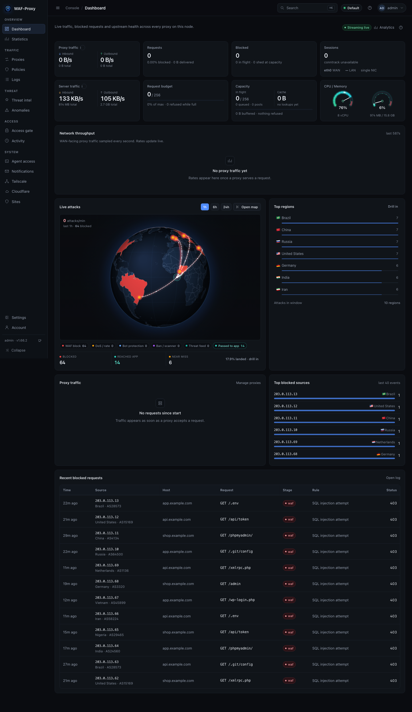

# WAF-Proxy

A self-hosted reverse proxy with a real WAF in front of it: OWASP CRS, an IPS-style ban
engine, CrowdSec, GeoIP/ASN policy, threat feeds, bot challenges, per-site access gates and
live observability. One Go binary and one React console, deployed either as a Docker Compose
stack or as a systemd service on a two-NIC Linux host. Built to run on a home server, a lab box
or a small office network without a cloud dependency.

**Version 1.1.1** · Linux only · `443/tcp` only on the WAN · admin console on the LAN



*The dashboard on a two-site test deployment. **Every screenshot in this README uses seeded
sample traffic, not production figures.***

## Contents

- [What it does](#what-it-does)
- [How a request is handled](#how-a-request-is-handled)
- [Requirements](#requirements)
- [Native VM sizing](#native-vm-sizing)
- [Quick start](#quick-start)
- [First certificate and first site](#first-certificate-and-first-site)
- [Streaming forwarders (Plex, Jellyfin)](#streaming-forwarders-plex-jellyfin)
- [Tailscale access](#tailscale-access)
- [Host updates](#host-updates)
- [CrowdSec](#crowdsec)
- [Day-to-day operations](#day-to-day-operations)
- [Security model and limitations](#security-model-and-limitations)
- [Development](#development)
- [Documentation](#documentation)

## What it does

### Protection

| Feature | Behaviour |
|---|---|
| **OWASP CRS WAF** | Coraza v3 with the embedded Core Rule Set. Five profiles (Generic Web, WordPress, API-only, Static/CDN, Admin panel), paranoia level 1–4, anomaly thresholds, per-profile method allowlists, body limits and per-rule exceptions — all editable from **Policies → WAF profiles**. Each site can inherit its profile, or override with `block`, `detect` or `off`. |
| **Ban engine** | Temporary and permanent bans with a mandatory reason and source. Enforced in the kernel with nftables (IPv4 + IPv6), so banned traffic is dropped before it reaches the proxy, and expires on its own. Every ban is listed in the console and can be lifted there or with the `unban` CLI. |
| **Rate limiting** | Global per-IP request rate with burst, plus per-scope `rate_limit` policies (`rps/burst`) that can be global or attached to one site. |
| **Country / ASN policy** | Allow and block lists by ISO country code and by ASN, using MaxMind GeoLite2 or DB-IP Lite databases. Without a database the stages report “unavailable” in the console instead of silently allowing traffic. |
| **Threat feeds** | Nine built-in lists (FireHOL 1/2, Spamhaus DROP/EDROP, Tor exits, Feodo C2, URLhaus, ET compromised, DShield) plus your own HTTP(S) feeds. ETag/If-Modified-Since caching, CIDR de-duplication, a 5× growth freeze and last-good retention so a broken upstream cannot empty the table. |
| **CrowdSec** | LAPI decision stream applied as local bans (and removals honoured), with an optional sidecar that reads the same access log. Status and last poll are shown in **Settings**. |
| **Bot challenge** | JavaScript proof-of-work challenge with four levels, a 24-hour cookie and auto-ban after repeated failures. |
| **Access gate** | Per-site passphrase, accounts, or accounts + TOTP, with a per-site account allowlist. Escalating bans for repeated failures and per-account lockout that survives IP changes. |
| **Decoys** | Requests for configured decoy paths or hostnames never reach a backend and permanently ban the source. Defaults contain only paths no real application serves. |

### Front door

| Feature | Behaviour |
|---|---|
| **Reverse proxy** | HTTPS with SNI + Host routing, WebSocket passthrough, weighted round-robin upstreams, active health checks, path redirects and aliases, gzip, a conservative GET cache, and streamed responses. |
| **Tailscale ingress** | Optional native `tailscale0` listeners for the admin console and for app traffic. The app path keeps the existing TLS/SNI certificate and WAF pipeline, and a tailnet-only DNS responder supplies split-DNS answers for configured sites. |
| **TLS** | DNS-01 wildcard certificates through lego — DuckDNS, Cloudflare, Route53, DigitalOcean, Hetzner, OVH, GoDaddy and RFC2136. Per-site assignment, automatic renewal inside 30 days, serialised ACME orders, staging toggle. |
| **Streaming forwarders** | Transparent TCP relays for **Plex** and **Jellyfin** on their own WAN ports, with a source allowlist, connection cap, banned-source refusal that also cuts running streams, and live counters. |
| **Maintenance mode** | Per-site switch that answers with a maintenance response instead of the backend. |

### Operations

| Feature | Behaviour |
|---|---|
| **Live dashboard** | WAN/LAN throughput and packet rates, conntrack sessions, per-site counters, a canvas attack globe, and the newest blocked requests — pushed over SSE, no polling. |
| **Logs** | Filterable request log (source, host, stage, action, blocked-only), pagination and CSV export with spreadsheet-formula neutralisation. |
| **Sources** | Per-IP explorer: request and block counts, distinct hosts, first/last seen, ban state, recent requests, and one-click ban/unban. |
| **Audit log** | Every sign-in, settings change, proxy/certificate change, ban and restore is recorded and shown under **Settings → Recent administrator activity**. |
| **Host updates** | Native systemd installs can inspect the packages WAF-Proxy uses, refresh the apt index, see high/critical OSV advisories and apply one allowlisted package upgrade through a root-owned helper. |
| **Notifications** | Telegram, SMTP/Gmail and a generic webhook (Slack, Teams, …). Five-minute digest for bans, instant alerts for permanent bans, certificate problems and feed freezes, with per-event routing. |
| **Backup** | One-click JSON export/import of settings, sites, routes, policies, feeds and bans. Secrets, private keys and password hashes are excluded by design. |
| **Admin security** | LAN-only console, argon2id passwords, mandatory TOTP with single-use codes and recovery codes, CSRF tokens, login rate limits, 12-hour idle / 7-day absolute sessions, password and authenticator rotation, sign-out-everywhere, CSP and secrets encrypted at rest. |

### Console

A dark single-page console: **Dashboard**, **Proxies**, **Streaming**, **Policies** (bans,
countries/IPs/ASN, WAF profiles), **Sources**, **Threat intel**, **Certificates**, **Access
gate**, **Notifications**, **Updates**, **Logs**, **Settings** and **Account**. It uses native controls and
is responsive down to a phone.


*Sample data: the built-in CRS profiles on a test deployment.*

## How a request is handled

```
Internet ──► router DNAT 443 ──► WAN listener (TLS, SNI)
                                     │
        permanent ban → whitelist → country → ASN → decoy → threat feed
             → temporary ban → rate limit → method → bot challenge
             → access gate → WAF → upstream (weighted round-robin)
```

Every decision that blocks, bans or challenges produces one event row (source, country, ASN,
host, path, stage, rule) that feeds the dashboard, the globe, Logs, Sources and notifications.
A request that is merely allowed is sampled rather than logged, so the event table stays
small on a busy site.

## Requirements

- **Linux**, deployed either with Docker Engine 24+ / Compose v2 or as a systemd service
  (`make build && sudo ./deploy/install.sh`). Host networking and nftables are used, so Docker
  Desktop on macOS/Windows is not a supported target; the systemd path needs Go 1.27 to build.
- **`443/tcp`** reachable from the edge firewall. No port 80: certificates are DNS-01 only.
- **One or two interfaces.** The intended deployment is dual-homed (one WAN, one LAN); a
  single-NIC host works too — see [Single NIC](#single-nic).
- nftables available inside the container. The image grants `NET_ADMIN` and
  `NET_BIND_SERVICE` through file capabilities; do **not** add `no-new-privileges`, because
  that makes the kernel ignore them.
- **Optional:** `GeoLite2-City.mmdb` / `GeoLite2-ASN.mmdb` (or the DB-IP Lite equivalents) in
  the data volume for country and ASN policy.
- **Optional:** the CrowdSec sidecar profile.
- **Optional:** a native Tailscale installation (`tailscale0`) for private admin and app access; no Tailscale sidecar or auth key is needed by WAF-Proxy.

### Native VM sizing

For the **native systemd** install, use a VM with **Ubuntu Server 24.04 LTS minimal (amd64)**,
**4 vCPU, 8 GB RAM, 50 GB NVMe/SSD and two virtio NICs** (one WAN, one LAN). This is the
comfortable home/lab-edge size; **2 vCPU / 4 GB / 30 GB** is the supported floor.

| Resource | Recommended | Floor |
|---|---:|---:|
| vCPU | 4 | 2 |
| RAM | 8 GB | 4 GB |
| Disk | 50 GB local NVMe/SSD | 30 GB |
| Network | 2 virtio NICs, static IPv4 | 1 NIC also works |

Why this size:

- TLS, WAF inspection and scan bursts are CPU-spiky; the measured Coraza+CRS cost is roughly
  **3 ms per inspected request per core** on the reference sandbox. Four vCPUs leave headroom
  for the WAF while accepting TLS connections and writing events.
- The stack's steady-state RAM is roughly **300–600 MB**; the extra RAM is for SQLite page
  cache, optional CrowdSec (about 60–120 MB), GeoIP and burst absorption.
- SQLite WAL is random-I/O bound, so keep `/var/lib/wafproxy` on local SSD/NVMe — never NFS or
  SMB. Seven days of events at roughly 1M events/day can use 5–10 GB before logs, GeoIP and
  backups.
- Two NICs preserve real WAN client IPs: the router DNATs `443` to the WAN address without
  SNAT. A single-NIC VM works, but the GUI port must then be firewalled from the WAN.

Use 26.04 LTS if it is your standard; avoid interim Ubuntu releases. Install
`nftables`, `ca-certificates` and `tzdata`, assign the WAN/LAN addresses statically, and open
only the WAN proxy port plus the LAN GUI port. The systemd build needs **Go 1.27**; Ubuntu's
apt Go is older, so install the official Go 1.27 toolchain or build the two binaries elsewhere
and copy them into `bin/` before running `install.sh`. See
[docs/OPERATIONS.md](docs/OPERATIONS.md#capacity-and-disk) for tuning and capacity notes.

## Quick start

```bash
git clone https://github.com/kenhermesagent-lab/WAF-Proxy-Docker.git waf-proxy-docker
cd waf-proxy-docker
cp .env.example deploy/.env
$EDITOR deploy/.env                       # set TZ; optional CrowdSec key
docker compose -f deploy/docker-compose.yml up -d --build
docker compose -f deploy/docker-compose.yml logs -f wafproxy
```

The image builds the console and embeds it in the binary, so there is nothing else to install.

### First boot

With no stored binding the process listens on **`0.0.0.0:8080`** for the console and
**`0.0.0.0:8443`** for the proxy. That is deliberate: the wizard writes the real addresses to
the database and the listeners move on the next start.

The wizard is unauthenticated, and whoever reaches it first can claim the administrator
account. Before first boot you can keep it off the WAN:

```ini
# deploy/.env
WAFPROXY_LISTEN_GUI=192.168.101.2:8080
```

Open `http://<host>:8080` from the LAN and complete the wizard:

| Field | Example |
|---|---|
| Admin username | `admin` |
| Password | 12+ characters (argon2id) |
| Base domain | `example.duckdns.org` |
| WAN IP : port | `192.168.191.2` : `443` |
| LAN egress IP : GUI port | `192.168.101.2` : `8443` |
| DuckDNS token | optional, stored encrypted |
| ACME email | Let’s Encrypt contact |

Both addresses must be configured on the host. The wizard returns the TOTP secret and ten
recovery codes **once** — save both, then restart so the listeners move:

```bash
docker compose -f deploy/docker-compose.yml restart wafproxy
```

The console is now `http://192.168.101.2:8443` and every sign-in needs password + TOTP (or a
recovery code). The proxy is on `192.168.191.2:443`.

If a stored address is not present on the host at boot (DHCP change, NIC renamed), the
listener falls back to the first-boot address and logs why instead of exiting, so the console
stays reachable. The fallback console port is `:8080` on every interface; the boot log warns
about it, so fix the address in **Settings** promptly.

### Single NIC

Two NICs are not required. Enter the host’s own address for both WAN and LAN, forward `443`
(and any streaming ports) to it, and keep the console port firewalled from the WAN. The
interface charts then show that one NIC for both directions, and “ignore ICMP echo” applies to
the whole NIC — leave it off unless dropping LAN ping is acceptable.

### Without Docker (systemd)

The same binary runs directly under systemd, which is the path for a two-NIC host that manages
its own nftables and does not want the container layer:

```bash
make build                      # Go 1.27; the console is embedded from internal/webui/dist
sudo ./deploy/install.sh
sudo systemctl status wafproxy
```

The installer lists the host’s IPv4 interfaces and asks which one is **WAN** and which is
**LAN** (plus the WAN and GUI ports, defaulting to 443 and 8443). It creates the `wafproxy`
user and `/var/lib/wafproxy`, installs the unit with only `CAP_NET_BIND_SERVICE` and
`CAP_NET_ADMIN` (so 443 and kernel bans work without root), and starts the service. The proxy
is bound to the WAN address and the admin GUI to the LAN address only; the admin listener also
refuses every client outside RFC1918, with loopback also accepted for local checks. The wizard is
prefilled with those addresses, so open `http://<LAN-IP>:8443` and finish setup. The wizard,
firewall rules and first certificate are otherwise identical. Upgrade with
`git pull && make build && sudo ./deploy/install.sh` (it prompts again and keeps the database;
on an existing install the addresses stored in **Settings** still take precedence over the env
file). To remove the native install, run `sudo ./deploy/uninstall.sh`; it prompts before
removing the units, binaries, config, data, logs, app-owned nftables table and `wafproxy`
user/group. Use `--keep-data` to keep the database and config for a later reinstall. See
[docs/INSTALL.md](docs/INSTALL.md#11-bare-metal-with-systemd).

### Tailscale access

If the host already runs Tailscale, the **Tailscale** page can add two default-off listeners
without changing the LAN/WAN bindings:

- **Admin console over Tailscale** binds the existing console to the tailnet IPv4 address and
  accepts only sources in `100.64.0.0/10`. The LAN listener and its RFC1918 rule remain. The URL
  is `http://<tailnet-ip>:<gui-port>`; HTTP is carried inside WireGuard, not the public WAN.
- **Proxy app traffic over Tailscale** binds the normal TLS/SNI proxy to the tailnet IPv4
  address. Remote devices use the app's normal HTTPS hostname after a Tailscale split-DNS
  override, so the WAF still sees the hostname, certificate and real tailnet client IP before
  forwarding to the LAN app.

The page can also answer split DNS on `tailnet-ip:53` for configured proxy hostnames. This is
needed because Tailscale split DNS forwards a domain to a nameserver, not to a direct A-record
override. It is authoritative and non-recursive and answers only existing sites.

The tailnet listeners need a concrete LAN/WAN bind address. A wildcard listener such as `:8080`
or `:8443` (the Docker Compose defaults) already owns the port, so set `WAFPROXY_LISTEN_GUI` and
`WAFPROXY_LISTEN_WAN` to the host's real LAN/WAN addresses before enabling these switches.

Install Tailscale first, run `sudo tailscale up`, then enable the listeners, save, and restart:

```bash
curl -fsSL https://tailscale.com/install.sh | sh
sudo tailscale up
tailscale ip -4
```

The installer detects an existing Tailscale address but deliberately does not install Tailscale
or run `tailscale up` for you. See [docs/INSTALL.md](docs/INSTALL.md#12-optional-native-tailscale-access)
for the ACL and split-DNS setup. Tailscale ACLs still gate who can reach the ports; the admin
console still requires password + TOTP.

### Host updates

The **Updates** page manages the small set of host packages the native service actually uses:
`ca-certificates`, `nftables` and `tzdata`. It shows the installed and candidate versions,
refreshes the apt package index on demand, and flags high/critical advisories from the OSV
database for the installed version. A package from a distribution security repository is shown
as a security update even when the advisory record has no CVSS score.

The **Update** button does not give the console root. It asks `wafproxy-updated`, a separate
root-owned helper installed by `deploy/install.sh`, to upgrade exactly one package. The helper
listens on a `root:wafproxy` Unix socket and accepts only its compiled allowlist; the admin
service keeps `NoNewPrivileges=yes` and only `CAP_NET_BIND_SERVICE`/`CAP_NET_ADMIN`.

Docker deployments cannot manage host packages from inside the container. The page explains
that and stays read-only; rebuild the WAF-Proxy image and recreate the container to pick up
base-image and application updates. See [docs/INSTALL.md](docs/INSTALL.md#13-host-updates-on-systemd)
for the helper service, failure modes and the exact package list.

## First certificate and first site

1. **Certificates → Request certificate.** Provider `duckdns`, domains
   `*.example.duckdns.org,example.duckdns.org` (leave credentials empty if the wizard stored
   the token). Issuance is asynchronous; the row moves from `pending` to `issued`.
2. **Proxies → New proxy.** Hostname `app.example.duckdns.org`, upstream
   `http://192.168.101.10:8080`, a protection profile, and `Detect only` for the first 48
   hours if the application is new to you.
3. **Router.** Forward WAN `443` to `192.168.191.2:443`, **DNAT only, no SNAT**, so real
   client IPs survive for GeoIP, bans and rate limits.
4. **Verify.**

   ```bash
   curl -v https://app.example.duckdns.org/
   curl -v https://example.duckdns.org/       # connection closed, no response
   ```

The apex is reserved and blackholed; only single-label subdomains of the base domain are
accepted.

## Streaming forwarders (Plex, Jellyfin)

Media servers validate their own certificates (Plex clients check the `*.plex.direct` names
that encode the server address), which this gateway cannot mint. The **Streaming** page
therefore runs a transparent TCP relay per application instead of an HTTP reverse proxy: TLS
passes through untouched and the server sees every client as the proxy’s LAN address — the one
entry its allow list needs.

1. **Streaming → Plex** (or **Jellyfin**) → enable, then set the listen address (this host),
   the port clients will use (defaults `32400` / `8096`), and the application’s LAN address
   and port.
2. Optional source CIDRs and a maximum concurrent connection count.
3. **Save and apply** binds the port immediately — no restart with `network_mode: host`.
4. Forward the same port on the router, **DNAT only, no SNAT**.
5. In the application:
   - **Plex:** Settings → Network → *List of IP addresses and networks that are allowed
     without auth* → the proxy’s LAN address.
   - **Jellyfin:** Settings → Networking → *Known proxies* → the proxy’s LAN address.

The relay is not inspected: the WAF and access gate cannot see that traffic. The source
allowlist, connection cap and ban engine do apply, and refusals appear in Logs as `stream`
events (one per source per minute, so a retry loop cannot flood the table).


*Sample data: forwarder settings on a test deployment.*

## CrowdSec

```bash
docker compose -f deploy/docker-compose.yml --profile crowdsec up -d
docker exec crowdsec cscli bouncers add wafproxy
# put the key in deploy/.env as WAFPROXY_CROWDSEC_KEY, then
docker compose -f deploy/docker-compose.yml up -d wafproxy
```

The sidecar tails `/logs/access.log` with the stock nginx parser; decisions arrive over the
LAPI stream and become `source=crowdsec` bans.

## Day-to-day operations


*Sample data: runtime state and recent audit entries on a test deployment.*

| Task | How |
|---|---|
| Lift a ban | **Policies → Temp bans / Permanent → Unban**, or `docker exec wafproxy unban 203.0.113.7` (takes effect within 30 s) |
| Change an address or port | **Settings**, then restart the container |
| Tune the WAF | **Policies → WAF profiles** → edit paranoia, anomaly threshold, methods, body limit or rule exceptions |
| Back up | **Settings → Download JSON** (secrets excluded) |
| Upgrade | `git pull && docker compose -f deploy/docker-compose.yml build && docker compose -f deploy/docker-compose.yml up -d` |
| Check health | `docker compose -f deploy/docker-compose.yml ps`, `curl -s http://<lan-ip>:8443/api/health` |
| Uninstall (Docker) | `docker compose -f deploy/docker-compose.yml down && docker volume rm wafproxy_data` (destructive) |
| Uninstall (systemd) | `sudo ./deploy/uninstall.sh` (prompts; `--keep-data` preserves config and database) |

The database schema is applied idempotently on boot. Event retention is configurable (1–30
days, default 7) and pruned hourly together with expired bans and sessions.

With the systemd install, use
`sudo env WAFPROXY_DATA_DIR=/var/lib/wafproxy wafproxy unban <ip>`, `journalctl -u wafproxy -f` and
`sudo systemctl restart wafproxy` in place of the container commands above; the data lives in
`/var/lib/wafproxy`.

## Security model and limitations

These are deliberate design decisions, not gaps to discover later:

- **The console is LAN-only and plain HTTP.** Keep the GUI port firewalled from the WAN; the
  session cookie is only marked `Secure` when the console is served over TLS. Do not port
  forward it. The optional Tailscale admin listener is also plain HTTP, but only inside
  Tailscale's WireGuard transport and only from `100.64.0.0/10`; it is not public.
- **Host updates use a privileged helper, not sudo.** The console service keeps
  `NoNewPrivileges=yes`; `wafproxy-updated` is the only root component and accepts only the
  compiled package allowlist over a `root:wafproxy` Unix socket. It cannot run arbitrary apt
  commands or install packages outside that list. This is a native-systemd feature only.
- **Subdomains are not a secrecy boundary.** Every certificate is published to Certificate
  Transparency logs, so `*.example.duckdns.org` is discoverable. Protection comes from
  443-only exposure, no default vhost, DROP-by-default, the WAF and the ban engine.
- **Without a GeoIP database**, country and ASN policy report “unavailable” and are skipped.
  The console shows the state rather than pretending the rule is active.
- **Decoy paths ban permanently.** The built-in list only contains paths no real application
  serves; add application-specific paths per site only when you know nothing legitimate
  requests them.
- **Streaming traffic is a byte relay**, not an inspected proxy — see above.
- **One administrator account.** There are no multi-user roles.
- Not included in 1.1.1 (tracked in [PLAN.md](PLAN.md) §13): AbuseIPDB enrichment, tarpit,
  HTTP basic auth/mTLS per site, brotli, per-site bandwidth history, encrypted backup
  archives, HTTP/3, HA and multi-user roles.

## Development

```bash
make ui        # npm ci + Vite build into internal/webui/dist
make build     # static Go binary with version ldflags
make test      # go test ./...
make vet       # go vet ./...
make run       # run from source against ./data
```

Go 1.27 and Node 22 are what CI uses. The Docker build compiles the console first and embeds
it in the binary. [`.github/workflows/ci.yml`](.github/workflows/ci.yml) runs gofmt, `go vet`,
race tests, the Go build, the console typecheck/build, a production dependency audit and a
container image build.

## Documentation

- [docs/INSTALL.md](docs/INSTALL.md) — full deployment walkthrough, router/DNS, streaming,
  upgrades, uninstall
- [docs/OPERATIONS.md](docs/OPERATIONS.md) — runbook, troubleshooting, capacity
- [docs/BENCHMARKS.md](docs/BENCHMARKS.md) — measured numbers and methodology
- [PLAN.md](PLAN.md) — architecture, pipeline, data model, phases, risks
- [CHANGELOG.md](CHANGELOG.md) — release history
