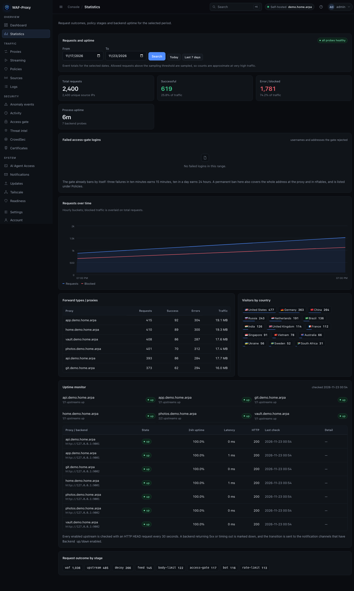
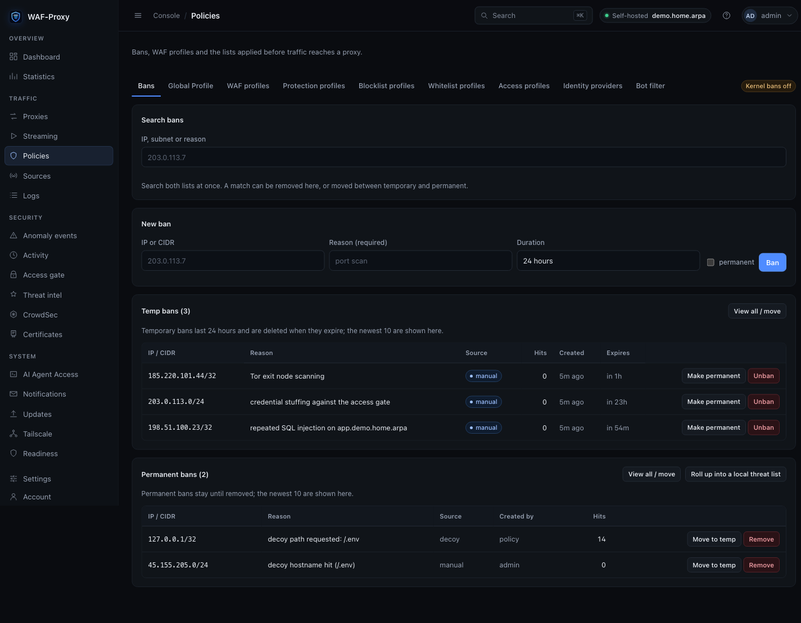
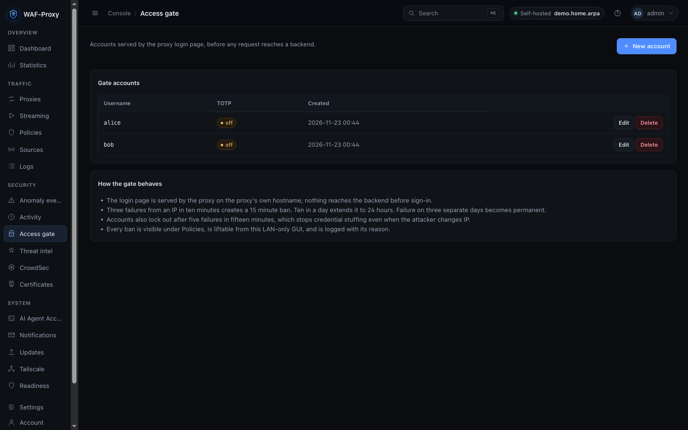
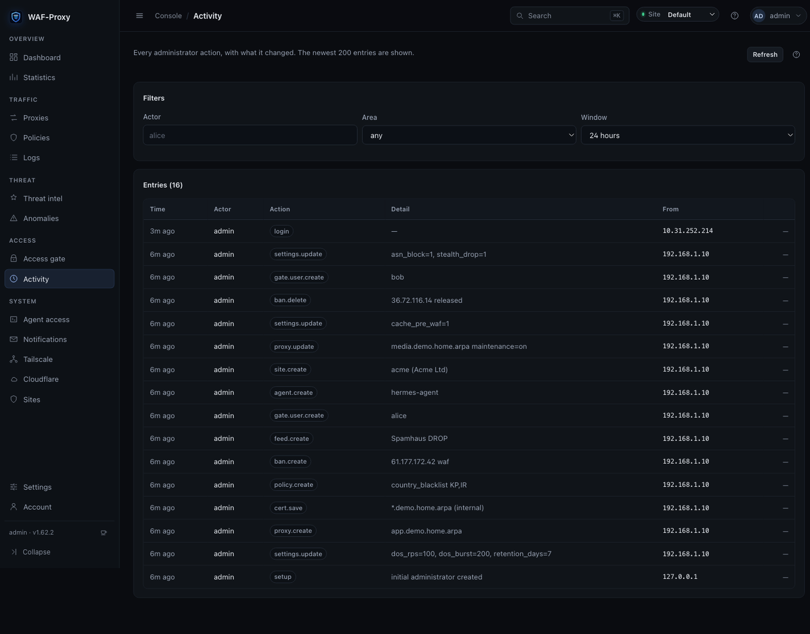
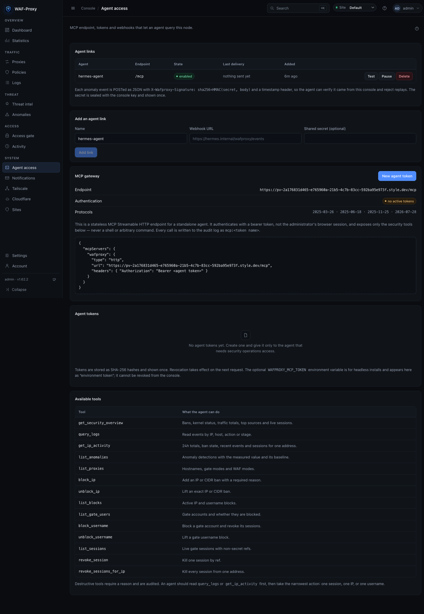
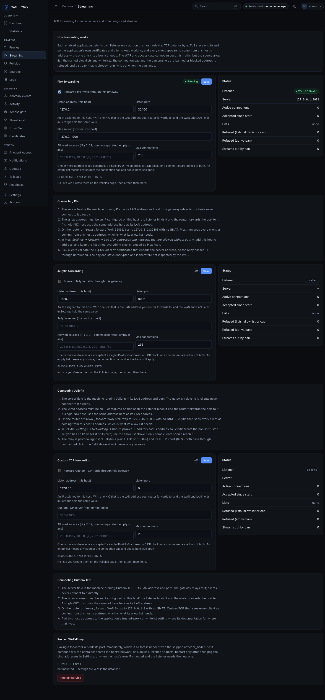
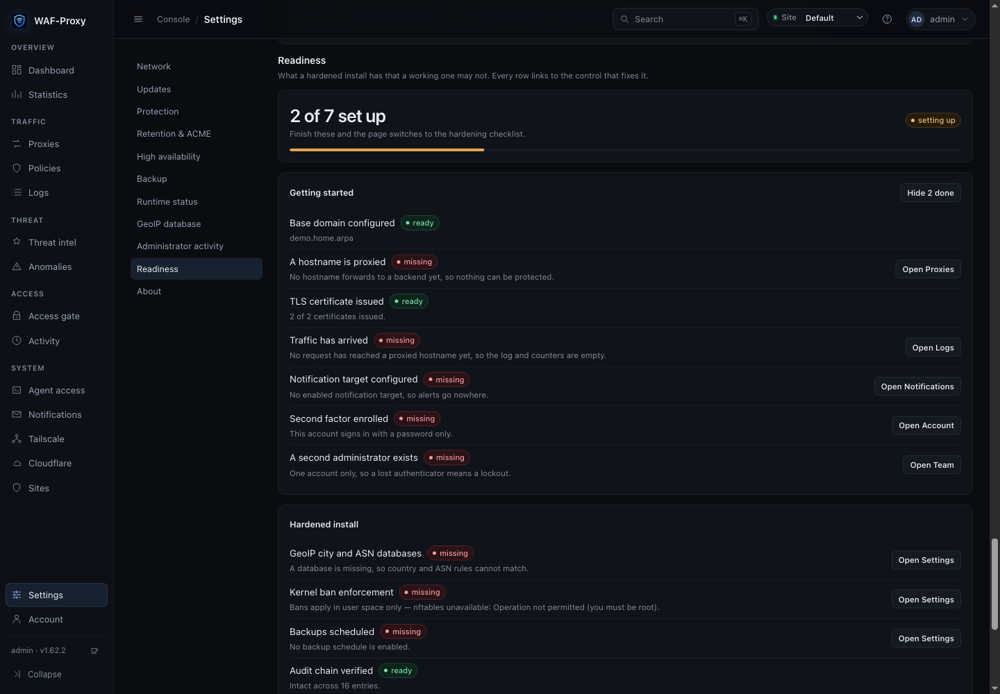
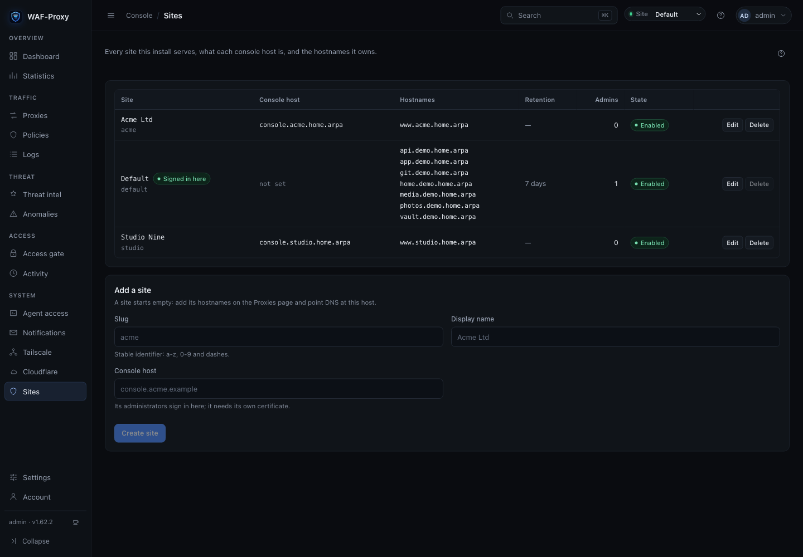

# WAF-Proxy

A self-hosted web application firewall and reverse proxy for a home lab or small edge. It
terminates TLS, screens every request through a managed rule set, gates private sites behind a
passphrase or per-site accounts, forwards streaming services without inspection, and puts all of
it — traffic, decisions, bans and certificates — in one console.

Written in Go with an embedded SQLite database and a React console; ships as a container or a
systemd service. Version 1.64.0.

## Contents

- [What it does](#what-it-does)
- [How a request is handled](#how-a-request-is-handled)
- [Signature bundles](#signature-bundles)
- [Requirements](#requirements)
- [Quick start](#quick-start)
- [First boot](#first-boot)
- [Single NIC](#single-nic)
- [The console](#the-console)
- [Configuration and transport](#configuration-and-transport)
- [Security model and limitations](#security-model-and-limitations)
- [High availability](#high-availability)
- [Operations](#operations)
- [Development](#development)
- [Documentation](#documentation)

## What it does

**Protection**

- OWASP CRS through Coraza, with per-site WAF profiles (paranoia level, anomaly threshold, body
  limit, method allowlist, per-rule exceptions) and response inspection that can flag or block a
  malicious upstream answer before it reaches the browser.
- A request pipeline that applies permanent and temporary bans, whitelists, country and ASN
  policy, decoy hostnames, threat feeds, rate limits, bot filtering and a proof-of-work challenge
  before the WAF sees the request.
- Named blocklists and whitelists (IPs, CIDRs, countries) that attach to access profiles and to
  streaming forwarders, with the deciding list named in every event.
- Keyless threat feeds plus local uploads, CrowdSec LAPI bouncer, and a ban engine backed by
  nftables with escalating temporary bans and permanent bans.
- Signed signature bundles: an ed25519-signed channel delivers rule packs between releases, they
  are verified, checksummed and compiled before replacing the previous version, and each pack is
  off, log only or block per WAF profile.
- Access gates per site: a shared passphrase, named accounts, or accounts plus TOTP, with an
  allowlist, lockout that survives an IP change, and a session cookie bound to the client network.

**Front door**

- TLS with SNI, per-site minimum versions, certificates via DNS-01, HTTP-01 or TLS-ALPN-01,
  uploaded PEM pairs, an internal CA for `*.home.arpa` installs, DuckDNS updates, and automatic
  renewal with backoff; HTTP/2 and WebSocket pass-through.
- Opt-in HTTP/3 over QUIC on the same WAN port (`WAFPROXY_HTTP3=1`): the same handler serves h3,
  HTTP/1.1 and HTTP/2 answers advertise it with `Alt-Svc`, 0-RTT is refused, and the TCP path is
  unchanged while the flag is off.
- Proxies with per-site load balancing (`weighted_rr`, `least_conn`, `least_latency`, `ip_hash`,
  `sticky_cookie`), per-upstream connection caps, configurable health probes with passive ejection,
  per-site and per-client request budgets, per-site upstream timeouts with bounded idempotent
  retries, ordered request/response header rewriting, method/header/query/regex routes with per-rule upstreams and timeouts, redirects and maintenance mode; a shared response cache with per-host
  quotas and purge; drain readiness; application presets for Nextcloud, Jellyfin, Plex, Home Assistant, Proxmox VE,
  Vaultwarden, Gitea/Forgejo, Grafana, n8n, BookStack, the *arr suite and more.
- Streaming forwarders (Plex, Jellyfin, game servers) that relay bytes without HTTP inspection —
  TCP, UDP or both on the same number, with port ranges, game presets, per-source session and
  rate limits, and the same lists and bans as a proxied site.

**Operations**

- Dashboard with live traffic, an attack globe, top sources and upstream health; statistics,
  event log with a request simulator ("Why?"), anomaly events and uptime history.
- Scheduled backups to a local directory, SFTP, FTP or a Git remote, optionally encrypted with
  AES-256-GCM under a passphrase; manual JSON and YAML downloads use the same passphrase.
- Declarative YAML export/import of settings, WAF and protection profiles, access lists, access
  profiles, proxies and policies. References are names, so a file restores onto another install.
- Tamper-evident audit log (SHA-256 chain with an anchored head), full CSV export, and notifications
  through webhooks.
- MCP gateway for AI agents with per-tool token scopes; a metrics endpoint guarded by a bearer
  token; Tailscale-aware listeners; Cloudflare Tunnel with a guided setup and an Access
  checklist; one-click self-update with rollback.
- **Optional two-node high availability.** A role machine on disk, a keepalived virtual address, a
  witness lease and a fencing hook move the service between an active and a standby without
  restarting the process, while configuration, sessions, bans, audit and alerts replicate over an
  authenticated TLS link. Off by default: turn it on with the **Settings → High availability**
  switch, which enables the runtime and restarts once to bind the HA listeners. No environment
  variable is needed. The two-node hardware lab gates have not been run, so read
  [docs/HA.md](docs/HA.md) before trusting a pair with production traffic.

**Console**

- Password + TOTP sign-in with single-use recovery codes, a "remember this device" cookie that
  skips the code for 30 days, and an emailed password-reset link when notifications are configured.
  CSRF tokens, strict CSP, secrets sealed at rest, an optional admin source allowlist, and RBAC
  with Administrator, Operator, Read-only and Viewer roles plus custom roles.

## Headless commands

- `wafproxy setup --password …` creates the first administrator without a browser.
- `wafproxy recover --password … --reset-totp` resets a locked-out account.
- `wafproxy backup --keep 7` writes an encrypted backup and prunes older ones.
- `wafproxy unban <ip|cidr>` removes a ban while the console is unreachable.
- `wafproxy sites list|add|rename|remove` manages the sites one process serves.
- `wafproxy ha status|pair|join|sync|failover|failback|unpair|notify` runs the same pair and move
  sequence as the console and API, for a node whose console is unreachable; `wafproxy ha upgrade
  --check` says whether the pair can be upgraded before either node restarts.
- `bundletool keygen|sign` publishes a signed signature-bundle channel.

## How a request is handled

```
Internet ──► router DNAT 443 ──► WAN listener (TLS, SNI)
                                     │
        permanent ban → whitelist → country → ASN → decoy → threat feed
             → temporary ban → rate limit → method → bot challenge
             → access gate → WAF → upstream (balanced per site)
```

With response inspection on, the answer is checked on the way back: up to the profile's body
limit is buffered and run through the CRS response rules, and a match is refused with the uniform
502 before the status line is written. SSE, WebSocket upgrades, range requests, compressed,
bodyless and oversized responses are forwarded untouched and logged as `response-skipped` with
the reason. It is off by default because it delays the first byte by up to one buffer.

Every decision that blocks, bans or challenges produces one event row (source, country, ASN, host,
path, stage, rule) that feeds the dashboard, the globe, Logs, Sources and notifications. Allowed
requests are downsampled once the site passes `sample_above_rps` (500 requests per second by
default), so the event table stays small on a busy site.

## Signature bundles

The bundled OWASP CRS moves with the release, so a newly exploited pattern waits for the next
version of this project. A bundle channel fills that gap without turning the console into a rule
editor: a publisher signs a manifest, the service checks it hourly, and each pack becomes extra
phase-1 rules in the profiles that opt in.

- Packs carry **rules only**. A bundle can add a signature but never ban an address; IP and CIDR
  lists stay in Threat intel → Feeds.
- The manifest is ed25519-signed and carries a `sequence` that must increase, so a mirror cannot
  roll the channel back to an older pack.
- A pack is installed only after its signature, SHA-256, advertised size and a throwaway compile
  all pass. The previous version stays on disk as the last known good copy, and the swap is atomic.
- Rules use the reserved range `990000–999999`: above every CRS rule ID (CRS v4 tops out at
  980170) and inside the per-profile exception cap, so an exception can disable one signature.
- A bundle's action is **off, log only or block per WAF profile**. A new pack starts in log only,
  and a site whose own WAF mode is `detect` keeps logging even when its profile allows block. An
  administrator can also switch a whole pack off from the console; it then contributes no rules to
  any profile until it is switched back on.
- **Known good packs ship with the release** and need no provider: `secret-probes` (environment
  files, Git metadata, cloud credentials, database dumps), `exploit-payloads` (Log4Shell,
  Shellshock, Spring4Shell, PHP stream wrappers) and `scanner-tools` (scanner user agents and
  router/NAS exploit paths). They start switched off and are enabled one at a time in the console.

A refresh reads the manifest only (`If-None-Match` answers 304 in the steady state); a pack is
downloaded only when its version changes. Configure the channel:

```
WAFPROXY_BUNDLE_PROVIDERS=[{"name":"vendor","url":"https://bundles.example.com/stable/manifest.json","public_key":"<hex or base64 ed25519 public key>"}]
WAFPROXY_BUNDLE_INTERVAL=3600
```

Every entry is a separate provider with its own manifest, publisher key, refresh sequence and
last-error state; they are checked and downloaded independently, so one unreachable publisher does
not hold up the others. Bundle names must be unique across providers, because a profile switches
them by name. The older single-channel pair `WAFPROXY_BUNDLE_URL` and `WAFPROXY_BUNDLE_PUBKEY`
still works and becomes the provider named `default`. Without a URL and key the channel stays off
and the service serves whatever packs are already installed.

Providers can also be added from **Threat intel → Bundles → Bundle providers** (name, manifest URL,
publisher public key): the list is stored in the database, applied without a restart, and replaces
the environment list once the first one is saved. A saved name updates that provider's URL and key;
removing it stops future refreshes but leaves its installed packs on disk. The manifest and pack
shapes are documented in `internal/bundle`. To publish:

```
go run ./cmd/bundletool keygen -out publisher.key
go run ./cmd/bundletool sign -dir packs -seq 42 -key publisher.key -base /stable/packs -out manifest.json
```

The tool validates and compiles every rule before signing, so the channel cannot ship a pack the
service will reject. In the console, **Threat intel → Bundles** lists the **Known good bundles** with
an Enable/Disable button, a **Bundle providers** card where channels are added and removed, and the
installed versions with the modes across profiles. **Bundle hits** counts the rules that matched in
the last 24 hours from the request log, including matches that were only logged, and names the
provider. Whether a pack logs or blocks lives in **Policies → Profiles → Edit**, next to paranoia
and rule exceptions.

## Requirements

- **Linux**, deployed with Docker Engine 24+ / Compose v2, or as a systemd service
  (`make build && sudo ./deploy/install.sh`). Host networking and nftables are used, so Docker
  Desktop on macOS or Windows is not a supported target. The systemd path needs Go 1.27 to build.
- **`443/tcp`** reachable from the edge firewall. Port 80 is optional and only needed for the
  HTTP-01 certificate challenge; DNS-01 and TLS-ALPN-01 need no extra port.
- **One or two interfaces.** The intended deployment is dual-homed (WAN and LAN); a single-NIC
  host works too — see [Single NIC](#single-nic).
- nftables inside the container. The image grants `NET_ADMIN` and `NET_BIND_SERVICE` through file
  capabilities; do **not** add `no-new-privileges`, which makes the kernel ignore them.
- **Optional:** GeoIP for country and ASN policy — install DB-IP Lite from **Settings → GeoIP
  database**, or place `GeoLite2-City.mmdb` / `GeoLite2-ASN.mmdb` in the data volume.
- **Optional:** the CrowdSec sidecar profile and its LAPI bouncer.
- **Optional:** a native Tailscale installation (`tailscale0`) for private admin and application
  access. WAF-Proxy needs no Tailscale sidecar or auth key.

Sizing guidance for 4 vCPU/8 GB and 8 vCPU/16–32 GB hosts is in
[docs/BENCHMARKS.md](docs/BENCHMARKS.md).

## Quick start

```bash
git clone https://github.com/kenhermesagent-lab/WAF-Proxy.git WAF-Proxy
cd WAF-Proxy
cp .env.example deploy/.env
# edit deploy/.env: TZ, the GUI bind address, optional CrowdSec and metrics token
docker compose -f deploy/docker-compose.yml up -d --build
docker compose -f deploy/docker-compose.yml logs -f wafproxy
```

The image builds the React console and embeds it in the Go binary. Before the first start, set in
`deploy/.env`:

```ini
# This host's real LAN address. The console listens only here.
WAFPROXY_LISTEN_GUI=10.0.0.10:8080
# Refuse console requests from anything but a private network.
WAFPROXY_GUI_PRIVATE_ONLY=true
# Only if a tunnel or proxy fronts this host: the CIDRs whose X-Forwarded-For may name the client.
WAFPROXY_TRUSTED_PROXIES=
```

## First boot

Open the console on the LAN address and port from `deploy/.env` and complete the wizard: base
domain, administrator name and a 12+ character password, WAN and LAN addresses, ports, and
optionally a DuckDNS token and ACME email. The wizard shows the authenticator secret and ten
recovery codes **once**; store them before continuing. Both bind addresses are required, because
an empty address would put the console on every interface.

The setup endpoint is unauthenticated until the administrator exists, which is why Compose keeps
the console on loopback. Complete setup before exposing the port, and keep
`WAFPROXY_GUI_PRIVATE_ONLY=true` unless a trusted reverse proxy terminates access in front of it.

Then add a proxy, pick a certificate, and point a hostname at the WAN address. The
[installation guide](docs/INSTALL.md) walks through the router, DNS and the first certificate.

## Single NIC

A host with one address and one interface uses that address for both WAN and LAN, and the console
is firewalled from the WAN side. The WAN listener terminates TLS on 443; the LAN egress address is
the same address, so upstreams are reached over that interface. Enter the address in both fields
in the wizard and in **Settings → Network**, and do not forward the console port from the router.

## The console


*The console of the demo install these docs were written against. The sites, bans and events in
the screenshots are sample data; the [screenshot index](docs/screenshots/README.md) lists every
page.*

| Page | What it covers |
|---|---|
| Dashboard | Needs-attention queue, live requests and byte rates, attack globe with country drill-down, top sources, upstream health |
| Statistics | **Uptime monitor** (live probes, shown above the date range on every tab), **Overview** (totals, trend, stages), **Traffic** (per-site requests, countries) and **Access gate logins** (failed sign-ins with a block action); the date range and trend stay above the tabs |
| Proxies | **Hostnames** (upstreams, routes, health checks, maintenance, presets, per-hostname **360** view), **Certificates** (issue, renew, inspect; DNS-01, HTTP-01, TLS-ALPN-01) and **Streaming** (TCP/UDP byte relay for Plex, Jellyfin and game servers) |
| Policies | **Bans**, **Profiles** (global profile with policy **Preflight**, WAF and protection profiles), **Access profiles**, **Lists** (blocklists/whitelists) and **Bot filter** |
| Logs | Event search, filters, saved views, live tail, bulk source actions, incident report, the **Why?** request simulator |
| Threat intel | **Feeds** (health and rollup), **Lookup**, **Sources** (per-address investigation), **Bundles** and **CrowdSec** (engine, bouncer and the console blocklists it is enforcing) |
| Anomalies | Requests that tripped a rule but were not blocked |
| Access gate | **Accounts** (site accounts, TOTP) and **Identity providers** |
| Activity | The audit log with before/after diffs and rollback of edits |
| Agent access | MCP endpoint, tokens and their per-tool scopes |
| Notifications | Webhook routing |
| Tailscale | Listener on the tailnet address |
| Sites | Every site this install serves: create, edit and remove one, its console host, the hostnames and retention it owns, and the admins in it (`sites.read`/`sites.write`) |
| Settings | One page of sections: **Network**, **Updates** (version, release check, one-click update), **Protection**, **Retention & ACME**, **High availability** (the host-wide switch, default console only), **Backup**, **Runtime status**, **GeoIP database**, **Administrator activity** (audit, YAML/JSON transport) and **Readiness** (a scored hardening checklist, each gap linking to the control that fixes it) |
| Account | Password, authenticator rotation, recovery codes, administrators and roles |

### Console tour

Each image is a page of the demo install the guides were written against, with sample data:
two tenant sites, nine proxies, certificates, bans, threat feeds and a week of traffic. The
captures were taken on **v1.62.2**, so the sidebar and the pages match this release.

<table>
<tr>
<td width="50%"><br><sub><b>Dashboard</b> — needs-attention queue, live rates, attack globe, top sources and upstream health.</sub></td>
<td width="50%"><br><sub><b>Statistics</b> — totals, trend, per-site traffic, countries and the uptime tab.</sub></td>
</tr>
<tr>
<td width="50%"><br><sub><b>Proxies</b> — hostnames, upstream health, routes, certificates and streaming.</sub></td>
<td width="50%"><br><sub><b>Policies</b> — bans, the global profile, WAF and protection profiles, lists and bot filter.</sub></td>
</tr>
<tr>
<td width="50%"><br><sub><b>Logs</b> — event search, stages, saved views and the <b>Why?</b> request simulator.</sub></td>
<td width="50%"><br><sub><b>Threat intel</b> — feed health, the lookup, bundles and CrowdSec.</sub></td>
</tr>
<tr>
<td width="50%"><br><sub><b>Sources</b> — feeds, local lists and per-address investigation.</sub></td>
<td width="50%"><br><sub><b>Anomalies</b> — behavioural detections measured against a baseline.</sub></td>
</tr>
<tr>
<td width="50%"><br><sub><b>Access gate</b> — site accounts, TOTP enrolment and lockouts.</sub></td>
<td width="50%"><br><sub><b>Activity</b> — the audit log with before/after diffs and rollback.</sub></td>
</tr>
<tr>
<td width="50%"><br><sub><b>Certificates</b> — issuance, renewal policy and expiry.</sub></td>
<td width="50%"><br><sub><b>Agent access</b> — the MCP endpoint and per-tool token scopes.</sub></td>
</tr>
<tr>
<td width="50%"><br><sub><b>Notifications</b> — channels and per-event routing.</sub></td>
<td width="50%"><br><sub><b>Streaming</b> — byte-relay forwarders for Plex, Jellyfin and similar.</sub></td>
</tr>
<tr>
<td width="50%"><br><sub><b>Settings</b> — network, protection, retention, backup, GeoIP and Readiness.</sub></td>
<td width="50%"><br><sub><b>Readiness</b> — the scored hardening checklist, each gap linking to its fix.</sub></td>
</tr>
<tr>
<td width="50%"><br><sub><b>Updates</b> — application and host package versions, and the restart that applies a rebuild.</sub></td>
</tr>
<tr>
<td width="50%"><br><sub><b>Sites</b> — the sites this install serves, each with its own console host and hostnames.</sub></td>
<td width="50%"><br><sub><b>High availability</b> — cluster status and the pairing flow for a second node.</sub></td>
</tr>
</table>

**Investigating a source.** Any address in the log, dashboard, attack map, source explorer or ⌘K
search opens one drawer: totals for 1h/24h/7d/30d, block share, hosts, first and last seen, threat-intel
matches, recent requests and the ban state. Administrators with `policies.write` can ban for 24 hours
with a reason or release the ban; the drawer is read-only for other roles.

## Configuration and transport

**YAML configuration.** **Settings → Download YAML** exports the declarative half of the install:
settings, WAF and protection profiles, access lists, access profiles, proxies and policies.
Bans, feeds, certificates and secrets are excluded. Every reference between rows is a name, so
the file imports onto an empty install and resolves to the entities created from the same file.
**Import YAML** is additive: existing hostnames and profiles are skipped and every problem is
listed in the response.

```bash
curl -fsS -b cookies.txt https://console.example.com/api/config/export.yaml -o wafproxy.yaml
curl -fsS -b cookies.txt -X POST --data-binary @wafproxy.yaml \
  -H 'Content-Type: application/yaml' https://console.example.com/api/config/import.yaml
```

A passphrase of 16+ characters in the field beside either download button seals that file with
AES-256-GCM, and **Import YAML** opens an encrypted file with the same passphrase. The scheduled
backup uses the same format and the passphrase configured on the backup card.

**Backups.** The schedule writes a JSON document to a local directory, SFTP, FTP or a Git remote,
keeps a chosen number of files, and can be encrypted. Restoring is additive as well; encrypted
files ask for the passphrase and are decrypted before parsing. Bans, feeds, certificates and
secrets are not part of the document.

## Security model and limitations

- The console is **plain HTTP on a private address**. Put it behind an SSH tunnel, a LAN-only
  address or Tailscale; do not publish it. TLS terminates on the WAN listener, not the console.
- **Only 443 is exposed by design.** Port 80 exists only if HTTP-01 is used. The proxy refuses
  unknown hostnames rather than serving a default vhost.
- **Secrets are sealed with a master key** at `master.key` in the data directory. The key is
  created on first boot; the database alone does not disclose tokens, passwords or TOTP secrets.
  Back up the key with the database, and treat both as sensitive.
- **The update helper runs as root** and builds from the checkout you recorded. A compromised
  admin session can make it install code; this is documented design rather than privilege
  escalation, and the rollback exists for failed builds.
- **Streaming forwarders are a byte relay**, not an inspected proxy. They enforce their lists at
  connection time and then stay out of the traffic: no protocol parsing, no player counts, no game
  panel. A UDP source address can be forged, so an allow list decides who is answered, not who
  sent; amplification ports are refused over UDP, datagrams are size-capped and one address may
  open at most ten new sessions a second.
- **Bans are kernel state.** A permanent ban is absolute for its address; decoy hostnames ban
  permanently by design.
- **Auditing is tamper-evident, not tamper-proof.** The hash chain and anchored head detect edits
  or truncation in the database file, not an attacker who can rewrite every row.
- **GeoIP is optional.** Without a database, country and ASN policy reports "unavailable" and is
  skipped instead of pretending to be active.
- **Subdomains are not a secrecy boundary.** Certificates are published to Certificate
  Transparency logs, so a wildcard's names are discoverable.
- **Capacity is bounded, not endless.** A request that cannot be admitted waits the queue window
  and is then refused with a `503` and `Retry-After`, and the byte budget is checked as well as the
  count, so the box stays inside its memory limit instead of swapping. The dashboard's Capacity card
  shows what is in flight, queued, cached and refused. This is not HAProxy parity and the numbers
  should not be read as such: cache hits and WAF-off sites run at relay speed, but every inspected
  request still pays Coraza and the CRS.
- **Not included:** AbuseIPDB enrichment, tarpit, per-site HTTP basic auth/mTLS, per-site bandwidth
  history, console single sign-on, and multi-organisation tenancy.

## High availability

Two nodes can share one virtual service address, with one active and one standby. It ships **off by
default** and changes nothing about a single-node install until an operator turns it on. The
two-node hardware lab gates in [docs/HA.md](docs/HA.md) have not been run and the page still
lacks some cards, so run that checklist before trusting a pair with production traffic:

1. Give both nodes a private HA link address (`WAFPROXY_HA_LINK_LISTEN`, port 9443) and an
   optional fixed management console address (`WAFPROXY_HA_MGMT_LISTEN`), then enable
   **Settings → High availability** on each; the first enable restarts the service so the HA
   listeners bind.
2. **Create a pair** on one node (a 26-character code, valid for 10 minutes) and **join** it from
   the other with that code and the first node's address and fingerprint. Both nodes must share
   the master key; certificates may differ because the link pins fingerprints rather than names.
3. Put keepalived in front: `wafproxy ha notify MASTER|BACKUP|FAULT` records the address owner,
   and a move makes the node that is serving the address the active one.
4. A witness (optional) renews a lease every three seconds; an active that cannot renew stops
   serving rather than risk two actives, and a fence command can power off the peer before a
   promotion. Without a witness, moves stay manual.

The console page shows the role, peer, replication lag and the actions; `wafproxy ha status
--watch` shows the same from a terminal. If the stored switch is on but the loops failed to
bind, the page shows **HA did not start** with the failure, **Retry startup** (re-authenticates,
then runs the same start the boot path uses) and **Copy diagnostics**; moves stay refused until
a retry succeeds. A standby is read-only: configuration writes are refused
while it follows the active. Upgrading a pair has its own order (standby first); see
[docs/OPERATIONS.md](docs/OPERATIONS.md#upgrading-a-high-availability-pair). The design, the
state machine and the lab checklist are in [docs/HA.md](docs/HA.md).

## Operations

- `GET /api/health` is public and reports the version and liveness; the console uses it to detect a
  stopped service.
- `GET /metrics` serves Prometheus counters and requires `Authorization: Bearer
  $WAFPROXY_METRICS_TOKEN` (32+ characters). Without the variable it answers 403.
- **Audit.** Every administrator action is recorded; **Verify chain** checks the hash chain and the
  anchored head, and the CSV export downloads the whole table.
- **Updates.** The **Update** button and `deploy/wafproxy-self-update.sh` pull, build, install and
  roll back on failure. A Docker host can install `deploy/install-docker-updater.sh` for the same
  action without exposing the Docker socket to the console.
- **Agent gateway.** The MCP endpoint is documented in [docs/MCP.md](docs/MCP.md); tokens are
  limited per tool and can be revoked from **Agent access**. An agent can read the tenant list,
  a host's posture, certificate expiry, WAF profiles, the media relay and the audit log, block
  or revoke visitors, and cut a relay stream; it still cannot change configuration.
- **Sites.** The **Sites** page lists every tenant with its console host, its hostnames, its
  retention and its administrator count, and creates, edits and removes them. The console topbar
  carries a **site switcher**: the choice rides on every request (`X-WAF-Site`) and is kept in
  `localStorage`, so reloading returns to the same site, and switching remounts the views so no
  page keeps the previous site's data on screen. Settings are per site and carry a badge naming
  the site they apply to; the host-wide sections (network, updates, GeoIP) are read-only on a
  non-default   console with a note saying why. Host-only pages — Bundles, CrowdSec and High availability —
  are absent from a non-default console, and a deep link to one opens the first tab it may read.
  The built-in `host_admin` role administers one site
  (its hostnames, policies, certificates, feeds, settings and accounts) without the `sites` area:
  it sees no switcher and no Sites page, and a `X-WAF-Site` header from it is ignored, so it
  cannot read another tenant's rows.
- **Sites and row ownership.** Every configurable row belongs to a site. An upgrade adopts the existing install as
  `default`, with its current `base_domain` as the console host, and `wafproxy sites` manages the
  rest. Each site has its own console host: a request arriving on that hostname is served from that
  site's rows only, signs in only that site's administrators, and shows that site's proxies, bans,
  events, audit trail and settings. One process serves every console, each with the certificate
  issued for its own hostname. Process-wide settings (WAN/LAN addressing, the admin source
  allowlist, CrowdSec, auto-update) stay host-wide: any site reads them, only `default` sets them,
  and the others are refused. A ban is host-wide at the kernel but recorded on the site that
  observed it, retention follows each site's own `retention_days`, and
  `wafproxy backup --site <slug>` / `--all` export one file per site while a restore writes
  only into the site whose console posted it.
- **Per-site policy, notifications, anomaly detection, canary and ACME.** Each of these is one
  instance per site, built from that site's own rows and settings (`internal/siteres`). A site's
  `dos_rps`, normalization mode, decoy hosts, WAF and access profiles, notification
  channels and alert classes, anomaly thresholds, canary target and ACME account/staging switch
  are its own: writing one site's console leaves every other site's policy compiled state,
  channels and thresholds untouched. The proxy asks the site's engine for every request, resolved
  from the hostname; the certificate listener serves whichever site holds the name, and a
  certificate can only be listed, renewed or revoked from the console of the site that stores it.
  Only `default` sets host-wide behaviour (body cap, stealth, interface names) — every other site's
  console reads those from `default`. A `host_admin` is confined to its own site's instances: a
  site header it sends is ignored, so it cannot read or write another tenant's channels,
  thresholds, policies, canary or certificates.
- **Which settings are per site.** A non-default console writes and the engines read these per
  site: `dos_rps`, `dos_burst`, `sample_above_rps`, `retention_days`, the normalization mode, the
  protection, ASN and stealth switches, decoy hosts, proxies and their WAF/access profiles, feeds,
  access lists, certificates, saved log views, notification channels, anomaly thresholds, canary
  and the ACME email and staging switch. One setting is deliberately not per site: `max_body` is a
  single process-wide inspection buffer read from the default site, so a non-default console shows
  it disabled with a note, and the API refuses a per-site write of it with the same `403` as the
  other host-wide keys, instead of pretending the save changed traffic. The remaining host-wide
  sections (network addressing, admin source allowlist, CrowdSec, GeoIP and updates) are read-only
  on a non-default console for the same reason, and each says so.
- **Upgrade behaviour.** Nothing migrates: every row and setting written before sites existed
  already lives on `default`, so the default-site instances read exactly the configuration an
  earlier release used, and the first new site starts from the shipped defaults.

## Development

```bash
make ui             # npm ci + Vite build into internal/webui/dist
make build          # static Go binary with version ldflags
make test           # go test ./...
make vet            # go vet ./...
make run            # run from source against ./data
make perf           # WAF hot-path throughput and p50/p95/p99
make perf-gate      # compare the benchmarks with perf/baseline.json
make sbom           # CycloneDX document of the build graph into dist/
make verify-release # VERSION and the newest CHANGELOG section agree
```

Go 1.27 and Node 26 are what CI uses. `web/package.json` pins `engines.node` to `>=26` and
`web/.npmrc` sets `engine-strict`, so `npm ci` in `web/` stops with an `EBADENGINE` message on an
older Node instead of installing a tree the Vite 8 and jsdom 31 toolchain cannot run. CI runs
gofmt, `go vet`, race tests, the Go build, the console typecheck/build and its component tests, a
production dependency audit, release metadata and SBOM checks, the performance gate, and a
container image build.
[`.github/workflows/ci.yml`](.github/workflows/ci.yml) is the source of truth. `make perf-record`
re-records the performance baseline after a deliberate change.

## Documentation

- [SECURITY.md](SECURITY.md) — supported versions, private vulnerability reporting, delivered fixes
- [docs/README.md](docs/README.md) — documentation index, split by task
- [docs/CONFIGURATION.md](docs/CONFIGURATION.md) — admin configuration reference: every page,
  setting, option and default, plus environment variables
- [docs/INSTALL.md](docs/INSTALL.md) — installation hub: Docker, DNS/TLS, first site, bare metal, Tailscale
- [docs/openapi.yaml](docs/openapi.yaml) — generated reference for every admin API route
- [docs/MCP.md](docs/MCP.md) — agent gateway, tool reference, containment playbook
- [docs/HA.md](docs/HA.md) — high availability: role machine, pairing, moves, the lab checklist
- [docs/OPERATIONS.md](docs/OPERATIONS.md) — runbook, troubleshooting, capacity
- [docs/screenshots/](docs/screenshots/README.md) — screenshots of every console page, with sample data
- [docs/BENCHMARKS.md](docs/BENCHMARKS.md) — measured numbers and methodology
- [CHANGELOG.md](CHANGELOG.md) — release history

## License

[MIT](LICENSE) © 2026 kenhermesagent-lab. Use it, modify it and redistribute it; keep the
copyright notice and take it as-is, with no warranty.
