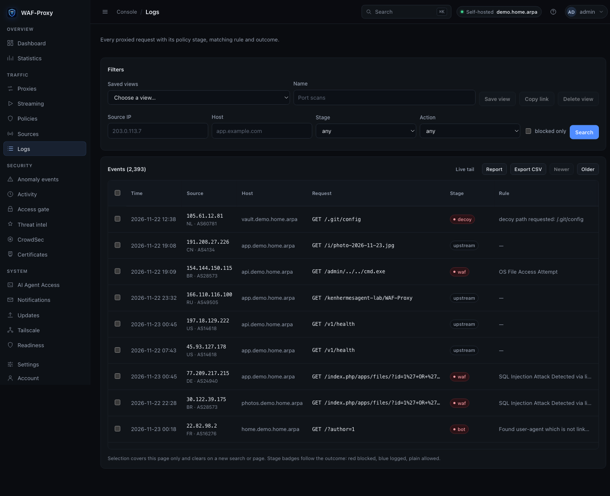
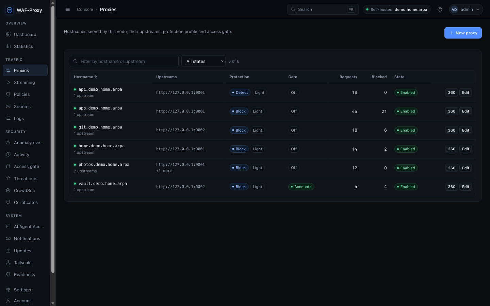
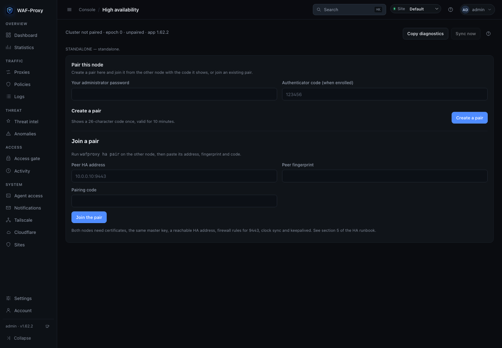

<div align="center">


# WAF-Proxy

<p>
  <a href="https://github.com/kenhermesagent-lab/WAF-Proxy/releases/latest"></a>
  <a href="LICENSE"></a>
  
  
  <a href="https://github.com/kenhermesagent-lab/WAF-Proxy/pkgs/container/wafproxy"></a>
  <a href="actions/workflows/ci.yml"></a>
</p>

**A self-hosted reverse proxy with a real web application firewall in front of it.**

TLS termination, OWASP Core Rule Set screening, per-site access gates, streaming relays and one
console for traffic, bans and certificates. A single Go binary with an embedded SQLite database and
a React console, shipped as a container or a systemd service.

[Quick start](#quick-start) · [Features](#features) · [Deploy](#deploy) · [Build](#build-from-source) · [Update](#update-and-upgrade) · [Documentation](#documentation)

</div>


<p align="center"><em>One screen for the whole edge: throughput, the attack map, and the stage and rule behind every blocked request.</em></p>

## Quick start

```bash
git clone https://github.com/kenhermesagent-lab/WAF-Proxy.git
cd WAF-Proxy
cp .env.example deploy/.env                      # TZ, optional CrowdSec keys
docker compose -f deploy/docker-compose.yml up -d --build
```

The console comes up on `http://127.0.0.1:8080` and the setup wizard takes over: interfaces, WAN and
LAN addresses, the first site, then a certificate. To finish the wizard from another machine, set
`WAFPROXY_LISTEN_GUI` in `deploy/.env` to this host's LAN address first.

Every release also publishes that build to GHCR for `linux/amd64` and `linux/arm64`:

```bash
docker pull ghcr.io/kenhermesagent-lab/wafproxy:$(cat VERSION)
```

The package starts **private**: an anonymous pull answers `denied` until it is made public under
**Packages → wafproxy → Package settings**, and a private pull needs a token with `read:packages`.
No Docker on the host? Jump to [native Linux](#native-linux-systemd).

## Features

**Protection**

- OWASP CRS through Coraza — per-site paranoia level, anomaly threshold, body limit, method
  allowlist and per-rule exceptions, plus optional response inspection.
- Everything decided before the WAF: permanent bans, whitelists, country and ASN policy, decoy
  hostnames, threat feeds, rate limits, bot filtering and a proof-of-work challenge.
- Named IP/CIDR/country lists shared by sites and streaming forwarders, with the deciding list named
  in every event; escalation on nftables; CrowdSec LAPI bouncer.
- ed25519-signed signature bundles between releases — rules only, atomic swap, off/log/block per
  profile — plus three built-in packs for secret probes, exploit payloads and scanner tools.
- Access gates per site: shared passphrase, named accounts, or accounts plus TOTP. Lockout survives
  an IP change and the session cookie is bound to the client network.

**Front door**

- TLS with SNI, per-site minimum versions, DNS-01 / HTTP-01 / TLS-ALPN-01, uploaded PEM pairs, an
  internal CA for `*.home.arpa`, DuckDNS and renewal with backoff.
- HTTP/2 and WebSocket pass-through; opt-in HTTP/3 over QUIC on the WAN port (`WAFPROXY_HTTP3=1`),
  0-RTT refused, TCP path unchanged while the flag is off.
- Load balancing — `weighted_rr`, `least_conn`, `least_latency`, `ip_hash`, `sticky_cookie` — with
  per-upstream caps, health probes and passive ejection.
- Routes on method, header, query or regex with their own upstream and timeout; redirects;
  maintenance mode; ordered header rewriting in both directions.
- Shared response cache with per-host quotas and purge, per-site and per-client budgets, bounded
  idempotent retries, drain readiness.
- Streaming forwarders for Plex, Jellyfin and game servers: TCP, UDP or both, port ranges, game
  presets, per-source session and rate limits.
- Presets for Nextcloud, Jellyfin, Plex, Home Assistant, Proxmox VE, Vaultwarden, Gitea/Forgejo,
  Grafana, n8n, BookStack and the *arr suite.

**Operations**

- Dashboard with live traffic, attack map, top sources and upstream health; statistics, an event log
  with a "Why?" request simulator, anomaly events and uptime history.
- Backups to a directory, SFTP, FTP or a Git remote, optionally AES-256-GCM encrypted; declarative
  YAML/JSON export and import that references names, so a file restores onto another install.
- Tamper-evident audit log (SHA-256 chain with anchored head), CSV export, webhook notifications.
- MCP gateway for AI agents with per-tool token scopes, bearer-guarded metrics, Tailscale-aware
  listeners, Cloudflare Tunnel with an Access checklist, one-click self-update with rollback.
- Optional two-node high availability: keepalived virtual address, witness lease, fencing hook and
  TLS replication of config, sessions, bans and audit. Off by default — read
  [docs/HA.md](docs/HA.md) before trusting a pair with production traffic.
- Console security: password + TOTP, single-use recovery codes, remember-device cookie, CSRF tokens,
  strict CSP, secrets sealed at rest, admin source allowlist and RBAC with custom roles.

## The console

|  |  |  |
|:--:|:--:|:--:|
| <br/>**Sites and certificates** | <br/>**WAF and protection profiles** | <br/>**Event log and request simulator** |
| <br/>**Upstreams and balancing** | <br/>**Streaming forwarders** | <br/>**Two-node failover** |

Every page is pictured in the [screenshot index](docs/screenshots/README.md), captured from a demo
install with sample data.

## Deploy

### Container

`deploy/docker-compose.yml` is the reference deployment: host networking (the proxy
binds the addresses the wizard picks, sees real client IPs and drives nftables), a read-only
root filesystem, and only `NET_ADMIN` + `NET_BIND_SERVICE`. Do **not** add `no-new-privileges` — the
image grants those capabilities through file capabilities, and that flag makes the kernel ignore
them. Pin the release with `VERSION=` in `deploy/.env`:

```bash
VERSION=1.66.0 docker compose -f deploy/docker-compose.yml up -d
```

`deploy/install-docker-updater.sh` adds the host-side helper that lets the Updates page apply a
release; without it the page still checks for updates but cannot apply them. CrowdSec is an opt-in
compose profile (`--profile crowdsec`) that reads the access log.

### Native Linux (systemd)

Same binary, no container layer: the installer creates the `wafproxy` user, a root-owned checkout,
the data directory and `/etc/systemd/system/wafproxy.service`, then starts it.

```bash
sudo apt install nftables          # or: dnf install nftables
make build
sudo ./deploy/install.sh           # or --wan-iface eth0 --lan-iface eth1 --yes
```

| Path | Contents |
| --- | --- |
| `/var/lib/waf-proxy/bin` | `wafproxy`, `wafproxy-updated`, helper scripts |
| `/var/lib/waf-proxy/src` | root-owned checkout the Update button builds |
| `/var/lib/waf-proxy/data` | SQLite database, master key, GeoIP files, feeds, backups |
| `/etc/wafproxy/wafproxy.env` | listener and runtime settings, kept across upgrades |

Both paths are walked through step by step in [docs/INSTALL.md](docs/INSTALL.md).

## Build from source

Go 1.27 and Node 20+ for the console; the built console is committed, so `make ui` is only needed
after changing `web/`.

```bash
make build          # bin/wafproxy and bin/wafproxy-updated
make ui             # rebuild the embedded console
make test           # go test ./... with the documentation gate
make docker         # image through deploy/docker-compose.yml
make docker-smoke   # build, boot and check /api/health
```

## Update and upgrade

| Deployment | Apply a release | Go back |
| --- | --- | --- |
| Container | **Updates → apply** in the console, or `docker compose ... pull && up -d` with the new `VERSION` | start the previous `VERSION` again; the data volume is untouched |
| systemd | **Updates → Update application**, or `git fetch --tags && git checkout vX.Y.Z && make build && sudo ./deploy/install.sh` | check out the previous tag and install again — environment file and data are kept |
| Binaries | replace `wafproxy` with the release asset for your arch | keep the previous binary; rollback is one file copy |

Release assets are signed: `cosign verify-blob` with the workflow identity, `gh attestation verify`
for provenance, and `sha256sum -c SHA256SUMS` for the four binaries. The console's Update button
uses the same flow and can roll back on its own.

## Headless commands

| Command | Use |
| --- | --- |
| `wafproxy setup --password …` | create the first administrator without a browser |
| `wafproxy recover --password … --reset-totp` | unlock an account locked out of TOTP |
| `wafproxy backup --keep 7` | write an encrypted backup and prune older ones |
| `wafproxy unban <ip\|cidr>` | lift a ban while the console is unreachable |
| `wafproxy sites list\|add\|rename\|remove` | manage the sites one process serves |
| `wafproxy ha status\|failover\|failback` | same move sequence as the console, from a shell |
| `bundletool keygen\|sign` | publish a signed signature-bundle channel |

## Documentation

| Start here | Also |
| --- | --- |
| [Installation](docs/INSTALL.md) — Docker, domain and certificates, first site, bare metal | [Configuration](docs/CONFIGURATION.md) — every environment variable and file |
| [Operations](docs/OPERATIONS.md) — releases, tags, upgrades, recovery, runbook | [High availability](docs/HA.md) — pair, failover, upgrade order |
| [API reference](docs/openapi.yaml) — OpenAPI 3 for every console action | [MCP gateway](docs/MCP.md) — agent access and token scopes |
| [Benchmarks](docs/BENCHMARKS.md) — measured throughput and latency | [Changelog](CHANGELOG.md) — what changed, release by release |

---

<p align="center">
  <sub>MIT licensed · <a href="SECURITY.md">security policy</a> · built and tested on Linux for amd64 and arm64 · reverse proxy, web application firewall and TLS front door for a home lab or a small edge</sub>
</p>
