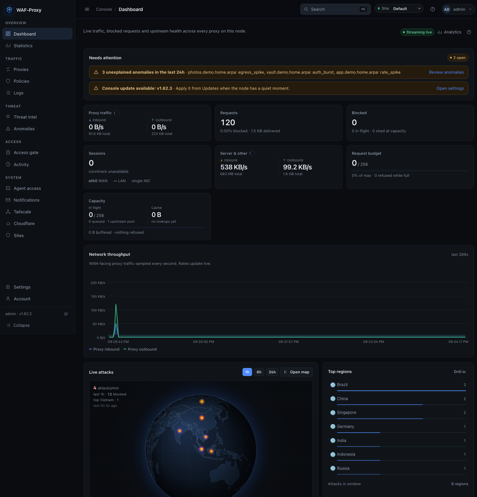
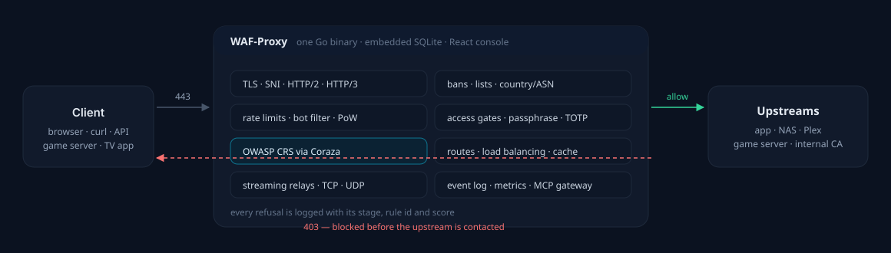

<div align="center">


# WAF-Proxy

<p>
  <a href="https://github.com/kenhermesagent-lab/WAF-Proxy/releases/latest"></a>
  <a href="LICENSE"></a>
  
  
  
  <a href="https://github.com/kenhermesagent-lab/WAF-Proxy/actions/workflows/ci.yml"></a>
</p>

**A self-hosted reverse proxy with a real web application firewall in front of it.**

One Go binary that terminates TLS, screens every request with the OWASP Core Rule Set, bans hostile
sources on nftables, gates private apps behind a passphrase or TOTP, balances and caches upstreams,
relays TCP/UDP game and media traffic, and serves its own admin console — on Docker or plain systemd
Linux, amd64 and arm64.

[Quickstart](#quickstart) · [Verify it works](#verify-it-works) · [Features](#features) · [Architecture](#architecture) · [Compare](#how-it-compares) · [Deploy](#deploy) · [Update](#update-and-upgrade) · [Docs](#documentation)

</div>



<p align="center"><em>One screen for the whole edge: throughput, the attack map, and the stage and rule behind every blocked request.</em></p>

## Quickstart

### Docker Compose

```bash
git clone https://github.com/kenhermesagent-lab/WAF-Proxy.git
cd WAF-Proxy
cp .env.example deploy/.env                      # TZ, optional CrowdSec keys
docker compose -f deploy/docker-compose.yml up -d --build
```

The console comes up on `http://127.0.0.1:8080` and the setup wizard takes over: interfaces, WAN and
LAN addresses, the first site, then a certificate. To finish the wizard from another machine, set
`WAFPROXY_LISTEN_GUI` in `deploy/.env` to this host's LAN address first.

Every release also publishes that build to GHCR for `linux/amd64` and `linux/arm64`:

```bash
VERSION=$(cat VERSION) docker compose -f deploy/docker-compose.yml up -d
```

The package currently starts **private**: an anonymous pull answers `denied` until it is made public
under **Packages → wafproxy → Package settings**, and a private pull needs a token with
`read:packages`. Until then, `up -d --build` is the path that works.

### Standalone Linux (release binary + systemd)

No Docker and no Go toolchain — the signed release binary, installed as a service:

```bash
git clone --depth 1 https://github.com/kenhermesagent-lab/WAF-Proxy.git
cd WAF-Proxy
tag=$(curl -fsSL -o /dev/null -w '%{url_effective}' \
  https://github.com/kenhermesagent-lab/WAF-Proxy/releases/latest | sed 's#.*/tag/##')
curl -fsSLO "https://github.com/kenhermesagent-lab/WAF-Proxy/releases/download/$tag/wafproxy_${tag#v}_linux_amd64"
sudo ./deploy/install.sh "./wafproxy_${tag#v}_linux_amd64" --wan-iface eth0 --lan-iface eth1
```

Use `_linux_arm64` on ARM. The installer creates the `wafproxy` user, `/var/lib/waf-proxy`, the
environment file and `wafproxy.service`, binds 443 on the WAN interface and the console on the LAN
interface only, then starts it. Console at `https://<lan-ip>:8443`, logs with
`sudo journalctl -u wafproxy -f`.

Both paths are walked through step by step in [docs/INSTALL.md](docs/INSTALL.md).

## Verify it works

### Under a minute, no backend of your own

[`examples/quickstart`](examples/quickstart/README.md) starts the proxy and a throwaway echo service
on loopback, imports one site, and shows both outcomes:

```bash
cd examples/quickstart
docker compose up -d            # add -f docker-compose.build.yml to build it locally
./demo.sh
```

```
1/2  An ordinary request
GET /                     -> HTTP 200

2/2  A SQL injection
GET /?id=1' OR '1'='1    -> HTTP 403

Allowed: 200   Blocked: 403
```

### Against an install of your own

`demo.local` stands for a hostname the proxy serves and `8443` for its WAN port — a real install uses
`443`, so drop the port. `-k` only skips the certificate check on a throwaway handshake.

```bash
# allowed: the request reaches the upstream, and the upstream's body comes back
curl -k --resolve demo.local:8443:127.0.0.1 https://demo.local:8443/

# blocked: SQL injection, caught by rule 942100 before the upstream is contacted
curl -k -i --resolve demo.local:8443:127.0.0.1 "https://demo.local:8443/?id=1%27%20OR%20%271%27%3D%271"

# blocked: cross-site scripting, same ruleset, same generic 403 page
curl -k -o /dev/null -w '%{http_code}\n' --resolve demo.local:8443:127.0.0.1 \
  "https://demo.local:8443/?q=%3Cscript%3Ealert(1)%3C%2Fscript%3E"
```

| Response | What it means |
| --- | --- |
| `200` and your application's body | The request passed TLS, the policy engine, the WAF and the route |
| `403`, block page, `x-request-id` header | Stopped before the upstream; nothing was forwarded |
| `502` / `503` | The WAF let it through and the upstream or the request budget refused it |
| `000` from curl | Nothing listening: interface, port or `--resolve` mismatch |

Then open **Logs** in the console: the blocked request is there with stage `waf`, rule `942100` and
its anomaly score, and **Why?** replays it against the current rules without touching the backend.

## Features

**Protection**

- OWASP CRS through Coraza — per-site paranoia level, anomaly threshold, body limit, method
  allowlist and per-rule exceptions, plus optional response inspection.
- Everything decided before the WAF: permanent bans, whitelists, country and ASN policy, decoy
  hostnames, threat feeds, rate limits, bot filtering and a proof-of-work challenge.
- Named IP/CIDR/country lists shared by sites and streaming forwarders, with the deciding list named
  in every event; escalating bans applied by nftables in the kernel; CrowdSec LAPI bouncer.
- ed25519-signed signature bundles between releases — rules only, atomic swap, off/log/block per
  profile — plus three built-in packs for secret probes, exploit payloads and scanner tools.
- Access gates per site: shared passphrase, named accounts, or accounts plus TOTP. Lockout survives
  an IP change and the session cookie is bound to the client network.

**Front door**

- TLS with SNI, per-site minimum versions, DNS-01 / HTTP-01 / TLS-ALPN-01, uploaded PEM pairs, an
  internal CA for `*.home.arpa`, DuckDNS and renewal with backoff.
- HTTP/2 and WebSocket pass-through; opt-in HTTP/3 over QUIC on the WAN port (`WAFPROXY_HTTP3=1`),
  0-RTT refused, TCP path unchanged while the flag is off.
- Load balancing — `weighted_rr`, `least_conn`, `least_latency`, `ip_hash`, `sticky_cookie` — with
  per-upstream caps, health probes and passive ejection.
- Routes on method, header, query or regex with their own upstream and timeout; redirects;
  maintenance mode; ordered header rewriting in both directions.
- Shared response cache with per-host quotas and purge, per-site and per-client budgets, bounded
  idempotent retries, drain readiness.
- Streaming forwarders for Plex, Jellyfin and game servers: TCP, UDP or both, port ranges, game
  presets, per-source session and rate limits.
- Presets for Nextcloud, Jellyfin, Plex, Home Assistant, Proxmox VE, Vaultwarden, Gitea/Forgejo,
  Grafana, n8n, BookStack and the *arr suite.

**Operations**

- Dashboard with live traffic, an attack map that separates what was blocked from what reached your apps, top sources and upstream health; statistics, an event log
  with the "Why?" request simulator, anomaly events and uptime history.
- Backups to a directory, SFTP, FTP or a Git remote, optionally AES-256-GCM encrypted; declarative
  YAML/JSON export and import that references names, so a file restores onto another install.
- Tamper-evident audit log (SHA-256 chain with anchored head), CSV export, webhook notifications.
- MCP gateway for AI agents with per-tool token scopes, bearer-guarded metrics, Tailscale-aware
  listeners, Cloudflare Tunnel with an Access checklist, one-click self-update with rollback.
- Optional two-node high availability: keepalived virtual address, witness lease, fencing hook and
  TLS replication of config, sessions, bans and audit. Off by default — read [docs/HA.md](docs/HA.md)
  before trusting a pair with production traffic.
- Console security: password + TOTP, single-use recovery codes, remember-device cookie, CSRF tokens,
  strict CSP, secrets sealed at rest, admin source allowlist and RBAC with custom roles.

**Shipping**

- One container or one systemd unit; no sidecar, no external database, no control plane.
- Releases carry `linux/amd64` and `linux/arm64` binaries plus a container image, all signed: cosign
  keyless signatures, GitHub build provenance, and `SHA256SUMS` over the four binaries.
- The console's Updates page reads the release feed and can apply a release with rollback.

## Architecture



- **One process.** `wafproxy` terminates TLS, runs the request pipeline, and serves the console from
  the same binary. The React console, the OWASP CRS rules and three signature packs are compiled in;
  there is nothing else to deploy, and no database server to keep alive.
- **The pipeline is ordered and each stage is named.** TLS → bans → lists → country/ASN → decoy
  hostnames → threat feeds → rate limit → bot filter → access gate → WAF → route → upstream. Every
  refusal records its stage, rule id and score, which is what the event log and "Why?" read back.
- **Bans land in the kernel, decisions in userspace.** Bans are nftables sets, so a repeat offender is
  dropped before the Go code sees the packet; the WAF and policy decisions are Coraza and Go, reloaded
  atomically without dropping connections.
- **Throughput is measured, not asserted.** `cmd/perftool` drives the real proxy: ~7,000 req/s
  uncached, ~8,400 with CRS blocking, ~51,800 cache hits, 200 keep-alive clients on 8 shared vCPUs,
  with p99 of 79.5 ms / 89.8 ms / 14.0 ms respectively. Numbers, method and hardware:
  [docs/BENCHMARKS.md](docs/BENCHMARKS.md).
- **State is one directory.** SQLite, the master key, GeoIP files and backups live under the data
  directory; a backup is a file, not a database dump.

## How it compares

|  | What it is | CRS WAF | Admin UI | Certificates |
| --- | --- | --- | --- | --- |
| **WAF-Proxy** | proxy + WAF + console in one binary | built in (Coraza) | full console, RBAC | ACME, DNS-01, internal CA, PEM |
| **Nginx + ModSecurity** | web server + WAF module | yes, the reference setup | none (Kibana/Grafana alongside) | manual or certbot |
| **Caddy** | HTTP server, automatic TLS | plugin only | none (JSON config) | automatic, best in class |
| **Traefik** | container-first edge router | plugin only | read-only dashboard | automatic |
| **CrowdSec** | detection engine + bouncers | behavioural, no CRS | yes (console) | not a proxy |

**WAF-Proxy fits** a single host or a small edge — a homelab, a home office, a small business, a NAS
or a rack with a handful of services behind one public IP — where you want TLS, rule-based blocking,
bans and a UI without assembling a proxy, a WAF module, a log pipeline and a dashboard, and where a
UI beats a config tree.

**It is not** a Kubernetes ingress controller, a multi-tenant edge for hundreds of domains, or a
GitOps-only setup: routing lives in the console and the YAML transport, not in container labels.
Nginx plus ModSecurity is the more battle-tested choice at scale, Caddy remains the simplest TLS
terminator, Traefik is the better fit for label-driven container routing, and CrowdSec is a
complement to any of them rather than a replacement.

## Deploy

### Container

`deploy/docker-compose.yml` is the reference deployment: host networking (the proxy binds the
addresses the wizard picks, sees real client IPs and drives nftables), a read-only root filesystem,
and only `NET_ADMIN` + `NET_BIND_SERVICE`. Do **not** add `no-new-privileges` — the image grants
those capabilities through file capabilities, and that flag makes the kernel ignore them.

```bash
VERSION=1.66.0 docker compose -f deploy/docker-compose.yml up -d
```

`deploy/install-docker-updater.sh` adds the host-side helper that lets the Updates page apply a
release; without it the page still checks for updates but cannot apply them. CrowdSec is an opt-in
compose profile (`--profile crowdsec`) that reads the access log.

### Native Linux (systemd)

Same binary, no container layer:

```bash
sudo apt install nftables          # or: dnf install nftables
make build
sudo ./deploy/install.sh           # or --wan-iface eth0 --lan-iface eth1
```

| Path | Contents |
| --- | --- |
| `/var/lib/waf-proxy/bin` | `wafproxy`, `wafproxy-updated`, helper scripts |
| `/var/lib/waf-proxy/src` | root-owned checkout the Update button builds |
| `/var/lib/waf-proxy/data` | SQLite database, master key, GeoIP files, feeds, backups |
| `/etc/wafproxy/wafproxy.env` | listener and runtime settings, kept across upgrades |

## Build from source

Go 1.27 and Node 20+ for the console; the built console is committed, so `make ui` is only needed
after changing `web/`.

```bash
make build          # bin/wafproxy and bin/wafproxy-updated
make ui             # rebuild the embedded console
make test           # go test ./... with the documentation gate
make docker         # image through deploy/docker-compose.yml
make docker-smoke   # build, boot and check /api/health
```

## Update and upgrade

| Deployment | Apply a release | Go back |
| --- | --- | --- |
| Container | **Updates → apply** in the console, or `docker compose ... pull && up -d` with the new `VERSION` | start the previous `VERSION` again; the data volume is untouched |
| systemd | **Updates → Update application**, or `git fetch --tags && git checkout vX.Y.Z && make build && sudo ./deploy/install.sh` | check out the previous tag and install again — environment file and data are kept |
| Binaries | replace `wafproxy` with the release asset for your arch | keep the previous binary; rollback is one file copy |

Release assets are signed: `cosign verify-blob` with the workflow identity, `gh attestation verify`
for provenance, and `sha256sum -c SHA256SUMS` for the four binaries. The console's Update button uses
the same flow and can roll back on its own.

## Headless commands

| Command | Use |
| --- | --- |
| `wafproxy setup --password …` | create the first administrator without a browser |
| `wafproxy recover --password … --reset-totp` | unlock an account locked out of TOTP |
| `wafproxy backup --keep 7` | write an encrypted backup and prune older ones |
| `wafproxy unban <ip\|cidr>` | lift a ban while the console is unreachable |
| `wafproxy sites list\|add\|rename\|remove` | manage the sites one process serves |
| `wafproxy ha status\|failover\|failback` | same move sequence as the console, from a shell |
| `bundletool keygen\|sign` | publish a signed signature-bundle channel |

## Documentation

| Start here | Also |
| --- | --- |
| [Installation](docs/INSTALL.md) — Docker, domain and certificates, first site, bare metal | [Configuration](docs/CONFIGURATION.md) — every console page, environment variable and file |
| [Operations](docs/OPERATIONS.md) — releases, tags, upgrades, recovery, runbook | [High availability](docs/HA.md) — pair, failover, upgrade order |
| [API reference](docs/openapi.yaml) — OpenAPI 3 for every console action | [MCP gateway](docs/MCP.md) — agent access and token scopes |
| [Benchmarks](docs/BENCHMARKS.md) — measured throughput and latency | [Changelog](CHANGELOG.md) — what changed, release by release |
| [Quickstart demo](examples/quickstart/README.md) — allow and block in one minute | [Screenshots](docs/screenshots/README.md) — every console page |

---

<p align="center">
  <sub>MIT licensed · <a href="SECURITY.md">security policy</a> · Linux amd64 and arm64 · a self-hosted reverse proxy, web application firewall and TLS front door for a homelab or a small edge</sub>
</p>
