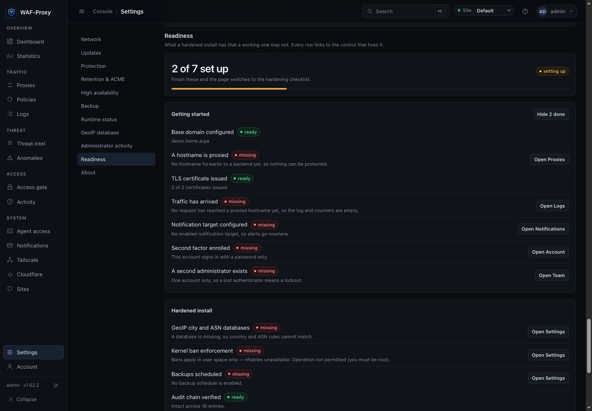

# Security policy

WAF-Proxy terminates TLS, inspects traffic and runs a privileged update helper on the host it
protects. A bug here can expose every site behind it, so reports are welcome and are taken
seriously even when the project is small.

## Supported versions

Only the newest minor release receives security fixes. Fixes are shipped as a patch release of
that minor; older minors are not back-patched, because the fixes so far have touched the database
schema and the unit files.

| Version | Supported |
|---|---|
| 1.57.x | Yes |
| 1.54.x and older | No — upgrade first (`deploy/install.sh`, or the Update button) |

The version you run is shown on **Updates** and in `GET /api/health`. If a report only
reproduces on an unsupported version, the first step is to confirm it on the newest release.

## Security fixes delivered

These are the fixes since the 1.16 review, newest first. Each has a matching CHANGELOG section.

- **1.28.0** — Manual JSON and YAML downloads can be encrypted under the backup passphrase; a
  passphrase shorter than 16 characters is refused. The console sends file bytes unchanged, so a
  sealed file round-trips through import without text decoding.
- **1.27.0** — YAML configuration references profiles, lists and hosts by name instead of the
  exporting install's numeric ids, so a restored file cannot be linked to an unrelated row.
  Empty exported settings are ignored instead of reported as validation errors.
- **1.26.0** — Scheduled backups are sealed with AES-256-GCM under a scrypt-derived key, the
  passphrase is stored sealed, and restores require it. YAML import resolves access-profile
  references by name and reports an unknown target instead of guessing one.
- **1.25.0** — Agent tokens are scoped per MCP tool (replacing the coarse group scopes), the
  gateway refuses tools outside the token's set, and the audit hash is anchored in settings so
  truncating the newest rows is detected.
- **1.24.0** — `/metrics` requires a 32+ character bearer token and is closed when the variable is
  unset; the audit table gains a SHA-256 chain and a full CSV export.
- **1.22.0** — Remote threat feeds can no longer inject private, loopback, link-local, multicast
  or unspecified addresses into the ban engine; skipped entries are counted.
- **1.21.0** — `/api/setup/status` stops disclosing the base domain, listener addresses,
  interfaces and kernel-ban state once an administrator exists. The bot-challenge cookie is bound
  to the client network (IPv4 exactly, IPv6 within its /64).
- **1.20.0** — Administrator accounts and roles (RBAC) with per-area grants; an admin source
  allowlist enforced at sign-in and on every API call, refusing a change that would exclude the
  caller. The last administrator cannot be demoted or deleted.

## Reporting a vulnerability

**Do not open a public issue, discussion or pull request for a security problem.** A public
report is a working exploit for every deployment that has not updated yet.

Use GitHub's private vulnerability reporting on this repository:

<https://github.com/kenhermesagent-lab/WAF-Proxy/security/advisories/new>

That opens a private advisory visible only to the maintainer. If the form is unavailable, open a
public issue that says only "I have a security report, please enable private reporting" — with no
details — and wait for a private channel.

Please include:

- the version (`VERSION`, or `GET /api/health`), the deployment (native systemd, Compose, bare
  binary) and the host OS;
- what an attacker gains, and what they need first (no session, an admin session, a LAN
  position, access to a backup);
- the smallest reproduction: a request, a config, or a test, with the exact bytes where they
  matter;
- whether the issue is already public anywhere.

Do not send real credentials, session cookies, private keys or a copy of your `wafproxy.db`. A
synthetic reproduction is enough, and anything you paste into the advisory stays private but is
still stored by a third party.

## What happens next

These are targets for a volunteer maintainer, not a commercial SLA. If a fix will take longer,
you will be told rather than left waiting.

| Step | Target |
|---|---|
| Acknowledgement that the report arrived | 3 business days |
| Triage: severity, affected versions, whether it is in scope | 10 business days |
| Fix or mitigation for critical and high severity | 30 days from triage |
| Fix for medium severity | 90 days from triage |
| Low severity and hardening | next scheduled release |

Severity follows impact × reachability for a realistic deployment (a home lab or a small LAN,
usually reachable from the internet on 443). "Requires a compromised admin session" is still a
valid report — the console is the highest-value target — but it is rated lower than a
pre-authentication bug, and turning an admin session into root through the update helper is
documented design, not a vulnerability.

## Disclosure

You get credit in the advisory and the CHANGELOG entry unless you ask not to. The advisory is
published with the fix, and no later than 90 days after the report, whichever comes first. If a
fix is not ready at 90 days, the issue is disclosed with the mitigation that exists (a config
change, a disabled feature, a firewall rule) rather than kept secret indefinitely.

## Scope

In scope:

- the proxy pipeline: TLS, routing, request/response handling, the WAF, the ban engine, the
  access gate, streaming forwarders;
- the admin API and console: authentication, TOTP, sessions, CSRF, authorization on every route;
- the update helper (`wafproxy-updated`), `deploy/*.sh`, the unit files and the container image;
- the MCP agent gateway and its tokens;
- anything that lets an unauthenticated client reach the console, read another user's data, or
  bypass a block the operator configured.

Out of scope:

- a report that requires the admin credentials or an admin session, with no privilege escalation
  beyond what that session already allows (the docs say plainly what an admin can do);
- self-XSS, missing security headers on a site you configured yourself, or a WAF rule that does
  not block a payload in your own application — that is tuning, not a vulnerability; use the
  per-site exceptions;
- denial of service by volume that any proxy would suffer (the request budget and rate limits are
  documented, as are their limits);
- vulnerabilities in third-party dependencies with no exploitable path here (report them
  upstream; CI runs `go vet`, the race test suite and `npm audit --omit=dev`, so the advisory
  feeds are worth checking yourself for the Go modules);
- the fact that decoy paths ban permanently, or that a permanent ban is absolute — both are
  documented behaviour;
- findings from an automated scanner with no demonstrated impact.

## Hardening the deployment

*The **Readiness** page scores the deployment and links every gap to the control that closes it.*

`README.md` → **Security model and limitations** lists the deliberate trade-offs: the console is
plain HTTP on the LAN, secrets are sealed under `master.key` in the data directory, the update
helper installs code as root from a checkout you recorded, and streaming ports are a byte relay
rather than an inspected proxy. Set a response ceiling and an admin allowlist on profiles for
applications you expose (the presets fill in both), keep the login rate limit on so credential
stuffing is throttled here rather than at the application, and keep the metrics token set if the
console listener is reachable beyond the host. Read it before exposing anything beyond a trusted
network, and read `docs/INSTALL.md` → **Trusted proxies** if a tunnel or another proxy sits in
front of this host.

## Reviews and their scope

The last independent review covered **1.14.0** and produced the findings fixed in **1.16.0**
(webhook SSRF, session tokens at rest, unsafe container defaults, client address behind a
trusted proxy, queue and memory bounds, a racy test). Its report is summarised in the 1.16.0
CHANGELOG section; the document itself is not kept in the repository. The fixes delivered since
that review are listed under **Security fixes delivered** above; they were found and addressed in
normal development, not by an outside review.

The next review is scoped to the parts that review did not reach, in this order:

1. **Protocol framing and request smuggling** — `internal/proxy` header and path handling,
   `Upgrade`/`101` hop-by-hop behaviour, dot-segment canonicalisation as the upstream sees it.
   This is the class every proxy advisory of the last five years belongs to.
2. **The update path** — `wafproxy-updated`, the self-update script, the checkout ownership
   checks and the rollback, including what a compromised admin session can make it build.
3. **The admin API** — authorization on every route (not just authentication), CSRF coverage,
   and the MCP gateway's token scope.
4. **Deployment scripts** — `install.sh`, `uninstall.sh`, the Docker entrypoint, file ownership
   and permissions on the data directory.

Not in scope for that review: HTTP/3, HA, load behaviour, and the WAF rule set's coverage of
application-specific attacks. Those are tracked as product work, not review targets.
