# Admin configuration reference

Every knob the console exposes, what it changes, and where the change is enforced. Values in
**bold** are the defaults. Sections follow the sidebar, and the tables are named after the control
you see on screen.

Every picture below comes from the demo install these notes were checked against, so the sites,
bans and events in them are sample data.

For installing the service see [Installation](INSTALL.md); for day-to-day checks, recovery and
troubleshooting see the [operations runbook](OPERATIONS.md); for the wire API see
[openapi.yaml](openapi.yaml).

## Contents

- [How configuration is stored](#how-configuration-is-stored)
- [Setup wizard](#setup-wizard)
- [Settings](#settings)
- [Proxies](#proxies)
- [Streaming](#streaming)
- [Policies](#policies)
- [Sources and threat intel](#sources-and-threat-intel)
- [Signature bundles](#signature-bundles)
- [Logs](#logs)
- [Anomaly events](#anomaly-events)
- [Activity (audit log)](#activity-audit-log)
- [Access gate](#access-gate)
- [CrowdSec](#crowdsec)
- [Certificates](#certificates)
- [AI Agent Access](#ai-agent-access)
- [Notifications](#notifications)
- [Updates](#updates)
- [Tailscale](#tailscale)
- [Readiness](#readiness)
- [Sites](#sites)
- [High availability](#high-availability)
- [Account, administrators and roles](#account-administrators-and-roles)
- [Environment variables](#environment-variables)
- [Data directory and headless commands](#data-directory-and-headless-commands)
- [Configuration transport: YAML and backups](#configuration-transport-yaml-and-backups)

## How configuration is stored

Three kinds of configuration exist, and knowing which is which decides where you change it:

| Kind | Examples | Where it lives |
|---|---|---|
| Boot configuration | Data directory, console/WAN bind addresses, CrowdSec, metrics token | Environment variables (see [Environment variables](#environment-variables)) |
| Runtime configuration | Everything on the Settings, Proxies, Policies, Certificates pages | SQLite in the data directory, edited in the console |
| Secrets | DNS credentials, SMTP password, webhook URLs, gate secrets, TOTP secrets | Sealed with the master key (`master.key`) before being written to SQLite |

Listener addresses are the exception worth remembering: the wizard and **Settings → Network**
write them to the database, and they replace the environment values on the next start. The
environment values are only the first-boot fallback.

Only port **443/tcp** needs to be forwarded from the WAN. Port 80 is used only if you choose the
HTTP-01 certificate challenge.

## Setup wizard

Shown once, on the first unauthenticated start. Until an administrator exists, the setup endpoint
is open — which is why Compose binds the console to loopback by default.

| Field | What it does |
|---|---|
| Base domain | The DNS zone this install serves (`example.com`). Used for the default proxy hostname, certificate suggestions, and Tailscale split DNS. |
| Administrator name | The first account, created with the **Administrator** role. |
| Password | 12 characters minimum. |
| WAN address and port | The address the TLS listener binds, and the port for it (**443**). Must be an IP configured on this host. |
| LAN address | The address used to reach upstreams and to bind the console. On a single-NIC host this is the same IP as the WAN address. |
| Admin GUI port | The console port (**8443** here; the container's first-boot environment uses `8080`). |
| DuckDNS token (optional) | Stored sealed and used for DuckDNS DNS-01 certificates. |
| ACME email (optional) | Account email for Let's Encrypt registration. |

The wizard also seeds the initial protection settings listed under [Settings](#settings) and shows
the authenticator secret and ten recovery codes **once**. Store them before continuing.

Headless alternative: `wafproxy setup --password …` creates the first administrator without a
browser.

## Settings

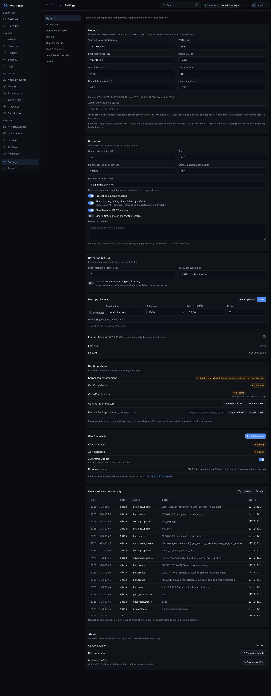

*Settings: network, protection, retention, backup and the GeoIP database. Sample data.*


**Settings** holds node-wide defaults. Saving reloads the policy engine, the body limit, the
stealth rules and the interface sampler without dropping connections. Bind-address changes take
effect after a restart.

### Network

| Field | What it does | Value |
|---|---|---|
| WAN address (443 listener) | Address the TLS/SNI listener binds. | An IP on this host; required |
| WAN port | Port for the proxy listener. | **443**, 1–65535 |
| LAN egress address | Source address used to reach upstreams and the console listener address. | An IP on this host; required |
| Admin GUI port | Console port. | **8443** (wizard), 1–65535 |
| WAN interface | Interface sampled for WAN throughput and used for stealth ICMP rules. Leave empty to auto-detect. | Interface name |
| LAN interface | Interface sampled for LAN throughput. Leave empty to auto-detect. | Interface name |
| Home latitude / longitude | Centre of the attack globe. | Decimal degrees, **51.5 / -0.12** |
| Admin allowlist (IPs / CIDRs) | When set, only these addresses may sign in or call the admin API; the console page itself still loads unless `WAFPROXY_GUI_PRIVATE_ONLY` blocks the listener. Empty allows any address. A save that would exclude your current address is refused. | Comma-separated IPs/CIDRs |

A single-NIC host enters the same address for WAN and LAN and firewalls the GUI port from the WAN
side. Both addresses are required — an empty bind address would put the console on every
interface.

### Protection

Applied before per-site profiles.

| Field | What it does | Value |
|---|---|---|
| Protection pipeline enabled | Gates the global bot-filter check in the request pipeline. Bans, lists, country/ASN rules, decoy names, feeds, rate limits, the access gate and the WAF keep running while it is off. | On |
| Global rate limit (rps/IP) | Per-address request rate allowed before the rate-limit stage refuses. | **100**, positive |
| Burst | Burst allowance above the rate. | **200**, positive |
| Max inspected body (bytes) | Hard ceiling on a request body. A larger body is refused with 413 before the WAF runs and logged with the `body-limit` stage; it is never forwarded uninspected. | **131072** (128 KiB), 1 KiB–8 MiB |
| Sample allowed above (rps) | Above this global request rate, allowed requests are sampled rather than each written as an event, so the event table stays small. | **500**, positive |
| Queue wait (ms) | Per site: how long a request waits for a free request slot before it is refused with a 503. `0` refuses at once, which is what a release before 1.61 did. | **250**, 0–5000 |
| Body deadline (s) | Per site: how long a client may take to send its body. A trickled upload is cut with `408` and logged with the `body-timeout` rule, so it cannot hold a request slot. The deadline is cleared before the request is forwarded, so it never limits an upstream response. `0` disables it. | **30**, 0–3600 |
| Request normalization | Action on malformed encodings (duplicate parameters, double encoding): **off**, **flag** (log only), or **block**. Only applies while the WAF stage runs. | **flag** |
| Block hosting / VPS / cloud ASNs | Blocks traffic from hosting-provider ASNs by default. Needs the ASN database; reported as unavailable and skipped without it. | On |
| Stealth mode (DROP, no reset) | Refused connections are dropped instead of answered with a reset. | On |
| Ignore ICMP echo on the WAN interface | Drops ICMP echo on the configured WAN interface. | Off |
| Decoy hostnames | Requests for these names never reach a proxy and **permanently ban** the source. Comma-separated. A name that matches an active proxy is refused. | Empty |

### Retention & ACME

| Field | What it does | Value |
|---|---|---|
| Event retention (days) | How long request events are kept: the hourly maintenance pass deletes older rows, and the analytics window follows it. Anomaly events and the audit log are not pruned by this setting. | **7**, 1–30 |
| ACME account email | Let's Encrypt account contact. | Email |
| Use the Let's Encrypt staging directory | Issues untrusted certificates for testing. Switch off before going live. | Off |

### High availability

| Control | What it does |
|---|---|
| Enable high availability | Host-wide switch (**off** by default). The first enable restarts the service so the HA listeners bind; a banner says so until the console reconnects. Turning it off on a paired active asks for the cluster id to be typed; a paired standby refuses until it is promoted or unpaired. |
| High availability page | Status, pairing and moves live on the [High availability page](#high-availability); this section only holds the switch. |

Only the **default** site's console shows this section, and the switch is one of the host-wide
settings the API refuses on another site's console.

### Backup

The **Backup schedule** card writes a JSON document (settings, profiles, lists, proxies, policies —
no secrets, certificates or bans) to a destination, then prunes older files.

| Field | What it does | Value |
|---|---|---|
| scheduled | Enables the schedule. | Off |
| Destination | **Local directory**, **Git repository**, **SFTP (over SSH)** or **FTP (unencrypted)**. | local |
| Schedule / Day / Time | Daily or weekly, weekday when weekly, and the run time in 24-hour `HH:MM`. | daily, **03:00** |
| Keep | Number of scheduled archives retained. A weekly schedule with 52 keeps a year of copies. | 1–365 |
| Daily copies | A second copy every day, written as `wafproxy-daily-*.json`. Off leaves only the schedule above. | Off |
| Daily time / Daily copies to keep | Run time for the daily tier (defaults to Time) and how many dailies it retains, counted independently of Keep. | 03:00, 1–365 |
| Directory | Absolute path on this host (local transport). | — |
| Git working directory, remote, branch | Repository to commit into and optionally push from. | — |
| Host / Port / User / Password / Remote directory | Remote target for SFTP and FTP. FTP sends credentials in clear text. | — |
| SSH host key fingerprint | SHA-256 fingerprint of the SFTP host key, pinned. Required for SFTP. | — |
| Encrypt backups | Seals the archive with AES-256-GCM; restoring needs the same passphrase. | Off |
| Passphrase | 16+ characters. Losing it makes the files unrecoverable. | — |

Every file is a complete export that restores on its own; there is no diff chain to rebuild. The two
tiers prune separately by file name, so an expired daily copy never deletes a weekly one. When the
weekly and daily times fall in the same minute the daily run waits for the weekly one to finish, so
both files land; a scheduled run that fails is retried until it succeeds, for up to fifteen minutes.
If a destination refuses the directory listing or a delete, the copy is still reported as written and
the prune failure is only logged, so a good upload never reads as a broken backup. Retention applies to the local, git, SFTP and FTP destinations.

**Back up now** writes one scheduled copy immediately. Status shows the scheduled tier's last run,
file, target and next run, the daily tier's own last and next run, and the last error; each tier
reports separately, so one file is never named twice.

### Runtime status

Read-only. Kernel ban enforcement (`active` or the reason it is unavailable), GeoIP loaded or not,
CrowdSec bouncer state and last poll, and the two configuration downloads. There is nothing to
configure here.

### GeoIP database

| Control | What it does |
|---|---|
| Install / Update database | Downloads the free DB-IP Lite city and ASN databases, validates them and swaps them in without a restart. |
| City / ASN badges | Whether each database is loaded, with its update time. |
| Automatic update | Refreshes both databases daily when one is installed (**on**). |

Without a database, country and ASN rules report "unavailable" and are skipped rather than
pretending to be active. DB-IP Lite is CC BY 4.0.

### Administrator activity

The newest 20 audit entries (time, user, action, detail, source). **Verify chain** checks the
SHA-256 hash chain and the anchored head; **Refresh** reloads. The full log, diffs and rollback are
on the **Activity** page.

### About

Console version, a link to the operations guide, and an optional tip link.

### Settings that are not in the console

A few stored settings are read by the engine and are settable through `PUT /api/settings` or the
YAML transport, but have no field on the Settings page:

| Key | Effect | Default |
|---|---|---|
| `gate_ttl_hours` | Lifetime of an access-gate visitor session, 1–720 hours. Read once a minute, so a change takes effect without a restart. | **12** |

## Proxies

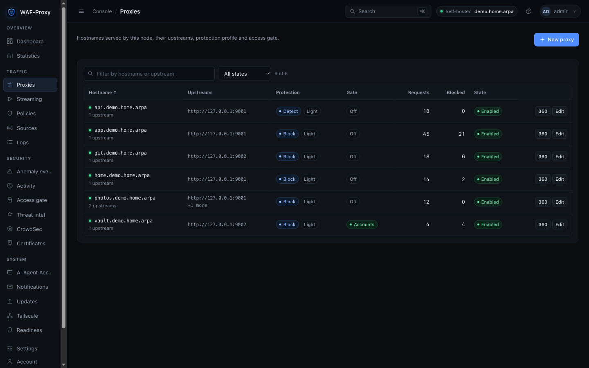

*Proxies: hostnames, upstream health and the per-site protection settings. Sample data.*


A proxy is one hostname: certificate, upstream pool, protection, optional access gate, and routes.
The list can be filtered by hostname/upstream and by state (enabled, disabled, maintenance), and
sorted by hostname, requests or blocks. **360** opens the site's traffic, health and configuration
summary.

### Overview tab

| Field | What it does |
|---|---|
| Application preset | Only when creating. Fills in a WAF profile tailored to the application; it creates an editable profile, it is not a locked mode. |
| Hostname | The SNI name clients request. Must be covered by the certificate. |
| Access profile | One choice that carries the site's lists, WAF profile and protection profile. Selecting one clears both per-site overrides; the protection override has no field here and is API-only. |
| WAF profile | Per-site override of the access profile's WAF profile. |
| Certificate | Auto/default, or a specific certificate from the inventory. |
| Proxy enabled | Disabled proxies answer 503 and keep their configuration. |
| Maintenance mode | Answers 503 with a maintenance page and `Retry-After: 300` while the upstream is worked on. |

### Upstreams tab

| Field | What it does | Value |
|---|---|---|
| Upstream URL | Backend origin, e.g. `http://10.0.0.10:8080`. | scheme://host:port |
| Weight | Relative share when balancing by weight; 0 or negative becomes 1. | 1+ |
| Add / remove upstream | One or more backends; healthy ones are chosen per request. | — |

Health probes send an HTTP `GET` to `/` every 10 seconds by default. An upstream is ejected after
three consecutive failures and gets a single half-open probe once 1.5× the interval has passed.
These per-site values are editable through the API/YAML (see
[Advanced per-site settings](#advanced-per-site-settings-api-and-yaml)).

### Protection tab

| Field | What it does | Values |
|---|---|---|
| WAF mode | **Inherit profile**, **Off**, **Detect only** (log, never block), **Block**. | inherit |
| Bot protection | Proof-of-work challenge level: **Off**, **Light**, **Standard**, **Aggressive**. Separate from the global bot filter. | light |
| Fingerprint mode | **Strict** or **Minimal** client fingerprinting for challenge decisions. | strict |

### Access gate tab

| Field | What it does |
|---|---|
| Gate mode | **Off**, **Shared passphrase**, **Accounts**, **Accounts + TOTP**, or **Identity provider (forward-auth)**. |
| Provider | The identity provider to delegate to, when forward-auth is selected. |
| Passphrase | New shared passphrase. Blank keeps the stored one. |
| Allowed accounts | Comma-separated gate usernames allowed on this site; empty allows every gate account. |
| Sign out visitors | Revokes every live gate session for this hostname (shown for existing proxies). |

The login page is served by the proxy on the site's own hostname, so nothing reaches the backend
before sign-in except health-check paths (`/healthz`, `/health`, `__health`) and ACME challenges.
A session is tied to the site and the account: it ends at `gate_ttl_hours` (**12 h**), when the
account is blocked, when its password is changed, or when visitors are signed out for the site.

### Routes tab

| Field | What it does |
|---|---|
| Kind | **redirect** or **alias**. |
| Match | Path prefix (or regex, see below) to match. |
| Target | Redirect destination or alias target. |

The drawer edits kind, match and target. Through the API/YAML a route also supports: `strip_prefix`
(remove the matched prefix before forwarding), `priority` (higher wins), `method`, `header`
(`Name: value`), `query` (`name=value`) and `regex` matchers (all non-empty matchers must agree),
`upstream` (override the site's pool for this route), `timeout` (seconds) and `status` (301, 307 or
308 for redirects).

### Advanced per-site settings (API and YAML)

These fields exist on the proxy record and in the YAML export, and apply to every upstream of the
site unless the upstream overrides them. They are not all exposed in the drawer.

| Field | Effect | Default |
|---|---|---|
| `lb_policy` | `weighted_rr`, `least_conn`, `least_latency`, `ip_hash`, `sticky_cookie`. | weighted_rr |
| `health_path` | Path probed for health. | `/` |
| `health_expect` | Accepted status: `200`, a range like `200-399`, or a comma-separated list; each value 100–599. | `200-399` |
| `health_interval` | Seconds between probes, 0–3600; 0 uses 10. | 10 |
| `health_fail_after` | Consecutive failures before passive ejection, 0–20; 0 uses 3. | 3 |
| `max_inflight` | Concurrent requests served for this site, 0–100000; 0 inherits the process budget. | 0 |
| `max_inflight_per_client` | Concurrent requests per client address, 0–10000; 0 inherits. | 0 |
| `upstream_timeout` | Whole upstream exchange in seconds, 0–3600; 0 keeps the transport default. | 0 |
| `retries` | Retries for idempotent requests only, 0–5. | 0 |
| `tls_min_version` | **1.2** or 1.3 for this site. | 1.2 |
| `request_headers` / `response_headers` | Ordered header rewrites: `{action: set|add|remove, name, value}`. | empty |
| upstream `max_conns` | Concurrent requests to one upstream; 0 or negative is uncapped. | 0 |
| upstream `enabled` | Takes an upstream out of rotation without deleting it. | true |

### Application presets

Presets create an editable WAF profile; they do not lock the site into a mode. The catalogue is:
Nextcloud, Jellyfin, Plex Media Server, Home Assistant, Proxmox VE, Vaultwarden, Gitea / Forgejo,
Paperless-ngx, Grafana, Uptime Kuma, Mealie, Navidrome, PhotoPrism, Syncthing, n8n, BookStack,
Cal.com, the \*arr suite (Sonarr, Radarr, Lidarr, Readarr, Prowlarr) and Generic web application.

## Streaming

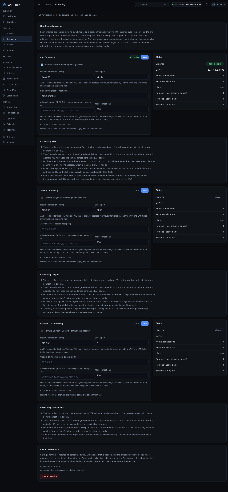

*Streaming: sample data from a 1.60 install. Since 1.63.0 the cards are grouped into media, game
and custom, and each carries a protocol and a port range; since 1.65.0 a tab per service sits under
the page tabs and shows one forwarder at a time. The table below is current.*


Streaming forwarders relay a service byte for byte instead of proxying HTTP: a TCP stream carries
TLS end to end, and UDP is relayed one session per client source over a connected upstream socket.
The payload cannot be inspected, so the WAF and access gate never see it — but the source allow
list, named lists, connection and session caps, the new-session rate limit and the ban engine still
apply, and a running stream is cut when a ban lands (a UDP session is cut on its next datagram).

The catalog is grouped into **Media** (Plex, Jellyfin), **Game** (twelve presets) and **Custom**. A
preset seeds the protocol, port range and note and stays fully editable; enabling a game card does
not lock its values. The tab strip under the page tabs lists every service in that order, marks the
enabled ones with a dot, and shows only the selected card with its status and connecting guide.

Saving an enabled forwarder also opens its listen range on the host firewall when the tools are
reachable: firewalld gets `--permanent --add-port=<range>/<proto>` followed by `--reload`, ufw gets
`allow <range>/<proto>` (its ranges use a colon). The console records the ports it opened, so
moving the card to another port or switching it off closes exactly those rules and leaves an
operator's own rules alone. A container with `network_mode: host` shares the host's rules. When
neither tool is running, or the process may not change the rules, the save still succeeds and the
Status card names the range to open by hand. SELinux needs no label while the service runs
unconfined, which is what the shipped unit and image do; a confined policy needs
`semanage port -a` for the range itself.

| Field | What it does | Value |
|---|---|---|
| Forward … through this gateway | Enables the listener or listeners. | Off |
| Listen address (this host) | IP on this host the listener binds; required when the forwarder is enabled. | IP |
| Protocol | `tcp`, `udp` or `both`. `both` binds a TCP listener and a UDP socket on the same number and reports bound only when both are. | preset default, otherwise `tcp` |
| Listen port | Base port the router forwards. | Plex **32400**, Jellyfin **8096**, game presets per their table, Custom TCP has none and must be set |
| Port count | Consecutive ports, 1–16, mapped 1:1 onto the upstream: `2456` with count `3` forwards 2456–2458. A range that would run past 65535 on either side is refused with the port named. | 1 |
| Server | The application's address (`host`, `host:port` or a URL); required. | — |
| Upstream port | Base port on the server when it differs from the listen port; the listen range maps onto it. Empty uses the port in **Server**. | — |
| Allowed sources | IPs/CIDRs allowed to connect; empty allows any. | Empty |
| Refuse sources that are not on an allow list | UDP only. Refuses every session whose source is not on **Allowed sources**; a UDP listen port below 1024 requires it. With no list attached it refuses everyone. | Off |
| Max connections | Concurrent TCP connections **or** UDP sessions for this card, 1–4096; 0 uses **256**. | 256 |
| Max sessions per source | UDP sessions one source address may hold on this card, 1–4096. | 8 |
| UDP idle timeout | Seconds without traffic before a UDP session is closed and its socket released, 10–3600. TCP keeps the 30-minute media window. | 60 |
| Max datagram | Largest datagram carried in either direction, 576–8192. A larger one is dropped and counted, never truncated and forwarded. | 1500 |
| Blocklists and whitelists | Named lists attached to this forwarder. A whitelist restricts the port to its entries plus the allow list; a blocklist wins when both name an address. Country entries need GeoIP. | none |

UDP cannot be a reflector: the amplification ports (DNS `53`, NTP `123`, SNMP `161`, CLDAP `389`,
SSDP `1900`, mDNS `5353`, memcached `11211`) refuse UDP outright, a UDP port below `1024` needs the
allow switch plus at least one allowed source, one address may open at most ten new sessions a
second (burst thirty), and an oversized datagram is dropped instead of forwarded.

Status reports the bound address, upstream, sessions per protocol, bytes and packets each way,
oversize drops, refusals by reason (ban, list, allow, cap), streams cut by ban, the fifty newest
sessions (with their last-seen time) ranked by traffic, and the last error; the card refreshes
every three seconds while the tab is visible. Saving rebinds immediately; restart only after changing bind
addresses. Each card includes its own router and application-side steps (Plex allow-without-auth
list, Jellyfin known proxies).

## Policies

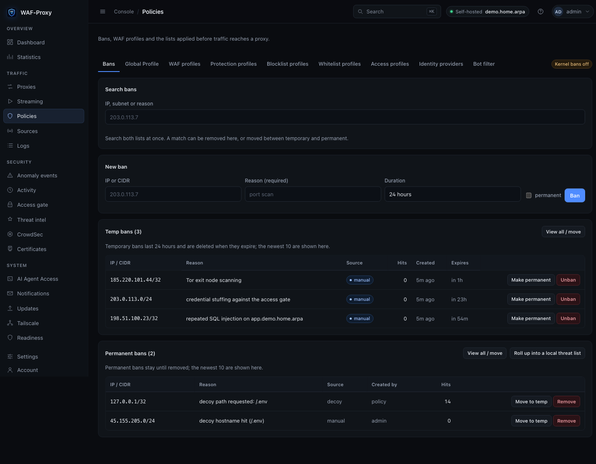

*Policies: bans, the global profile, WAF and protection profiles, lists. Sample data.*


Policies decide what happens before traffic reaches a proxy. The page is tabbed.

### Bans

| Control | What it does |
|---|---|
| Search bans | Matches temporary and permanent bans by IP, subnet or reason. |
| New ban | IP or CIDR, **reason (required)**, temporary (**24 hours**) or permanent. A temporary ban is capped at 24 hours; the API refuses a longer TTL. |
| Temp bans | Newest 10. Expired rows are deleted. The API returns at most 1000 rows and 200 when no limit is asked for. |
| Permanent bans | Newest 10. Lasts until removed. |
| Make permanent / Move to temp | Moves a ban between tables; moving to temporary gives it 24 hours from now. |
| View all / move | Two-panel bulk editor: tick rows (Ctrl-click, drag a range) or drag an address across, then apply. |
| Roll up into a local threat list | Folds permanent bans into a local always-block feed so the ban table stays small; they stay blocked through the list. |

Ban sources are recorded: `manual`, `scan`, `waf`, `bot`, `crowdsec`, `feed`, `decoy`, `gate`,
`mcp`.

### Global Profile

Adds rules that apply to every proxy, or to one proxy.

| Field | What it does |
|---|---|
| Type | **IP / Subnet**, **Country**, **ASN**, **Decoy paths (instant ban)** or **Rate limit (rps/burst)**. |
| Value | An IP/CIDR, an ISO-3166 alpha-2 country, ASN numbers, comma-separated paths, or `requests-per-second/burst`. |
| Action | **Allow** or **Block** for IP and country rules (the stored kind records which). |
| Scope | **Global — every proxy** or **One proxy**. |
| Preflight | Replays the last 24 hours against the rule and reports how many requests and addresses match, what would be blocked or allowed, plus sample rows. It changes nothing. |
| Add | Saves the rule. |

Semantics worth knowing: a country **allow** list is exclusive — every other country is refused,
though an explicit IP allow still wins; ASN rules block entire networks; decoy paths trigger an
immediate permanent ban, so list only paths no legitimate visitor requests; the policy table shows
each rule's state and lets you disable or delete it.

**Global profiles** attaches named whitelists and blocklists to every proxy.

**ASN recommendations** suggests hosting/VPS/cloud ASNs that can be blocked in one click.

### WAF profiles

OWASP CRS settings through Coraza. Changes reload the WAF without dropping connections.

| Field | What it does | Default |
|---|---|---|
| Profile name | 1–64 characters, unique; fixed after creation. | — |
| Mode | **Block**, **Detect only** or **Off**; a site set to `inherit` adopts this mode. | block |
| Upstream responses | Inspect responses: **off**, **flag** or **block**. Off by default because it delays the first byte by up to one buffer. | off |
| Paranoia level (1–4) | CRS paranoia, 1–4; an out-of-range value keeps 1. 3–4 is strict enough to block some legitimate apps. | 1 |
| Anomaly threshold | Score at which a request is refused (or flagged in detect mode), 1–100. | 5 |
| Allowed HTTP methods | Method allowlist, comma separated. | GET,HEAD,POST,PUT,PATCH,DELETE,OPTIONS |
| Maximum inspected body (bytes) | Per-profile body limit, 1 KiB–8 MiB. A body above it is rejected by the WAF transaction (rule 200004), never forwarded uninspected. | 131072 |
| Disabled CRS rule IDs | Removes specific CRS rules for this profile only, comma separated. | empty |
| Signature bundle rules | Per installed bundle: **Off**, **Log only** or **Block** on this profile. No choice means log only; CRS rules keep following Mode above. | log |
| Upstream response ceiling (bytes) | Cuts an oversized response instead of streaming it unbounded; 0–4 GiB, 0 is unlimited. | 0 |
| Login paths / rate / burst | Path prefixes that take credentials, with their own token bucket so credential stuffing is throttled before it reaches the app. Listing paths requires a non-zero rate; rate 0–1000 and burst 0–10000. | empty / 0 / 0 |
| Admin paths / admin allowlist | Path prefixes only the listed CIDRs may reach. An empty allowlist leaves the rule off. | empty |

Built-in profiles: **Generic Web** (P1/A5), **WordPress** (P2/A5), **API-only** (P2/A3),
**Static / CDN** (P1/A3), **Admin panel (strict)** (P3/A3). They are editable and cannot be
deleted.

### Protection profiles

Response-hardening headers applied to every response, after the upstream's own.

| Field | What it does | Default |
|---|---|---|
| Redirect HTTP to HTTPS | Redirects a plain-HTTP request before the WAF runs. | On |
| Send HSTS | Sends `Strict-Transport-Security` over TLS only. | On |
| HSTS covers subdomains | Adds `includeSubDomains`. | On |
| Frame policy | `SAMEORIGIN`, `DENY` or off for `X-Frame-Options`. | SAMEORIGIN |
| X-Content-Type-Options: nosniff | Sets `nosniff`. | On |
| Hide server banners | Removes `Server`/`X-Powered-By` style banners. | On |
| Referrer policy | One of the eight standard `Referrer-Policy` values. | strict-origin-when-cross-origin |
| Content-Security-Policy | Optional CSP value. | empty |
| Permissions-Policy | Optional value, e.g. `camera=(), microphone=()`. | empty |

The built-in profile is **Recommended hardening**. **Check a site** fetches a chosen proxy's
backend and compares its own headers with the profile, flagging where the profile is redundant or
actively weakening the application (for example, framing protection deleting the app's own
`X-Frame-Options`).

### Blocklist profiles / Whitelist profiles

Named sets of IPs/CIDRs and countries, attachable as a whole to access profiles and streaming
forwarders.

| Field | What it does |
|---|---|
| Kind | **blocklist** or **whitelist** (fixed by the tab). |
| Name | Label used everywhere the list is attached. |
| IP addresses and CIDRs | One per line, with an Add button. |
| Countries | Country picker; ISO-3166 alpha-2 entries. |

A blocklist refuses its entries for every host that attaches it. A whitelist makes that host
reachable only from its entries (and the host's allow list). The deciding list is named in the
event log.

### Access profiles

One profile per site bundles lists, WAF and protection so creating a host means one choice.

| Field | What it does |
|---|---|
| Profile name | Label; fixed after creation. |
| Lists | For each global IP/country/ASN/decoy/rate rule: **Not in this profile**, **Allow only these**, **Block these**, or **Use the list's own type**. A profile deny blocks even when a global allow names the address; a profile allow narrows the host. |
| Blocklists and whitelists | Named lists attached to the profile. |
| WAF profile | WAF profile to apply, or inherit the default. |
| Protection profile | Response-hardening profile, or none. |

### Identity providers

Forward-auth endpoints for the access gate's **Identity provider** mode.

| Field | What it does |
|---|---|
| Name | Label shown in the proxy's provider list. |
| Product | **Authelia**, **authentik** or **generic**. |
| Verify URL | Endpoint the proxy calls, e.g. `http://authelia:9091/api/verify`. A 2xx means authenticated. |
| Login URL | Portal an unauthenticated visitor is sent to. |
| Secret header | Header carrying the shared secret between proxy and provider. |
| Secret | The shared secret itself, sealed at rest and write-only. |

### Bot filter

| Field | What it does |
|---|---|
| Mode | **Off** (only the per-proxy challenge runs), **Block known scrapers** (SEO, marketing and AI-training crawlers; search engines and social previews kept), **Block scrapers and any declared bot** (adds empty user agents and unlisted agents calling themselves bot/spider/crawler). |
| Always allow | Comma-separated user-agent fragments exempt from both modes. Default suggestions: **Googlebot, Bingbot, DuckDuckBot, Applebot**. |

A refused request is recorded with the `bot-filter` stage. This is separate from the per-proxy
proof-of-work challenge: the filter refuses automation outright, the challenge makes a browser solve
a puzzle.

## Sources and threat intel

### Sources

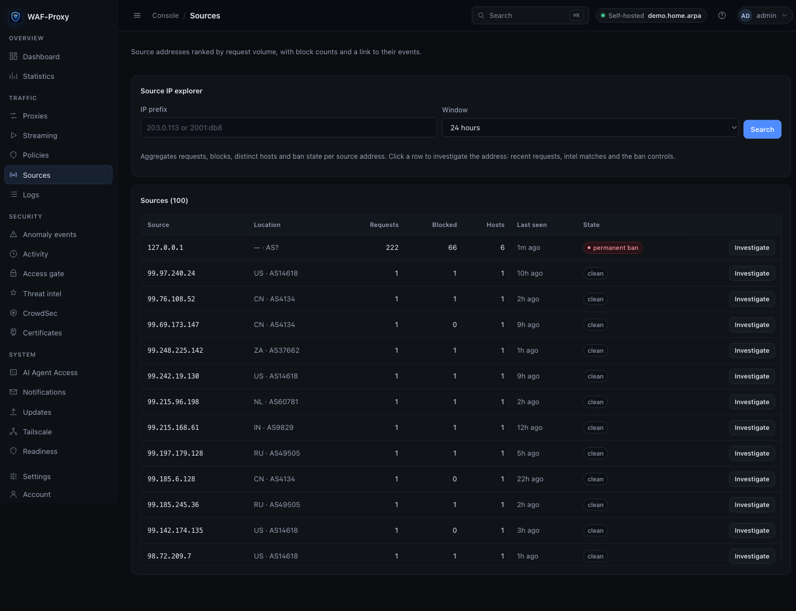

*Sources: threat feeds, local lists and per-address investigation. Sample data.*


The source explorer aggregates requests, blocks, distinct hosts and ban state per client address for
1 hour, 24 hours, 7 days or 30 days, optionally filtered by IP prefix. Clicking a row opens the
source drawer: totals for 1 h/24 h/7 d/30 d, block share, hosts, first/last seen, intel matches,
recent requests and ban state. Administrators with `policies.write` can ban for 24 hours with a
reason or release a ban; the drawer is read-only for other roles.

### Threat intel

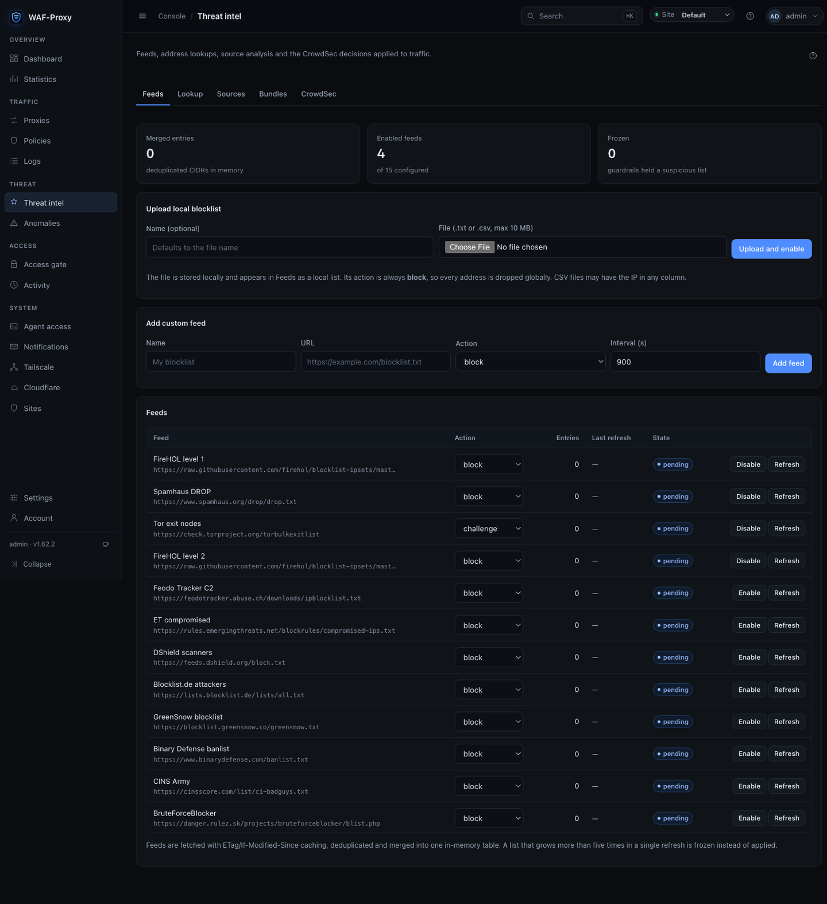

*Threat intel: feed health, entries and the intel rollup. Sample data.*


| Control | What it does |
|---|---|
| Check an address | Looks up one IP against local feeds, bans and GeoIP/ASN data. |
| Upload local blocklist | Uploads a `.txt` or `.csv` (max 10 MB) as a local feed. Uploaded lists are always blocks. To replace one, delete it and upload again. |
| Add custom feed | Name, URL, **action** (block, challenge, log) and **interval** in seconds (default 900). |
| Feeds table | State (`ok`, `frozen`, `error`, `pending`), entry count, last fetch, action selector, enable toggle, refresh, delete. |
| CrowdSec console blocklists | Blocklists delivered by a CrowdSec console enrolment. |

Built-in keyless feeds (FireHOL levels 1–2, Spamhaus DROP and DROP IPv6, Tor exit nodes, Feodo
Tracker C2, ET compromised, ET firewall block list, DShield scanners, Blocklist.de, GreenSnow,
Binary Defense, CINS Army, BruteForceBlocker, IPSum level 3) are seeded once. FireHOL level 1,
Spamhaus DROP and Tor exit nodes (challenge) start enabled; the rest start disabled, so an upgrade
never starts blocking new ranges on its own. A feed with over 1000 entries that suddenly grows more
than fivefold is frozen instead of applied; this raises no notification and appears as `frozen` on
the Dashboard and the Intel page. Feeds marked `always_block` are enforced before
allow lists and no whitelist overrides them; the permanent-ban rollup writes one.

## Signature bundles

A bundle channel delivers attack-signature rule packs between releases from an ed25519-signed
manifest. The bundled OWASP CRS only changes with a release; a bundle fills that gap without
becoming a rule editor. Any number of providers can be configured; each has its own manifest URL,
publisher key, refresh sequence and error state, and each is checked and downloaded on its own, so
one unreachable publisher cannot hold up the others.

- Packs carry **rules only**. A bundle can add a signature, never ban an address; IP and CIDR
  lists stay in [Threat intel feeds](#sources-and-threat-intel).
- Rules occupy the reserved range `990000–999999`, above every CRS v4 rule, and count against the
  per-profile exception cap, so one signature can be disabled with a rule exception.
- A pack is installed only after its signature, SHA-256, advertised size and a throwaway compile
  pass. The previous pack stays on disk as the last known good copy and the swap is atomic. The
  manifest's `sequence` must increase, so a mirror cannot roll the channel back.
- A refresh reads the manifest only; a pack is downloaded only when its version changes.
- A bundle's action is **off, log only or block per WAF profile**. A new pack starts in log only,
  and a site whose own WAF mode is `detect` keeps logging even when its profile allows block. The
  console can also switch a whole pack off: it keeps its files and version but contributes no rules.

Three **known good packs** ship inside the binary and are validated at startup: `secret-probes`,
`exploit-payloads` and `scanner-tools`. They start switched off and need no provider; enabling one
in the console adds its rules to every profile, where the profile mode still decides log or block.

List providers in `WAFPROXY_BUNDLE_PROVIDERS` (see [Environment variables](#environment-variables)),
a JSON array of `{"name", "url", "public_key"}`; `WAFPROXY_BUNDLE_INTERVAL` (**3600** seconds, never
less than five minutes) applies to all of them. The original single-channel pair
`WAFPROXY_BUNDLE_URL` and `WAFPROXY_BUNDLE_PUBKEY` still works and becomes the provider named
`default`. A provider without both halves is listed in the console as **no channel** and never
fetched, and with no providers at all whatever packs are already installed keep serving.

Providers can also be added from the console (name, manifest URL and publisher public key). That
list lives in the `bundle_providers` settings row and replaces the environment list once the first
one is saved, so the same install can be managed entirely from the browser.

A bundle name belongs to the provider that installed it: profiles switch a bundle by name, so a
second publisher advertising the same name is refused with an error naming the owner.

### Threat intel → Signature bundles

| Control | What it does |
|---|---|
| Status badge | **signed channel** when at least one provider has a URL and key, otherwise **no channel**. |
| Known good bundles | The three shipped packs with version, rule count and a state badge, each with **Enable**/**Disable**. |
| Check all | Fetches every provider's manifest immediately instead of waiting for the next interval. |
| Provider row | Name, manifest URL, publisher key ID, sequence and the last and next check times, with its own **Check** button and **Remove**. |
| Provider form | Name, manifest URL and publisher public key; saving a name that exists replaces its URL and key. |
| Bundle table | Installed packs with provider, version, rule count, install time, modes across profiles and an **Enable**/**Disable** button. |
| Error banner | The last error for that provider (signature, checksum, compile or fetch), when there is one. |

**Bundle hits** lists the rules that matched in the last 24 hours: rule ID, bundle and version,
what it matched, hit count, distinct addresses, last seen, and whether today's matches were
blocked, logged or off. When every match was only logged, a banner links straight to
**Policies → WAF profiles** to set the mode. A hit proves a rule matched, not that the request was
hostile, and the counts follow the event retention window and sampling setting.

### Publishing a channel

```
go run ./cmd/bundletool keygen -out publisher.key
go run ./cmd/bundletool sign -dir packs -seq 42 -key publisher.key -base /stable/packs -out manifest.json
```

The tool validates and compiles every rule before signing, so the channel cannot ship a pack the
service will reject. Without a URL and key the channel stays off and whatever packs are already
installed keep serving.", 

## Logs

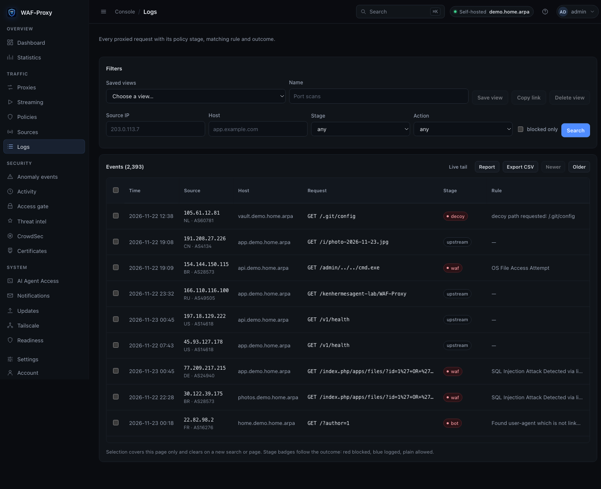

*Logs: every proxied request with its stage, rule and outcome. Sample data.*


| Control | What it does |
|---|---|
| Filters | Window, source IP, host, stage, action and free-text search. Stages run from `waf` and `response-waf` through `whitelist`, `method`, `protocol`, `route`, `stream`, `feed`, `list-block`, `list-allow`, `country-block`, `asn-block`, `decoy`, `decoy-host`, `dos`, `temp-ban`, `permanent-ban`, `access-gate`, `unknown-host` and the response-skip reasons. Actions are `allow`, `block`, `ban`, `challenge`, `log`. |
| Saved views | Named filter sets stored on the server, so the whole team sees the same views. Save, load or delete by name. |
| Live tail | Follows new events without manual refresh. |
| Bulk source actions | Select several source addresses from a page and ban or release them together. |
| Incident report | Exports the current selection as Markdown. |
| Why? (simulator) | Replays a method/path/host/query/body through the real pipeline and explains which stage decided, without sending it upstream. |
| CSV export | Downloads the current filtered event set. |

Allowed requests are sampled above `sample_above_rps`; every decision that blocks, bans or
challenges produces one event row (source, country, ASN, host, path, stage, rule).

## Anomaly events

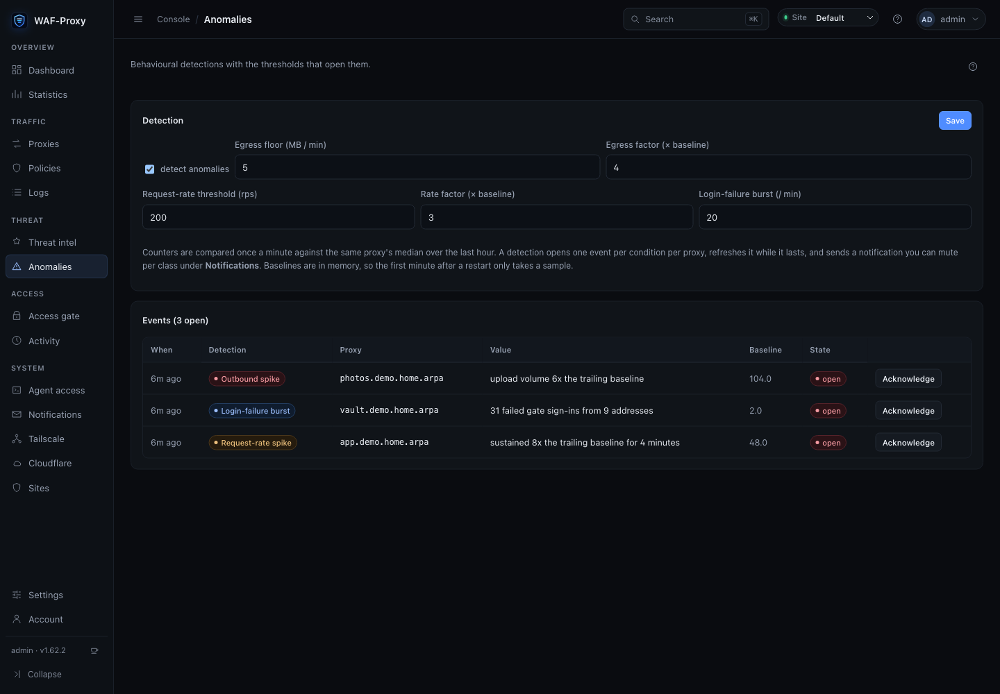

*Anomaly events: behavioural detections against a rolling baseline. Sample data.*


Behavioural detections, compared once a minute against the same proxy's median over the last hour.

| Field | What it does | Default |
|---|---|---|
| detect anomalies | Enables detection and notifications. | On |
| Egress floor (MB / min) | Minimum outbound volume before an outbound spike can fire. | 5, 1–102400 |
| Egress factor (× baseline) | Multiple of the hour's median that counts as a spike. | 4, 1.1–100 |
| Request-rate threshold (rps) | Minimum request rate before a rate spike can fire. | 200, 1–100000 |
| Rate factor (× baseline) | Multiple of the median rate that counts as a spike. | 3, 1.1–1000 |
| Login-failure burst (/ min) | Access-gate failures per minute that count as a burst. | 20, 1–10000 |

One event is opened per condition per proxy and refreshed while it lasts. **Acknowledge** closes
it. Each class can be muted under Notifications. Baselines are in memory, so the first minute after
a restart only takes a sample.

## Activity (audit log)

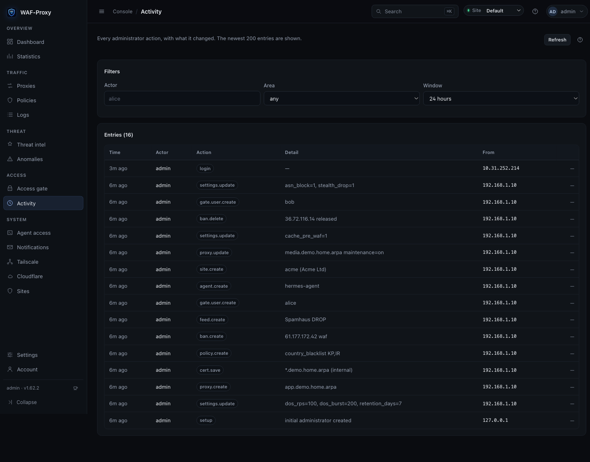

*Activity: the audit log with before/after diffs. Sample data.*


Every administrative mutation is recorded with actor, area, detail, source address and a
before/after snapshot where one applies.

| Control | What it does |
|---|---|
| Filters | Actor, area and window. |
| Entry | Opens the stored before/after state; **rollback** restores the previous version. |
| Verify chain | Checks the SHA-256 chain and anchored head; reports the number of entries covered or the first problem. |
| CSV export | Downloads the whole audit table. |

Auditing is tamper-evident, not tamper-proof: the chain detects edits or truncation in the database
file, not an attacker who can rewrite every row.

## Access gate

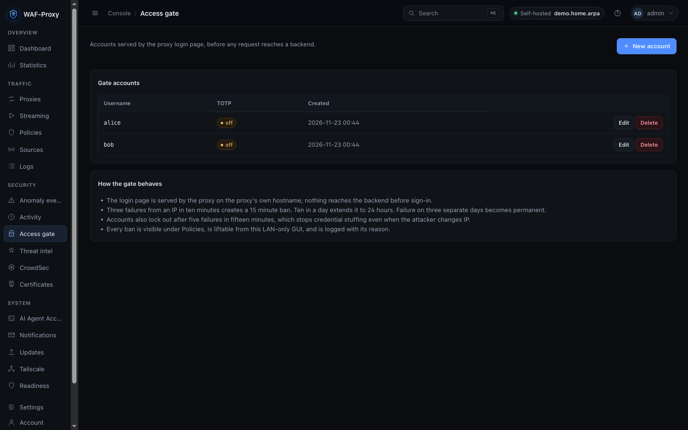

*Access gate: site accounts, TOTP and lockouts. Sample data.*


Accounts used by proxies whose gate mode is **Accounts** or **Accounts + TOTP**.

| Field | What it does |
|---|---|
| Username | Gate login name. |
| Password (12+ characters) | Initial password. Changing it signs out that account's existing sessions. |
| Require TOTP | Enables a second factor; the secret and `otpauth://` URL are shown once. |
| Delete account | Removes the account and revokes its sessions; bans are unaffected. |

Lockout behaviour, fixed by the engine and visible on the page:

- Three failures from one IP in ten minutes creates a 15-minute ban; ten in 24 hours extends it to
  24 hours; three separate days **and** ten failures in the last 24 hours make the ban permanent.
- An account also locks after five failures in fifteen minutes, which stops credential stuffing
  across changing IPs.
- Bans appear under Policies, are liftable from the LAN-only console, and are logged with a reason.
- A session lasts `gate_ttl_hours` (**12 h**) unless changed through `PUT /api/settings`; it is
  tied to one site and one account, not to the visitor's address.

**Sign out visitors** on a proxy revokes its live sessions; gate usernames can also be blocked and
their sessions killed from the MCP gateway or the API.

## CrowdSec

Optional community blocklists and a local security engine.

| Field | What it does |
|---|---|
| LAPI URL | CrowdSec local API, e.g. `http://127.0.0.1:8081`. |
| Bouncer key | Key created with `cscli bouncers add wafproxy`. Stored sealed. |
| Automatic install | Installs the engine natively on the host (Linux) with the recommended collections. |
| CrowdSec Cloud | Optional console enrolment key. |
| Docker Compose engine | Starts the bundled `crowdsec` profile instead of a native install. |

Status shows the last successful poll, how many decisions are applied, and the last error. A blank
URL or key disables the bouncer without a restart. The bouncer applies IP decisions as bans through
the same ban engine as everything else.

## Certificates

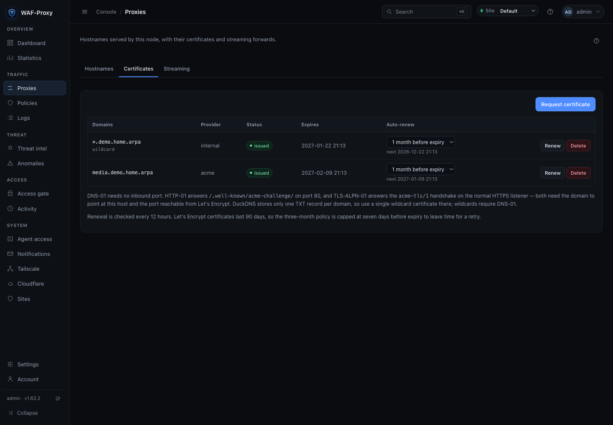

*Certificates: issuance, renewal policy and expiry. Sample data.*


| Field | What it does |
|---|---|
| Domains | Comma-separated names. Wildcards (`*.example.com`) require DNS-01. |
| Challenge | **DNS-01** (no inbound port, supports wildcards), **HTTP-01** (port 80 reachable), **TLS-ALPN-01** (answered on the HTTPS listener). |
| DNS provider | Provider used for DNS-01. |
| Credentials (JSON) | Provider credentials, stored sealed. Leave empty to reuse stored credentials. |

Credential shapes shown in the dialog: DuckDNS `{"token":"…"}`, Cloudflare `{"api_token":"…"}`,
Route 53 `{"access_key_id":"…","secret_access_key":"…","region":"us-east-1"}`,
DigitalOcean/Hetzner `{"token":"…"}` / `{"api_token":"…"}`, OVH
`{"endpoint":"ovh-eu","application_key":"…","application_secret":"…","consumer_key":"…"}`,
GoDaddy `{"api_key":"…","api_secret":"…"}` and RFC 2136
`{"nameserver":"10.0.0.2:53","tsig_key":"key","tsig_secret":"secret","zones":"example.com"}`.

| Control | What it does |
|---|---|
| Auto-renew policy | **1 month before expiry**, **Monthly**, **Every 2 months**, **Every 3 months**. Renewal is checked every 12 hours; Let's Encrypt certificates last 90 days, so the three-month policy is capped at seven days before expiry to leave room for a retry. |
| Renew | Starts renewal now. |
| Delete | Removes the certificate from the inventory. |
| Status / last error | `pending`, `issued` or `error`, with the failure reason. |

DuckDNS stores only one TXT record per domain, so use a single wildcard certificate there. The
certificate list is only what this install manages.

### Uploaded and internal certificates

Two further sources exist in the API but have no button in the console:

- `POST /api/certs/upload` with `{cert_pem, key_pem}` stores an operator-supplied PEM pair. The
  names come from the certificate itself, so the inventory cannot disagree with what is served.
- `POST /api/certs/internal` issues from the install's internal CA for names like `*.home.arpa`;
  `GET /api/certs/internal/root` downloads the root to install on clients.

## AI Agent Access

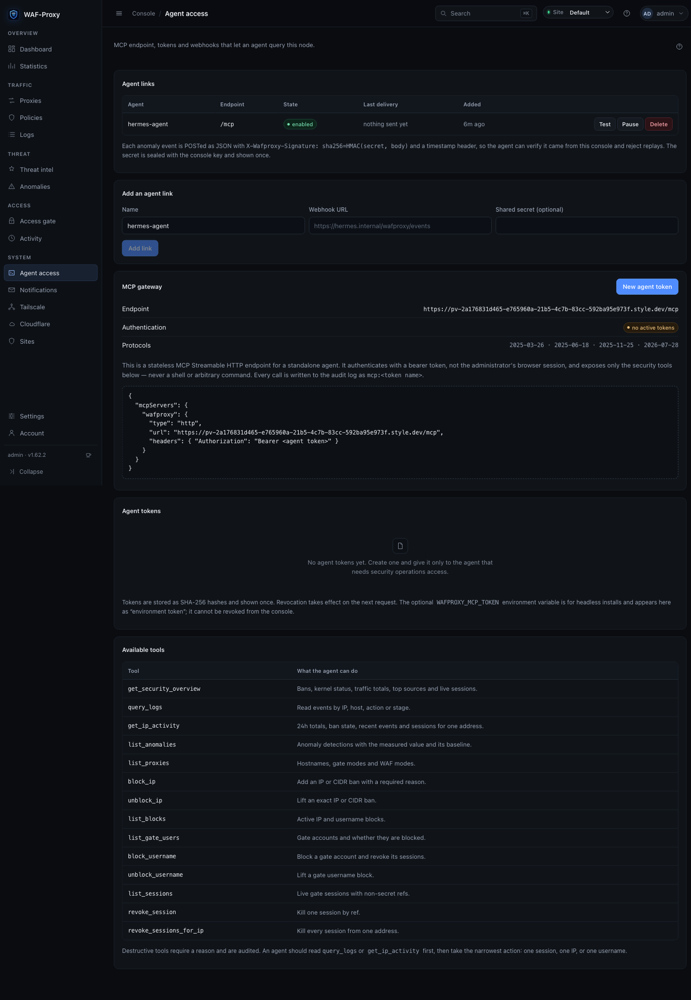

*AI Agent Access: the MCP endpoint and per-tool tokens. Sample data.*


### MCP gateway

A stateless MCP Streamable HTTP endpoint at `/mcp`, authenticated with a bearer token rather than
the administrator's browser session. It exposes only the security tools below — never a shell.

| Token field | What it does |
|---|---|
| Token name | Identifies the agent; appears in the audit log as `mcp:<name>`. |
| Site | The site the token acts on. It reads and writes only that site's rows; empty means the console's own site. |
| Tools this token may call | Per-tool scopes. An empty list sent to the API means every tool; the console requires at least one. Unknown tool names are refused. |
| Revoke | Takes effect on the next request. |

The endpoint answers MCP protocol versions 2025-03-26, 2025-06-18, 2025-11-25 and 2026-07-28.
Tokens are stored as SHA-256 hashes and shown once. `WAFPROXY_MCP_TOKEN` is an optional static
token for headless installs; it shows as "environment token" and cannot be revoked from the
console.

Available tools: `get_security_overview`, `query_logs`, `get_ip_activity`, `list_anomalies`,
`list_proxies`, `block_ip`, `unblock_ip`, `list_blocks`, `list_gate_users`, `block_username`,
`unblock_username`, `list_sessions`, `revoke_session`, `revoke_sessions_for_ip`. Destructive tools
require a reason and are audited.

### Agent links

Webhooks the console pushes signed events to.

| Field | What it does |
|---|---|
| Name | Label for the link. |
| Webhook URL | HTTPS endpoint the console POSTs to. |
| Shared secret | Optional secret used to sign each delivery. |
| Test / Retry / Deliveries | Send a test, retry a failed delivery, inspect delivery history. |

Each delivery carries `X-Wafproxy-Timestamp` and `X-Wafproxy-Signature: sha256=…` (HMAC of the
body with the shared secret) and is retried with exponential backoff; the last status, attempt
count and error are shown.

## Notifications

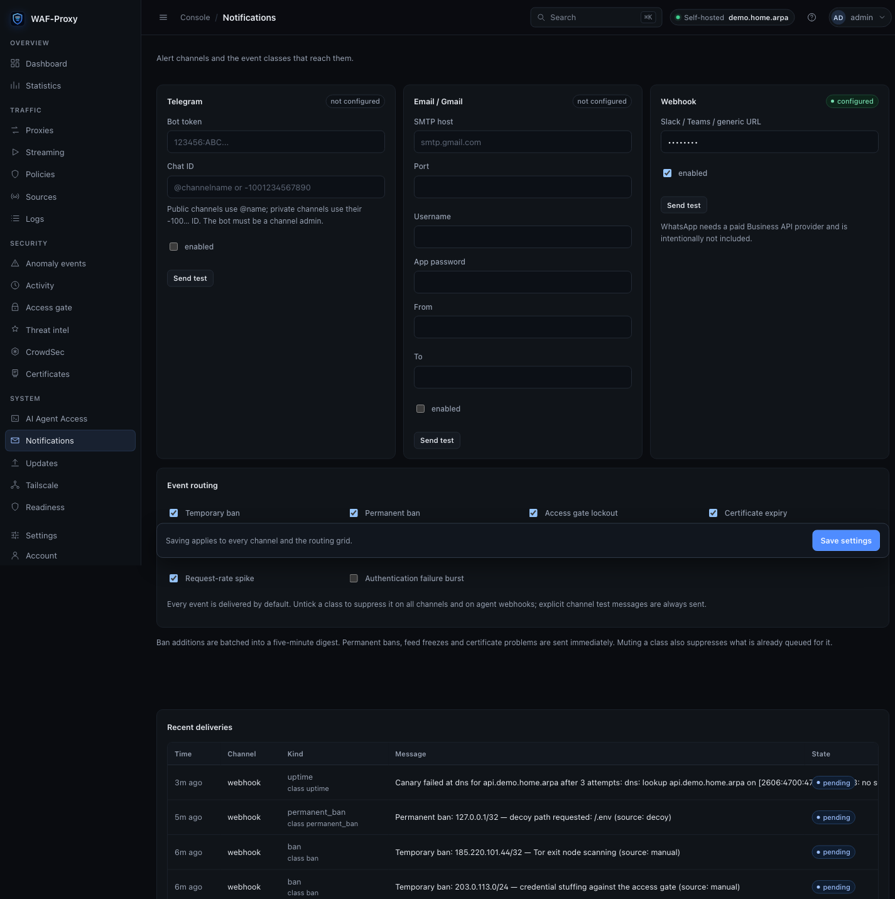

*Notifications: channels and per-event routing. Sample data.*


Alerts are queued, retried and recorded. **Send test** proves a channel works.

| Channel | Fields |
|---|---|
| Telegram | Bot token, chat ID (`@channel` or `-100…`), enabled. The bot must be an admin of the channel. |
| Email / Gmail | SMTP host, port (**587**), username, app password, From, To, enabled. |
| Webhook | Slack / Teams / generic URL and enabled. |

| Control | What it does |
|---|---|
| Event routing | Per-class toggles. Every class is delivered by default; unticking one suppresses it on all channels and on agent webhooks. Classes: temporary ban, permanent ban, access gate lockout, certificate expiry, backend up/down, application update, CrowdSec ban, outbound traffic spike, request-rate spike, authentication failure burst. |
| Recent deliveries | Time, channel, kind and class, message, state (`sent`, `failed`, `suppressed`, `pending`). |

Temporary bans and temporary access-gate lockouts are batched into a five-minute digest; permanent
bans, gate lockouts that become permanent, certificate-expiry warnings, uptime changes, anomalies
and application-update events are delivered immediately. A feed frozen by the size guardrail is not
notified; it shows on the Dashboard and the Intel page. Muting a class also suppresses what is
already queued for it.
Explicit channel test messages are always sent. WhatsApp needs a paid Business API provider and is
not included.

## Updates

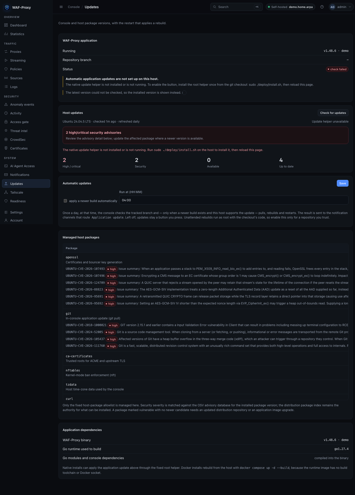

*Updates: application and host-package updates. Sample data.*


| Control | What it does |
|---|---|
| Application card | Installed version and commit, tracked branch, remote commit, and whether this deployment can rebuild itself. |
| Check now | Refreshes the release check. |
| Repository directory | Path to the checkout the update helper builds from, e.g. `/var/lib/waf-proxy/src`. |
| Update | Pulls the tracked branch, rebuilds, then restarts (systemd) or recreates the container. On failure the previous binary or container keeps running and the helper output is shown. |
| Automatic updates | Daily at a chosen **HH:MM**: checks the tracked branch and, only when a newer build exists and the host supports it, pulls, rebuilds and restarts. Results go to the **Application update** notification class. Off by default. |
| Host updates | Lists managed host packages with installed/candidate versions and severity (security, vulnerable, update available, up to date, not installed) and applies selected updates. Only on a native Debian/Ubuntu systemd install with apt; Docker deployments receive these through the image. |
| Last update output | The helper's output, for diagnosing a failed rebuild. |

Unattended rebuilds run as root with the checkout's code, so enable automatic updates only for a
repository you trust. Docker hosts need `deploy/install-docker-updater.sh` installed once; without
it the page still checks for updates but cannot apply them.

## Tailscale

Detected from a native `tailscale0` interface. The LAN console stays available; enabling a switch
adds a listener, it does not replace one.

| Switch | What it does |
|---|---|
| Admin console over Tailscale | Binds the console to the tailnet address on the GUI port (plain HTTP inside WireGuard). |
| Proxy app traffic over Tailscale | Binds the TLS/SNI proxy to the tailnet address on the WAN port. |
| Answer split DNS on the tailnet | Answers only configured proxy hostnames on UDP/TCP 53. Requires the proxy listener. |

Listener changes take effect after **Restart service**. Tailnet ACLs still apply, and the console
keeps its password + authenticator check. In the Tailscale admin console, allow `tcp:<wan_port>`
and `tcp:<gui_port>` (plus 53 when split DNS is on), and add a restricted nameserver for the base
domain pointing at the tailnet address.

## Readiness

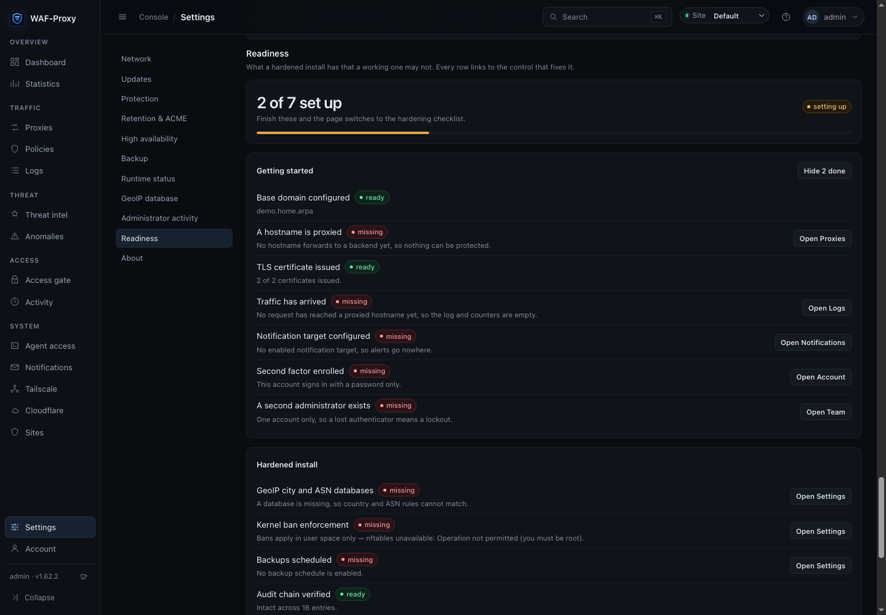

*Readiness: the scored hardening checklist. Sample data.*


A scored checklist of what a hardened install has that a working one may not. Each row links to the
control that fixes it.

1. Base domain configured.
2. TLS certificate issued.
3. GeoIP city and ASN databases loaded.
4. Kernel ban enforcement active.
5. Backups scheduled.
6. Notification target configured.
7. Second factor enrolled on this account.
8. Audit chain verified.
9. CrowdSec connected — marked optional and excluded from the score.

The score is met ÷ scored rows; a row whose source failed to load shows "unknown" and is not
counted as met.

## Sites

Every configurable row belongs to a site. The **default** site is the install itself and owns the
console host you signed in on; additional sites are tenants with their own console host,
hostnames, bans, events, audit trail, settings and administrators. The page lists each site with
its console host, hostnames, retention and administrator count.

| Control | What it does |
|---|---|
| Add a site | Slug (`a-z`, `0-9` and dashes; the stable identifier), display name and console host. The host needs its own certificate and must resolve to this node. |
| Edit | Changes the display name or console host. The slug stays. |
| Delete | Removes the site after **Confirm delete**. The default site cannot be deleted because it serves this console. |

A request arriving on a site's console host reads and writes that site's rows only. The topbar
**site switcher** — shown to default-site administrators with `sites.read` — scopes the console
with `X-WAF-Site`, and the choice is remembered per browser. A `host_admin` administers one site,
sees no switcher and no Sites page, and a site header from it is ignored. Row ownership,
per-site settings and the host-wide keys are described in [Operations](OPERATIONS.md#sites).

**Host-only pages are hidden on a tenant console.** **Threat intel → Bundles**, **Threat intel →
CrowdSec** and **High availability** belong to the default site: a tenant deep link to one of
those tabs opens the first tab it may read, Settings omits its HA section, and `#/ha` does not
render the HA page away from the default site.

## High availability

Off by default. The role machine, pairing sequence, witness and fencing, the lab checklist and
the upgrade order are in [HA.md](HA.md) and [Operations](OPERATIONS.md#upgrading-a-high-availability-pair).

| Card / action | What it says |
|---|---|
| HA is turned off | Why the switch is off, with a link to Settings. Shown while `ha_enabled` is off. |
| HA did not start | The stored switch is on but the runtime failed to bind. The panel carries the failure, **Retry startup** (re-authenticates, then runs the same start the boot path uses) and **Copy diagnostics**; moves stay refused until a start succeeds. |
| Pair this node | Create a pair (26-character code, valid ten minutes) or join one with the peer address, its pinned fingerprint and the code. |
| Role and state | Role, state, epoch, whether the node is serving, when it entered the role and the reason. |
| Peer | Peer address, pinned fingerprint and cluster id. |
| Replication | Outbox depth and size, last acknowledged sequence, and the pending rows by kind. |
| Actions from this console | The last 20 HA actions taken from this process; the audit log is the durable record. |
| Maintenance | Flap budget, **Fail over**, **Fail back** and **Unpair**. Failover and failback can be dry-run first and forced; a move needs the peer to be healthy. |
| Page actions | **Copy diagnostics** and **Sync now**, plus the read-only banner on a standby. |

Every action re-authenticates with the administrator password and, when enrolled, a current
authenticator code; failover and unpair also need the cluster id typed again. The page and the
Settings switch exist only on the default site's console.

## Account, administrators and roles

### This account

| Control | What it does |
|---|---|
| Change password | Requires the current password plus an authenticator code or a recovery code. 12+ characters. |
| Authenticator | Rotates the TOTP secret; shows the new secret and `otpauth://` URL once. The current password or a recovery code is required. |
| Recovery codes | Ten single-use codes issued at setup or rotation; each works once. |
| Sessions | Lists signed-in administrators; **sign out everywhere** ends all sessions for this account. |
| Remembered devices | **Remember this device** on the login form skips the authenticator in that browser for 30 days. Changing the password or rotating the authenticator forgets every device. |

Sign-in is password + TOTP, rate limited per address and per account. A recovery code is requested
only after **Don't have your authenticator code?** is opened; a successful recovery login offers a
replacement authenticator and new recovery codes before the console opens. **Forgot password?**
emails a single-use link (30 minutes) to the configured SMTP recipient (`smtp_to`, falling back to
`smtp_from`) and is only shown when the email channel is enabled and has a host and sender.
Sessions have a 12-hour sliding idle timeout with an absolute 7-day lifetime, carry a CSRF token,
and the cookie is `HttpOnly` and `SameSite=Lax`.

### Administrators

| Control | What it does |
|---|---|
| Add administrator | Username, initial password (12+) and role. The secret and recovery codes are shown once. |
| Role | Changes the account's role immediately. |
| Reset password | Sets a new password and ends that account's sessions. |
| Delete | Removes the account and its sessions; you cannot delete yourself. |

### Roles

A role grants **view** or **change** per area. A change grant implies view. Ten areas:
dashboard and live traffic; logs, analytics, IPs and audit; policies, bans, lists and WAF profiles;
proxies, routes and presets; streaming forwarders; certificates; threat feeds, CrowdSec and agents;
settings, GeoIP, notifications and backup; administrator accounts and roles; updates and restart.

Built-in roles, which cannot be edited or deleted:

| Role | Access |
|---|---|
| **Administrator** | Everything, including accounts and system settings. |
| **Operator** | All read, plus change on policies, proxies, streaming, certificates and sources. |
| **Read-only** | Every page and setting, no changes. |
| **Viewer** | Dashboard and traffic logs only. |

Custom roles are created from the same area matrix. Page access is driven by these permissions, so
a role without `settings.read` does not see Settings.

## Environment variables

Read at process start. Listener values are only the first-boot fallback once the database holds
addresses.

| Variable | Default | Effect |
|---|---|---|
| `WAFPROXY_DATA_DIR` | `./data` (`/data` in the image) | Database, master key, backups and internal CA material. |
| `WAFPROXY_LISTEN_GUI` | `127.0.0.1:8080` | Console bind address before the wizard stores one. |
| `WAFPROXY_LISTEN_GUI_TLS` | `false` | Serves the console over HTTPS using the certificate matching `WAFPROXY_GUI_HOST`. |
| `WAFPROXY_GUI_HOST` | empty | Certificate name for the console TLS listener; required with the option above. |
| `WAFPROXY_GUI_PRIVATE_ONLY` | `true` | Refuses console requests from non-private addresses even if the listener is wider. |
| `WAFPROXY_LISTEN_WAN` | `:8443` | Proxy listener before the wizard stores an address (**443** afterwards). |
| `WAFPROXY_LISTEN_HTTP` | empty | Serves ACME HTTP-01 and redirects to HTTPS on this address; empty disables it. |
| `WAFPROXY_HTTP3` | `false` | Serves HTTP/3 over QUIC on the WAN port over UDP and advertises it with `Alt-Svc`; open the same port over UDP on the firewall. A Cloudflare Tunnel carries HTTP/2 to the origin, so h3 is a direct-path feature. |
| `WAFPROXY_WAN_IFACE`, `WAFPROXY_LAN_IFACE` | empty | Interface names the installer passes to the wizard. |
| `WAFPROXY_TRUSTED_PROXIES` | empty | CIDRs whose `X-Forwarded-For` may name the client. Empty means the socket peer always wins. |
| `WAFPROXY_MAX_INFLIGHT` | `256` | Requests buffered at once. |
| `WAFPROXY_MAX_BUFFERED_BYTES` | `512 MiB` | Request memory those requests may hold, in bytes or with a `KiB`/`MiB`/`GiB` suffix. Both limits must hold before a request is admitted. |
| `WAFPROXY_QUEUE_MS` | `250` | How long a request waits for capacity before a 503; `0` refuses at once. Per-site override is the `queue_ms` setting. |
| `WAFPROXY_BODY_TIMEOUT` | `30` | Seconds a client may take to send its body before the request is cut with a 408; `0` disables the deadline. Per-site override is the `body_timeout_s` setting. |
| `WAFPROXY_MEMORY_LIMIT` | 75 % of the cgroup limit, unset without one | Soft heap limit. Boot fails when the cache plus `WAFPROXY_MAX_BUFFERED_BYTES` plus a 128 MiB runtime floor exceed it. |
| `WAFPROXY_DB_CONNS` | twice the CPU count, clamped 4–32 | SQLite connection pool size; an explicit value of 1–64 replaces the computed one. |
| `WAFPROXY_MASTER_KEY` | generated `master.key` | Base64 32-byte master key to seal secrets, instead of the file. |
| `WAFPROXY_LOG_LEVEL` | `info` | Service log verbosity. |
| `WAFPROXY_ACCESS_LOG`, `WAFPROXY_ACCESS_LOG_FORMAT` | empty (disabled); compose sets `/logs/access.log` | Access log path; `WAFPROXY_ACCESS_LOG_FORMAT=json` switches to JSON. |
| `WAFPROXY_ENV_FILE` | empty | Compose env file the Streaming page may mirror settings into. |
| `WAFPROXY_CROWDSEC_URL`, `WAFPROXY_CROWDSEC_KEY` | empty | CrowdSec LAPI bouncer. |
| `WAFPROXY_MCP_TOKEN` | empty | Static MCP bearer token (32+ characters). |
| `WAFPROXY_MCP_ACTOR` | `hermes-agent` | Audit name for the static MCP token. |
| `WAFPROXY_METRICS_TOKEN` | empty | Bearer token for `GET /metrics` (32+ characters); empty keeps it at 403. |
| `WAFPROXY_ACME_DIRECTORY` | Let's Encrypt | Alternate ACME directory (step-ca, Pebble). |
| `WAFPROXY_ACME_CA_FILE` | empty | PEM bundle to trust for that directory. |
| `WAFPROXY_BUNDLE_PROVIDERS` | empty | JSON list of signed bundle providers: `[{"name","url","public_key"}]`. Each is checked independently. |
| `WAFPROXY_BUNDLE_URL` | empty | Single-channel manifest URL, kept for compatibility; becomes the provider `default`. |
| `WAFPROXY_BUNDLE_PUBKEY` | empty | ed25519 publisher public key (hex or base64) for that single channel. |
| `WAFPROXY_BUNDLE_INTERVAL` | `3600` | Manifest refresh in seconds; never more often than every five minutes. |
| `WAFPROXY_BACKUP_PASSPHRASE` | empty | Passphrase for headless `wafproxy backup`. |
| `PLEX_*`, `JELLYFIN_*` | — | Document the streaming settings in `deploy/.env`; the console stores the live values in the database. |

The update helper scripts under `deploy/` use their own `WAFPROXY_UPDATE_*` and
`WAFPROXY_SELF_UPDATE_CONF` variables; see the comments in those scripts and
[docs/install/08-upgrades-and-removal.md](install/08-upgrades-and-removal.md).

### Per-site capacity settings

Settings → Protection holds these. Each is that site's override; the process default applies when
it is empty.

| Setting | Default | Effect |
|---|---|---|
| `queue_ms` | `WAFPROXY_QUEUE_MS` (250) | How long a request waits for budget before a 503; `0` refuses at once. |
| `body_timeout_s` | `WAFPROXY_BODY_TIMEOUT` (30) | How long a client may take to send its body before a 408; `0` disables it. |
| `cache_pre_waf` | off | Answers a cached GET after screening but before the CRS. Refused by the API on a site with an access gate or a WAF mode other than block/detect. |
| `upstream_idle_conns` | 64 | Idle connections kept per upstream address (1–256), so a repeat request reuses one instead of dialling. |

`GET /api/capacity` reports the numbers these produce — in flight against the cap, the queue,
refusals by reason and the cache hit ratio — and the dashboard's Capacity card shows the same.
See [Sizing the request budget](OPERATIONS.md#sizing-the-request-budget) before raising a limit.

## Data directory and headless commands

The data directory holds `wafproxy.db`, `master.key`, backups and internal CA material. The
database alone does not disclose tokens, passwords or TOTP secrets — **back up `master.key` with
it**, and treat both as sensitive.

| Command | What it does |
|---|---|
| `wafproxy setup --password …` | Creates the first administrator without a browser. |
| `wafproxy recover --password … --reset-totp` | Resets a locked-out administrator. |
| `wafproxy backup --keep 7` | Writes an encrypted backup and prunes older ones. |
| `wafproxy unban <ip|cidr>` | Lifts a ban while the console is unreachable. |
| `wafproxy sites list\|add\|rename\|remove` | Manages the sites one process serves. |
| `wafproxy ha status\|pair\|join\|sync\|failover\|failback\|unpair\|notify` | Runs the same pair and move sequence as the console; `ha upgrade --check` reports whether a pair can be upgraded before either node restarts. |
| `bundletool keygen`, `bundletool sign` | Creates a publisher key and signs a signature-bundle manifest; see [Signature bundles](#signature-bundles). |

Public health: `GET /api/health` (version and liveness, no auth). Metrics:
`GET /metrics` with `Authorization: Bearer $WAFPROXY_METRICS_TOKEN`.

## Configuration transport: YAML and backups

**Settings → Download YAML** exports the declarative half of the install: settings, WAF and
protection profiles, access lists, access profiles, proxies and policies. Bans, feeds, certificates
and secrets are excluded. References between rows are names, so the file imports onto an empty
install and resolves to the entities created from the same file.

**Import YAML** is additive: existing hostnames and profiles are skipped and every problem is
listed in the response.

```bash
curl -fsS -b cookies.txt https://console.example.com/api/config/export.yaml -o wafproxy.yaml
curl -fsS -b cookies.txt -X POST --data-binary @wafproxy.yaml \
  -H 'Content-Type: application/yaml' https://console.example.com/api/config/import.yaml
```

A passphrase of 16+ characters beside either download button seals the file with AES-256-GCM, and
**Import YAML** opens an encrypted file with the same passphrase. The scheduled backup uses the
same format and the passphrase configured on the backup card. Restoring is additive as well;
encrypted files ask for the passphrase and are decrypted before parsing. Gates are reset to off on
restore, and certificates, password hashes and secrets must be re-issued or reset afterwards.
