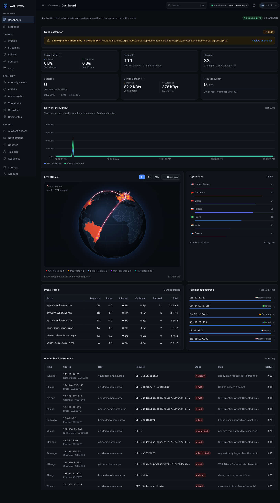

# Operations runbook

## Daily checks



*The dashboard of the demo install these pages were checked against; its sites, bans and events
are sample data.*

- **Dashboard** — WAN/LAN throughput, blocked ratio, top blocked sources, per-proxy live
  request and traffic rates, and the attack globe (1 h / 6 h / 24 h, category filters).
- **Statistics** — date-range request outcomes, hourly traffic, per-proxy shares, visitor
  countries and backend uptime. A red probe means the backend returned 5xx or timed out; the
  down/recovery transition is also sent to the **Backend up/down** notification channels.
- **Policies → Temp/Permanent bans** — unexpected permanent bans usually mean a decoy hit
  or a feed false positive; both carry a reason and source.
- **Certificates** — expiry and `last_error`. Renewal is checked every 12 hours; the default
  policy renews a month before expiry (`Every 3 months` is capped at seven days before expiry).
- **Threat intel** — a feed stuck in `frozen` means the 5× growth guardrail tripped;
  inspect before enabling it again. Uploaded `.txt`/`.csv` lists appear as local feeds and are
  always global blocks. To replace one, delete it first and upload the new file.
- **GeoIP** — Settings shows the city and ASN file dates. Reinstall monthly if country/ASN
  policy matters; DB-IP Lite publishes monthly. A failed install leaves the previous files
  loaded and shows the download error.
- **CrowdSec** — the dedicated page shows last successful poll, applied decisions and last
  error. A blank LAPI or key disables the bouncer without restarting WAF-Proxy.
- **Updates** — the application card names the remote commit. A failed rebuild leaves the old
  binary/container running and shows the helper output.
- **Logs** — filter by stage `waf` or `access-gate` after changing a profile or gate.
- Native (systemd) installs: replace `docker exec wafproxy ...` with `sudo wafproxy ...`,
  `docker compose ... logs` with `journalctl -u wafproxy -f`, and restart with `sudo systemctl restart wafproxy`. Prefix the
  one-shot `wafproxy unban` command with `WAFPROXY_DATA_DIR=/var/lib/waf-proxy/data`, because the unit
  environment does not apply to it.
- Service log: `docker compose -f deploy/docker-compose.yml logs --tail=200 wafproxy`, or
  `journalctl -u wafproxy --lines=200` for the systemd install.

## Recovery

### Unban an address

GUI → Policies → Temp bans / Permanent → **Unban**. Or, if the GUI is unreachable:

```bash
docker exec wafproxy unban 203.0.113.7
```

The running process reconciles the in-memory table from SQLite every 30 seconds, so the ban
lifts without a restart. On the systemd install use
`sudo env WAFPROXY_DATA_DIR=/var/lib/waf-proxy/data wafproxy unban 203.0.113.7`; the data lives in
`/var/lib/waf-proxy/data`, not a Docker volume.

### Locked out of the admin GUI

The GUI listener is exempt from every ban and binds to the LAN address only. Check that you
are on the LAN and using the stored `LAN_IP:GUI_PORT`. If the browser has no session, sign in
with password + TOTP, or a single-use recovery code.

### Lost password and TOTP and recovery codes

There is no online reset (that would be a backdoor), but the binary can repair an account
without the console:

```bash
sudo env WAFPROXY_DATA_DIR=/var/lib/waf-proxy/data wafproxy recover \
  --user admin --password 'a-new-12-plus-passphrase' --reset-totp
```

`recover` rewrites the password hash, signs that account out everywhere and, with `--reset-totp`,
disables its authenticator — sign in with the new password and add a new one from **Account →
This account**. Only the account you name is touched.

If the database itself is unusable, stop the stack, back up the data volume, and remove
`wafproxy.db` to re-run the setup wizard. This deletes proxies, bans, feeds, certificates and
settings. Restore a JSON backup afterwards to recover configuration (secrets and certificates
excluded).

### GeoIP install fails

- Settings shows the last error. The console tries the current month's DB-IP Lite URL and then
  the previous month.
- The data directory needs about 200 MB free for the compressed and expanded files, plus the
  old databases.
- Both files are validated as MMDB before either is replaced, so a timeout or invalid download
  does not break country/ASN policy.

### CrowdSec shows configured but never polls

- Open **CrowdSec → Test connection**. A rejected key means the bouncer was deleted on the
  engine; recreate it with `cscli bouncers add wafproxy` and paste the new key.
- LAPI URL is `http://127.0.0.1:8081` for the Compose sidecar and normally
  `http://127.0.0.1:8080` for a stock native engine. The bouncer connects outbound; do not
  expose the LAPI to the WAN.
- The engine must be running separately. WAF-Proxy configures the bouncer, not the engine.

### The CrowdSec install button is missing or fails

- It only appears on a native host: inside a container the console refuses to install host
  packages, so use the Compose sidecar. It also needs the privileged helper — if the page says
  the helper is not installed, re-run `sudo ./deploy/install.sh`.
- Failures are shown in the card with the captured output. `journalctl -u wafproxy-updates -n
  100` shows the helper side. Common causes: no outbound HTTPS to `install.crowdsec.net` and the
  CrowdSec package repository, or a host that is not Debian/Ubuntu.
- After a successful install the page reports the engine version and whether it is running. If
  the engine is installed but not running, `journalctl -u crowdsec -n 50` shows why; the
  installer leaves the package's own configuration in place rather than overwriting it.

### Application update fails

- Native: the Updates page shows the captured pull/build output; `journalctl -u
  wafproxy-updates -n 100` shows the helper's start/stop and timeout errors. Check `git`, `make`,
  Go 1.27 and Node 22 are available to the checkout owner
  (`/usr/local/go/bin` and `$HOME/toolchain/go/bin` are included). A dirty checkout is
  refused; commit or stash local changes first. The public repository needs no credentials;
  a private fork needs the owner's git credential helper or SSH key.
- Docker: the Updates page shows the captured pull/build output; `journalctl -u
  wafproxy-docker-updates -n 100` shows helper failures. The helper needs Docker Compose v2, the
  Docker socket, the original `deploy/.env` and a clean checkout. The public repository needs
  no credentials; a private fork needs the checkout owner's git credential helper or SSH key.
- A failed build does not replace the running binary or container. Fix the cause and press the
  button again.

### Certificate issuance fails

- Read the certificate row's `last_error` and the container log.
- Wrong DNS credentials are the common cause; re-save them on the Certificates page.
- With DuckDNS, only one TXT record exists. Request the wildcard, not per-host certificates.
- If Let's Encrypt rate-limited you, enable the staging toggle, verify issuance, then switch
  back and use **Renew**.

### `502`/`504` from a proxy

The uniform error page hides upstream details by design; the reason is in the container log
(`upstream error`). Check the backend from the host using the LAN source address, then the
proxy's up/down badge. Health checks probe `GET /` every 10 seconds and eject after three
failures.

### Kernel bans unavailable

The GUI shows `kernel: nftables unavailable` with a reason. Userspace bans still work, but
blocked packets receive a response instead of a silent DROP. Usual causes: `nft` missing,
missing `NET_ADMIN`, or `no-new-privileges` enabled (which disables the image's file
capabilities).

### Access gate loops or nobody can sign in

- Gate accounts are managed on the **Access gate** page; a proxy allowlist that names no
  existing account denies everyone.
- The ladder bans an IP after 3 failures in 10 minutes for 15 minutes. Unban from Policies
  or the CLI.
- Gate modes reset to `off` after a restore. Re-enable the mode and re-set the passphrase.

## Backup and restore

- Settings → **Download JSON** exports settings, proxies, upstreams, routes, policies,
  feeds and bans. It intentionally excludes secrets, DNS credentials, certificates/private
  keys and password hashes; uploaded local blocklist files must be uploaded again.
- Restore is additive: existing hostnames are skipped and reported in `problems`.
- After a restore: re-enter DNS credentials, re-issue certificates, reset gate secrets and
  passwords as needed. Gate modes are forced to `off`.
- The export is plaintext. Store it accordingly; it contains internal addresses and policy.

## Capacity and disk

- 2 vCPU / 4 GB / 30 GB is the floor; 4 vCPU / 8 GB / 50 GB is comfortable for a home edge.
- SQLite WAL needs a local SSD; do not put `/data` on NFS/SMB.
- Events default to 7 days (1–30 in Settings). Hourly flow rollups keep long-term volume
  small. Watch the database size in the logs at debug level and the host disk.
- Raise `net.netfilter.nf_conntrack_max` on the host if session counts climb; a scan flood
  can exhaust the default table and look like an outage.
- The WAF is the expensive stage. Measured Coraza+CRS cost on the reference sandbox was
  about 3 ms per inspected request per core (see [BENCHMARKS.md](BENCHMARKS.md)); size for
  bursts, and use `Static/CDN` or a higher-profile tuning only where appropriate.

## Security notes

- The GUI is plain HTTP on the LAN. Keep it on a trusted segment, or put it behind a TLS
  terminator if the LAN is not trusted. Session cookies are `HttpOnly`, `SameSite=Lax`, and
  marked `Secure` when TLS is present.
- The master key lives in `/data/master.key` (or `WAFPROXY_MASTER_KEY`). Losing it makes
  encrypted settings and DNS credentials unreadable. Back it up separately from the database.
- The access log under `/logs` contains client IPs and user agents. Treat it as personal
  data and rotate it with the host's log policy.
- Never expose the CrowdSec LAPI beyond loopback; the compose file binds `127.0.0.1:8081`.

## Request IDs and JSON access logs

Every request gets an `X-Request-Id` response header. A client or upstream load
balancer may supply one (letters, digits, `.`, `_`, `-`, at most 64 characters);
unsafe or oversized values are replaced rather than echoed.

Set `WAFPROXY_ACCESS_LOG_FORMAT=json` alongside `WAFPROXY_ACCESS_LOG` to write
one JSON object per request instead of nginx combined format. The object carries
the request ID, host, source, method, path, status, bytes, latency, stage, rule
and action, so a failed request can be traced to the stage that rejected it.
The default stays nginx combined format for CrowdSec's nginx parser.


## Admin console over HTTPS

The console can serve TLS from the certificates the gateway already manages. Issue or
upload a certificate whose names include the console host (for example
`console.home.arpa` from the internal CA), then set:

```
WAFPROXY_LISTEN_GUI=127.0.0.1:8080   # host:port only, no scheme
WAFPROXY_LISTEN_GUI_TLS=1           # 1/true/yes/on enables TLS on that listener
WAFPROXY_GUI_HOST=console.home.arpa # hostname only, no scheme or port
```

`WAFPROXY_LISTEN_GUI` is passed straight to `net.Listen`, so a URL scheme or path is
not accepted. The certificate is chosen by `WAFPROXY_GUI_HOST`, which is lowercased
and matched against the certificate's names.

The listener refuses to start when no valid certificate matches the host, so a typo
cannot silently leave the console on plain HTTP. The certificate is resolved on every
handshake, not captured at boot: a renewal or a replacement upload reaches the console
without restarting the process. The boot check still runs once so a missing
certificate fails early. Browsers need the internal root
(`GET /api/certs/internal/root`) or a public CA for that name.

## Revoking a certificate

`POST /api/certs/{id}/revoke` revokes an ACME certificate with the CA that issued it,
then deletes the local record. Uploaded and internal certificates have no ACME account;
they are deleted locally. If the CA refuses, the endpoint returns `502` with the reason
and keeps the certificate. Deleting a certificate without revoking it remains available
through `DELETE /api/certs/{id}`.


## Threshold alerting

The detector evaluates one-minute windows per proxy against a rolling baseline and
raises three event kinds: `egress_spike` (outbound bytes above both a floor and a
multiple of the median), `rate_spike` (requests per second above both a floor and a
multiple of the median) and `auth_burst` (failed logins in one minute). Thresholds are
stored as settings and edited with `PUT /api/anomaly/settings`:

| Setting | Meaning | Default |
| --- | --- | --- |
| `anomaly_enabled` | detector on/off | `1` |
| `anomaly_egress_mb` | egress floor per minute | `5` |
| `anomaly_egress_factor` | multiple of the baseline | `4` |
| `anomaly_rate_rps` | request-rate floor | `200` |
| `anomaly_rate_factor` | multiple of the baseline | `3` |
| `anomaly_auth_burst` | failed logins per minute | `20` |

Each raised event is stored once and refreshed while the condition stays open, so a
long spike is one row, not one row per minute. Alerts are routed through the same
notification channels and event toggles as bans (`notify_events`), and deduplication
uses the key `anomaly:<kind>:<proxy id>`: a second alert with the same key inside 24
hours is dropped before it reaches the queue.

## Testing a notification channel

`POST /api/notifications/test` with `{"channel":"telegram"|"email"|"webhook"}` sends a
real message through the configured channel, bypassing the event toggles and the
digest — the button in the console calls this endpoint. A missing or unknown channel
returns `400`. It returns `200` when the provider accepted the message and `502` with
the provider's error when a configured channel failed, so a bad token or webhook URL
fails visibly instead of silently. The test message is not
deduplicated: every click sends one.


## Diagnostics bundle

`GET /api/diagnostics` returns a JSON support bundle: version, Go version, platform,
listener addresses, configuration counts, certificate metadata (domains, status, source,
expiry, last error) and the settings map. Secret-bearing keys (`token`, `secret`,
`password`, `*_key`, `credential`, `webhook`, `*_url`) are replaced with `[redacted]`;
other URLs keep their host and path but lose credentials, query strings and fragments.
Copy the response into a ticket; it contains no keys, session tokens or password
hashes.

`GET /api/diagnostics/bundle` returns the same material as a zip for attaching to a
ticket: `version.json`, `settings.json` (redacted), `listeners.json`,
`certificates.json`, `errors.json` (failed alert deliveries, certificate errors,
anomalies and recent 5xx responses), `logs.txt` (the last 500 lines of the access log,
256 KiB at most) and `README.txt`. Log lines have query strings replaced and values
following `token`, `key`, `secret`, `password`, `authorization` or `apikey` masked, in
both `key=value` and quoted JSON forms. The bundle is only produced for an
authenticated session and is marked `no-store`. Client IPs are kept because they are
usually the point of the investigation; review `logs.txt` before sharing if that
matters.

## Synthetic canary

`POST /api/canary` probes one site end to end and reports each stage in order, naming
the first stage that failed:

```
{"ok": false, "host": "app.example.com", "failed_stage": "upstream",
 "stages": [{"name":"config","ok":true}, {"name":"dns","ok":true}, ...]}
```

The body may carry `{"proxy_id": 3}` or `{"host": "app.example.com"}`; with neither,
the first configured site is used. The probe resolves the name, opens a TCP connection, performs its own TLS handshake
with the site's hostname as SNI, and requests `/.well-known/wafproxy-canary`. Stages are
`config`, `dns`, `connect`, `tls`, `route`, `waf` and `upstream`. The TLS stage inspects
the presented certificate itself: an expired certificate fails with
`certificate expired on <date>`, a certificate for another name fails with the
verification error naming the expected and presented names, and a protocol-level
failure reports `handshake failed`. The leaf expiry is also returned as
`cert_expires_at`. A plain connect failure stays on the `connect` stage, so an
unreachable port is never reported as a certificate problem. After the HTTP request,
`403`/`429` fail at **waf**, `421` fails at **route**, `502`/`503`/`5xx` fail at
**upstream**, and any other status passes. It returns `200` when every stage passed and
`502` with the same body when one did not.

The probe runs from the gateway itself, so the site must answer on its public hostname
from that host (split-horizon DNS, hairpin NAT or an internal name may be needed). It
checks the externally reachable path, not a specific WAF rule.


## Private ACME directory

To issue from a private ACME server (step-ca, Pebble, an internal CA) instead of Let's
Encrypt, point the client at its directory and give it the PEM trust root:

```
WAFPROXY_ACME_DIRECTORY=https://acme.internal:14000/dir
WAFPROXY_ACME_CA_FILE=/etc/wafproxy/acme-ca.pem
```

`WAFPROXY_ACME_DIRECTORY` takes precedence over the staging toggle. The CA file is
only used for the ACME API connection; issued certificates still chain to whatever
that CA signs. The account key and registration are stored once and reused for both
issuance and revocation.

Pebble end-to-end check (opt-in, needs `pebble` with `httpPort` 5002 and this test's
listener on the same port):

```
PEBBLE_DIRECTORY=https://localhost:14000/dir \
PEBBLE_CA=$(go env GOMODCACHE)/github.com/letsencrypt/pebble/v2@*/test/certs/pebble.minica.pem \
go test ./internal/acme -run Pebble -v
```

The test issues a real certificate through the exported `proxy.PlainHTTPHandler`, then
asserts a second, unresolvable name fails and is stored as `error`, and that ordinary
traffic on the listener redirects to HTTPS.


### Scheduled canary

The gateway probes one site on a timer, so a broken path is noticed without an
operator clicking the button. Settings:

| Setting | Meaning | Default |
| --- | --- | --- |
| `canary_enabled` | run the schedule | on (`0` disables) |
| `canary_host` | site to probe; empty uses the first configured site | empty |
| `canary_interval_s` | seconds between probes, 30–86400 | `300` |
| `canary_retries` | extra attempts after a failed probe, 0–10 | `2` |

Each cycle runs the probe, retries a failure up to `canary_retries` times, and records
the last result: host, ok, failing stage, detail, connect latency in milliseconds,
consecutive failed cycles and the check time. Failures notify the **Backend up/down**
class once per outage (dedupe key `canary:<host>`, no alert on every retry); a
recovery sends one message and resets the counter, under its own
`canary:<host>:recovered` key so the outage dedupe cannot swallow it. Ordinary probe results are not
notified.

The last result is part of `GET /api/health`:

```
"canary": {"enabled": true, "host": "app.example.com", "ok": false,
           "failed_stage": "tls", "detail": "tls: certificate expired on ...",
           "latency_ms": 18, "cert_expires_at": "...", "checked_at": "...",
           "consecutive_failures": 2}
```

Health still returns `200` while the canary is failing; the field is diagnostic, and
`?ready=1` keeps answering only for proxy readiness. The probe runs from the gateway
over the public hostname, so it needs the same DNS/hairpin setup as the manual
`POST /api/canary`.

## Incident reports from a runbook

The console's Incident report drawer is rendered by the server, so an on-call
runbook can fetch and keep the same Markdown without a browser. Both routes
need the session cookie and the `traffic.read` permission, and both answer
`text/markdown` with an `incident-*.md` download name:

```sh
# Everything known about one source over the last 24 hours.
curl -s -b jar.txt 'https://console.example.com/api/ips/203.0.113.7/incident.md?hours=24' -o incident-203.0.113.7.md

# The Logs page report for any filter set (ip, host, country, stage, action, blocked).
curl -s -b jar.txt 'https://console.example.com/api/events/incident.md?host=app.example.com&stage=waf&hours=1' -o incident-app.example.com.md
```

The body carries the summary, verdict counts, the newest 50 events and the audit
actions that mention the subject; an empty window says so instead of inventing
a timeline.

## Release tags

A release is published with an annotated `vX.Y.Z` tag on the commit that carries its
`CHANGELOG.md` section. Pushing a tag runs only the `release` job at the tagged commit — publishing a batch of old
tags does not start a full build per tag — and that job fails when the tag name
disagrees with `VERSION`, or when the newest `CHANGELOG.md` section or
`internal/version/version.go` disagrees with it. Branch pushes still run every
job. To create a tag:

```sh
git tag -a v1.47.19 -m 1.47.19            # the release commit, annotated
git push origin HEAD:main --follow-tags   # branch plus its annotated tags
git push origin v1.47.19                  # or one tag on its own
```

Check what the remote really holds:

```sh
git ls-remote --tags origin               # annotated tags list the ref and its ^{} peel
git cat-file -t v1.47.19                  # "tag", not "commit": the object is annotated
git describe --tags --abbrev=0            # the nearest annotated tag, as tooling sees it
```
