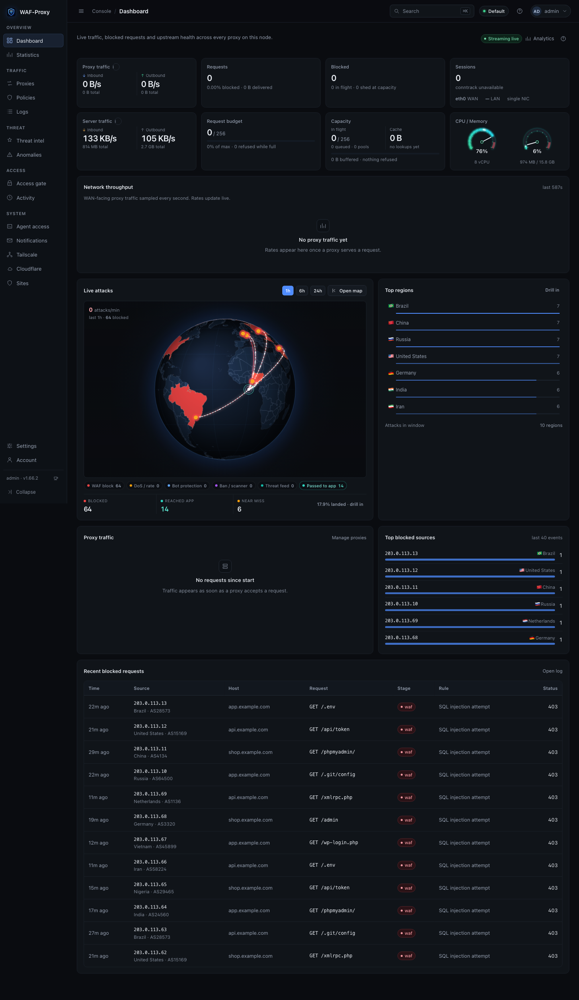

# Run it in Docker

Part of [Installation](../INSTALL.md).



*What you are aiming at: the dashboard after setup, with sample data. Every page in these guides
is pictured in the [screenshot index](../screenshots/README.md).*

## 1. Host prerequisites

- Linux. The Docker path needs Docker Engine 24+ and Compose v2; the systemd path needs Go 1.27
  to build the binary and systemd to run it.
- One or two interfaces. The reference deployment uses two (or two VLANs), one on the WAN
  subnet and one on the LAN. A **single-NIC host works too**: enter its address for both WAN
  and LAN (see §3), and firewall the GUI port from the WAN side.
- `nftables` usable inside the container. The image grants `NET_ADMIN` and
  `NET_BIND_SERVICE` through file capabilities, so do **not** enable
  `no-new-privileges` on the container — it makes the kernel ignore those capabilities.
- The host firewall must allow `443/tcp` to the WAN address and the GUI port on the LAN
  address.
- Optional GeoIP: install DB-IP Lite from **Settings → GeoIP database**, or place
  `GeoLite2-City.mmdb` / `GeoLite2-ASN.mmdb` in the data volume (`/data` in the container).
  Country and ASN policy is reported as unavailable without them.

## 2. Start the stack

```bash
git clone <this repo> WAF-Proxy
cd WAF-Proxy
cp .env.example deploy/.env
# edit deploy/.env: TZ, optional CrowdSec settings
docker compose -f deploy/docker-compose.yml up -d --build
docker compose -f deploy/docker-compose.yml logs -f wafproxy
```

The image builds the React SPA and embeds it in the Go binary. First boot has no saved
binding, so the process listens on `:8443` (proxy) and, by default, **`127.0.0.1:8080`** for the
console. Compose deliberately keeps the console on loopback: the setup wizard is
unauthenticated, and a container started before `deploy/.env` is filled in must not be able to
publish it on the WAN.

Set both values in `deploy/.env` before the first start:

```ini
# This host's real LAN address. The console listens only here.
WAFPROXY_LISTEN_GUI=192.168.1.10:8080
# Refuse console requests from anything but a private network.
WAFPROXY_GUI_PRIVATE_ONLY=true
# Only if a proxy or tunnel sits in front of this host: the CIDRs whose
# X-Forwarded-For may name the client. Empty trusts nobody.
WAFPROXY_TRUSTED_PROXIES=
```

`WAFPROXY_LISTEN_WAN=:8443` is the first-boot proxy port; the wizard moves it to `443` on the
next start. `WAFPROXY_GUI_PRIVATE_ONLY=true` is an independent second guard: even if the
listener ends up bound more widely than intended, requests whose source address is not private
are refused. Leave it true for Docker.

## 3. Complete the wizard

Open `http://<host-ip>:8080` from the LAN and fill in:

| Field | Reference value |
|---|---|
| Admin username | `admin` |
| Password | 12+ characters, stored as argon2id |
| Base domain | `example.duckdns.org` |
| WAN IP / port | `192.168.1.20` / `443` |
| LAN IP / GUI port | `192.168.1.10` / `8443` |
| DuckDNS token | optional, stored AES-256-GCM encrypted |
| ACME email | Let's Encrypt account contact |

Both addresses must be configured on the host; the listeners bind them directly from the
database. On a host with one NIC the WAN and LAN address are the same — the host's address
that the router DNATs to. The proxy then binds `443` on the NIC shared with the GUI, so only
forward `443` (and `443/udp` when `WAFPROXY_HTTP3=1`, plus streaming ports) from the WAN and firewall the GUI port. The interface
counters show that one NIC twice, and the stealth ping drop applies to the whole NIC, so
leave it off unless dropping LAN ICMP is acceptable.

If a stored address is missing at boot (a DHCP change, or the wizard was filled in before the
interface came up), the listener falls back to the first-boot `WAFPROXY_LISTEN_WAN` /
`WAFPROXY_LISTEN_GUI` values and logs `stored WAN/GUI address is not configured on this host`
instead of exiting. Fix the address in **Settings** and restart.

The shipped fallback GUI value is loopback `127.0.0.1:8080`, so after a fallback the console is
reachable only from the host itself (an SSH tunnel works). If you set the fallback to a wildcard
address, the log says `admin GUI is bound to all interfaces until the stored address is fixed in
Settings`; keep `8080` blocked at the WAN firewall until it is fixed.

The wizard returns the TOTP secret and ten recovery codes **once**. Save both. Then restart:

```bash
docker compose -f deploy/docker-compose.yml restart wafproxy
```

The GUI is now `http://192.168.1.10:8443` and every login requires password + TOTP (or a
recovery code).
