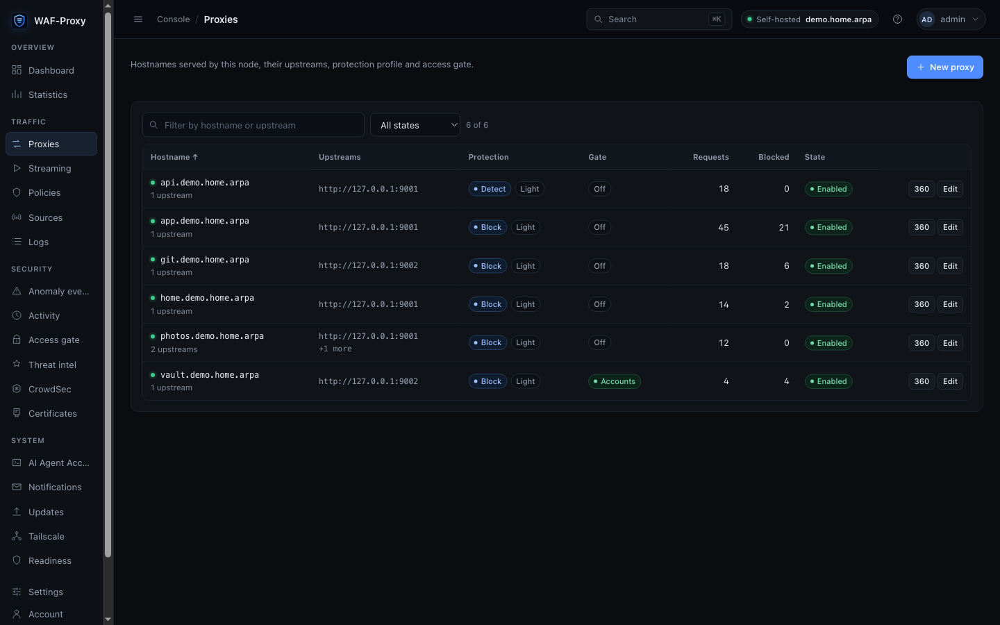

# Publish your first site

Part of [Installation](../INSTALL.md).

## 6. First proxy



*The Proxies page of the demo install, with sample sites. Yours starts empty.*

GUI → **Proxies** → **New proxy**:

- Hostname: `app.example.duckdns.org` (single-label subdomain of the base domain; the apex is
  reserved and blackholed)
- Upstream: `http://192.168.2.10:8080`
- Protection profile: `Generic Web` (or `WordPress`, `API-only`, …)
- WAF mode: `Detect only` for the first 48 hours if the app is unknown, then `Inherit` or
  `Block`.

Verify:

```bash
curl -v https://app.example.duckdns.org/
curl -v https://example.duckdns.org/        # connection closed, no response
```
